# DM3E 系列步进驱动器 用户手册

（手册版本号：V2.07）

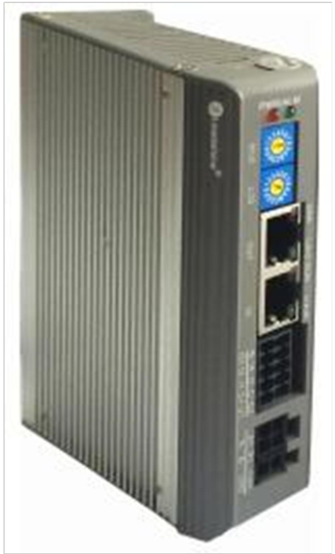

DM3E 产品已通过 ETC 实验室一致性认证。

EtherCAT® 是注册商标和专利技术，由德国倍福自动化有限公司授权。

---

## 前言

首先感谢您购买使用雷赛公司带 EtherCAT 总线的 DM3E 系列步进驱动器。

DM3E 系列是雷赛在高性能数字型步进驱动器基础上增加了总线通讯功能。总线通讯采用 EtherCAT 总线通讯接口，基于 EtherCAT 从站技术，实现步进系统的实时控制与实时数据传输，使得现场总线达到 100Mb/s 的传输速率。具有使用简单、稳定可靠、性能卓越等特点。支持包括雷赛、倍福、欧姆龙、翠欧、汇川、研华、凌华、基恩士、宝元、正运动、Kingstar 等在内的多家主站控制系统，在光伏、纺织、民用、机器人、锂电设备、3C 电子等行业得到普遍应用。

本手册仅介绍 EtherCAT 总线型步进驱动器的规格与应用。若对 EtherCAT 总线使用有所疑惑，请咨询我公司的技术人员以获得帮助。

感谢您选用深圳市雷赛智能控制股份有限公司的 DM3E 系列步进电机驱动产品，本手册提供了使用该产品的所需知识及注意事项。

> **操作不当可能引起意外事故，在使用本产品之前，请务必仔细阅读本说明书**

由于产品的改进，手册内容可能变更，恕不另行通知。
用户对产品的任何改动我厂将不承担任何责任，产品的保修单将因此作废。

阅读本手册时，请特别注意以下提示：

> ⚠️ **警告**
>
> - 只有技术人员才能安装，调试或维护本产品
> - 确保线路连接正确，方可通电测试
> - 错误的电压或电源极性可能会损坏驱动器或造成其他事故

---

## 第一章 概述

### 1.1 产品简介

DM3E 系列步进驱动是深圳市雷赛智能控制股份有限公司自主研制的全数字总线式步进驱动系列产品，基于 ETG COE + CANopen DSP402 协议，可与支持此标准协议的控制器/驱动器无缝连接。

与脉冲型步进相比，DM3E 系列步进产品具有以下优点：

- **降低通讯干扰，延长通讯距离**
  脉冲通讯方式下由于脉冲信号的传输线缆极易受到电磁干扰而降低通讯的可靠性。而 EtherCAT 总线通讯由于协议内含错误检测、限制及处理机制可以明显提高通讯的可靠性，减少干扰所对指令造成的影响并延长通讯距离。
- **提高运动性能**
  总线通讯型步进非周期性同步模式下的轨迹规划是在驱动器里实现，控制器只需要将目标位置、速度、加速度等信息传递给驱动器即可。所以驱动器可以在内部提前预知下一时刻的运动参数，进而采取前馈措施来提高运动性能。
- **降低系统接线复杂度**
  脉冲通讯方式下控制器需要与每台驱动器通过脉冲线缆连接通讯，常造成机器设备线缆密集且连线复杂。EtherCAT 总线通讯方式下，控制器只需要与其中一台驱动器使用线缆连接，其余驱动器只要使用链型方式与该驱动器连接即可。
- **减少对控制单元端口数量的要求，进而降低成本**
  多台总线式步进驱动器只需要一个端口与运动控制单元（运动控制器或运动控制卡）相连，无需脉冲模块，也无需因为驱动器的数量多而增加控制卡数量，进而无需考虑电脑插槽数量的限制。可以节约脉冲模块、控制卡及工控机的成本。

### 1.2 到货检查

1. 收货后，必须进行以下检查：
   - （1）包装箱是否完好，货物是否因运输受损？
   - （2）核对步进驱动器铭牌，收到的货物是否确是所订货物？
   - （3）核对装箱单，附件是否齐全？
2. 附件清单
   DM3E 系列步进驱动器标准附件包括：
   - （1）简易说明 1 页
   - （2）电源成品线 1 根
   - （3）电机绕组成品线 1 根
   - （4）控制信号 10PIN 按压式端子 1 个

> ⚠️ **注意**
>
> - 受损或零件不全的步进系统，不可进行安装。
> - 步进驱动器必须与性能匹配的步进电机配套使用。
> - 收货后有任何疑问，请与供应商或我公司联系。

3. 型号意义
   DM3E 系列步进驱动器型号意义，以 DM3E-556 为例说明。

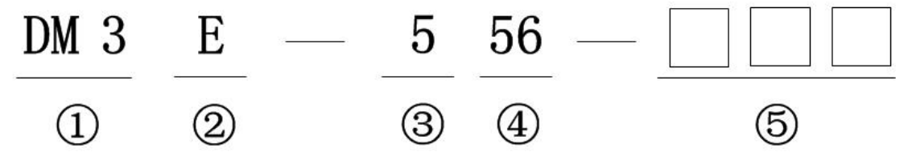

**表 1.1 DM3E 系列步进驱动器型号含义**

| 序号 | 含义 | 说明 |
| --- | --- | --- |
| ① | 系列名称 | DM3：雷赛第三代数字式驱动器 |
| ② | 系列名称 | E：通讯协议为 EtherCAT |
| ③ | 最大电压 | 5：乘以 10，表示最高输入电压为 50V |
| ④ | 最大电流 | 56：除以 10，表示最大输出峰值电流为 5.6A |
| ⑤ | 订制型号 | 特殊用途 |

### 1.3 产品规格和外观

**表 1.2 DM3E 系列驱动器规格一览表**

| 参数 | | DM3E-522 | DM3E-556 | DM3E-870 |
| --- | --- | --- | --- | --- |
| 输出电流（峰值） | | 0.5~2.2A | 2.1~5.6A | 2.1~7.0A |
| 匹配电机 | | 20、28、35、42 机座 | 57、60 机座 | 86 机座（*） |
| 电源电压 | | 24~48Vdc | 24~48Vdc | 24~70Vdc |
| 尺寸（H\*W\*L mm） | | 118\*90.4\*34 | 118\*90.4\*34 | 118\*90.4\*34 |
| 重量（kg） | | 0.57 | 0.57 | 0.57 |
| 输入信号 | | 原点输入、正向限位、负向限位、急停、探针、自定义 | ← | ← |
| 输出信号 | | 抱闸输出、报警输出、到位输出 | ← | ← |
| 报警功能 | | 过流、过压、限位、缺相等 | ← | ← |
| 使用环境 | 场合 | 不能放在其它发热的设备旁，要避免粉尘、油雾、腐蚀性气体，湿度太大及强振动场所，禁止有可燃气体和导电灰尘； | ← | ← |
| 使用环境 | 使用温度 | 0~50℃ | ← | ← |
| 使用环境 | 保存温度 | -20℃ ~ 65℃ | ← | ← |
| 使用环境 | 湿度 | 40~90%RH | ← | ← |
| 使用环境 | 振动 | 10~55Hz/0.15mm | ← | ← |
| 使用环境 | 安装 | 垂直安装或者水平安装 | ← | ← |

（*）注：如果您匹配的是 86 机座 4.5 牛米以上的电机，则推荐使用 DM3-EC882AC 这个型号的驱动器。

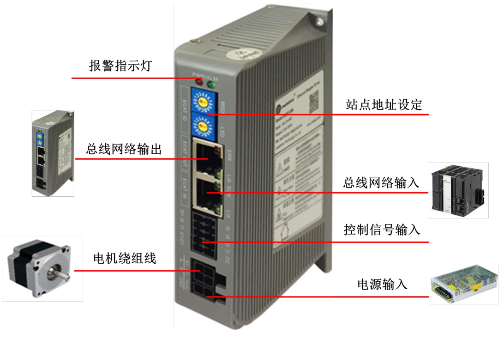

**图 1-3 驱动器产品外观**

图中文字：报警指示灯；站点地址设定；总线网络输出；总线网络输入；控制信号输入；电机绕组线；电源输入。

---

## 第二章 安装

### 2.1 储存和安装环境

**表 1 DM3E 系列驱动器存储及安装环境**

| 项目 | | 要求 |
| --- | --- | --- |
| 保存温度 | | -20℃ ~ 65℃ |
| 防护等级 | | IP20 |
| 使用环境 | 场合 | 不能放在其它发热的设备旁，要避免粉尘、油雾、腐蚀性气体，湿度太大及强振动场所，禁止有可燃气体和导电灰尘； |
| 使用环境 | 温度 | 0~50℃ |
| 使用环境 | 湿度 | 40~90%RH |
| 使用环境 | 振动 | 10~55Hz/0.15mm |

### 2.2 驱动器的安装

> ⚠️ **注意**
>
> - 步进驱动器必须安装在保护良好的电柜内。
> - 步进驱动器必须按规定的方向和间隔安装，并保证良好的散热条件。
> - 不可安装在易燃物体上面或附近，防止火灾。

#### 2.2.1 驱动器尺寸

**驱动器 MS13A 以下版本安装孔均为圆口：**

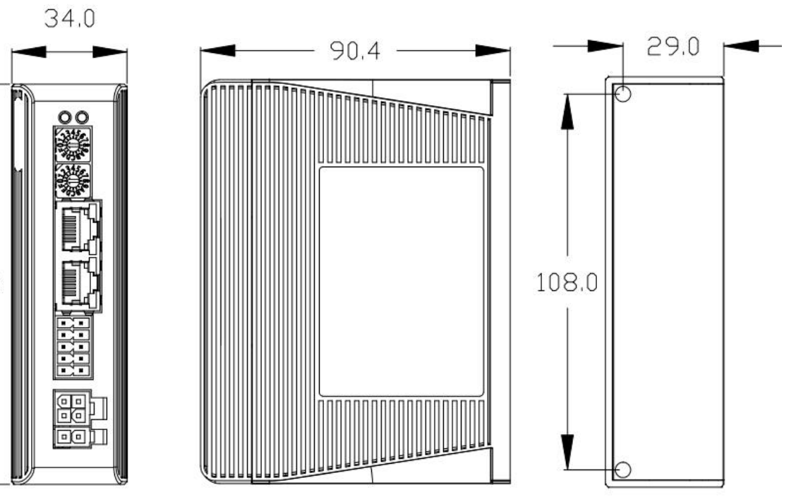

**图 2-1 DM3E-522/556/870 安装尺寸图（单位：mm）**

※ 设计安装尺寸时，注意考虑端子大小及布线！

**驱动器 MS13A 及以上版本安装孔均为 U 型口：**

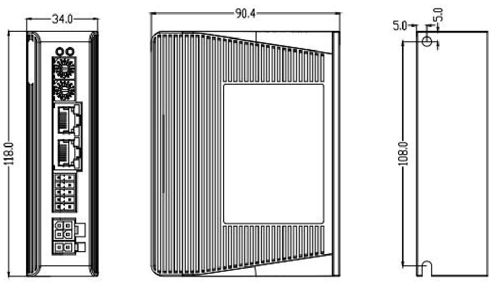

**图 2-2 DM3E-522/556/870 安装尺寸图（单位：mm）**

※ 设计安装尺寸时，注意考虑端子大小及布线！

#### 2.2.2 安装方法

用户可以采取底板安装或者面板安装方式安装，安装方向垂直于安装面，为了保证良好的散热条件，实际安装中必须尽可能预留较大安装间隔，驱动器与驱动器间至少留出 30mm 的间隔，并且保持柜内良好的通风散热条件。

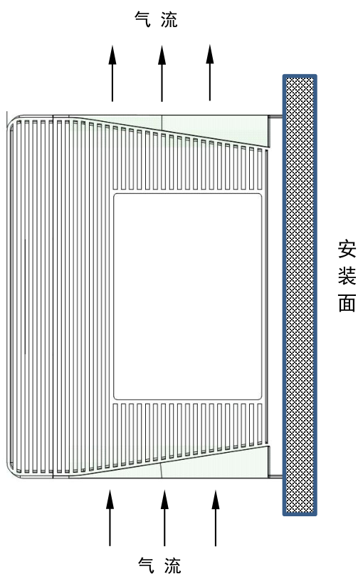

**图 2-3 驱动器安装方式示意图**

图中文字：气流；安装面。

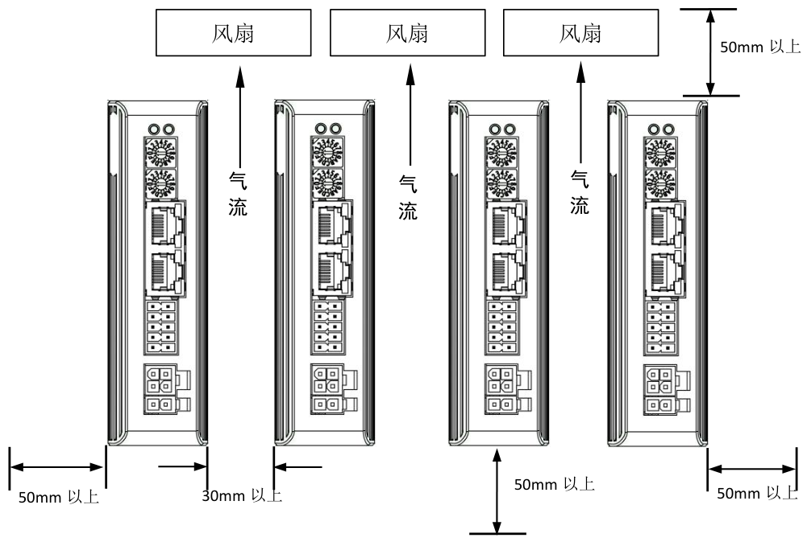

**图 2-4 驱动器安装间隔示意图**

图中文字：风扇；气流；50mm 以上；30mm 以上。

---

## 第三章 接口规格

> ⚠️ **警告**
>
> - 参与接线或检查的人员都必须具有做此工作的充分能力。
> - 驱动器接线和检查必须在电源切断后 5 分钟以后进行，防止电击。

> ⚠️ **小心**
>
> - 必须按端子电压和极性接线，防止设备损坏或人员伤害。直流版的驱动器电源不可反接。
> - 驱动器和步进电机必须良好接地。
> - 电缆及导线须固定好，并避免靠近驱动器散热器和电机，以免因受热降低绝缘性能。
> - 高压驱动器内有大容量电解电容，即使断电后，仍会保持高压，断电后 5 分钟内切勿触摸驱动器和电机。

### 3.1 总线步进配线图

**DM3E-522/556/870 接线方法一致，如下所示：**

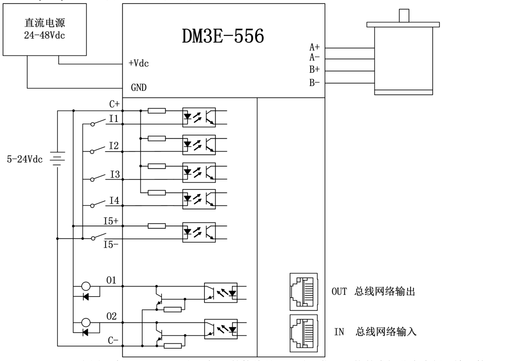

图中文字：直流电源 24-48Vdc；OUT 总线网络输出；IN 总线网络输入。

注：1）以上图示中 EtherCAT 通讯端子的接线是以驱动器位于网络的中间节点为例，输入接 IN 口，输出下一台接 OUT 口。

### 3.2 端子及拨码说明

#### 3.2.1 端子定义

| 端子号 | 描述 |
| --- | --- |
| CN1 | 电源端子 |
| CN2 | 电机端子 |
| CN3 | 控制信号端子 |
| CN4 | EtherCAT 总线接口端子 |
| SW1 | 旋码开关，与 SW2 设置通讯地址 |
| SW2 | 旋码开关，与 SW1 设置通讯地址 |
| PWR | 电源指示灯，上电长亮，断电熄灭 |
| ALM | 告警指示灯，故障发生时闪烁，闪烁次数标识不同故障类型，参见 5.1 节 |

#### 3.2.2 电源端子

| 端子号 | 图示 | 管脚号 | 信号 | 名称 |
| --- | --- | --- | --- | --- |
| CN1 | 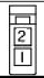 | 2 | VDC | 电源正输入端 |
| | | 1 | GND | 电源地 |

注：线径≥0.3mm2（AWG15-22）。建议电源经过噪声滤波器供电，提供抗干扰性。

#### 3.2.3 电机绕组端子

| 端子号 | 图示 | 管脚号 | 信号 | 名称 |
| --- | --- | --- | --- | --- |
| CN2 | 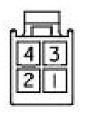 | 4 | A+ | 电机线组 A 相正端 |
| | | 3 | B+ | 电机线组 B 相正端 |
| | | 2 | A- | 电机线组 A 相负端 |
| | | 1 | B- | 电机线组 B 相负端 |

注：线径≥0.3mm2（AWG15-22）。

#### 3.2.4 控制信号端子

| 端子号 | 图示 | 管脚号 | 信号 | 名称 |
| --- | --- | --- | --- | --- |
| CN3 | 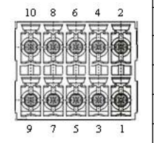 | 1 | OUT1 | 数字输出信号 1，单端方式，共 COM-，OC 输出，最大上拉 24VDC，50mA，默认报警输出 |
| | | 2 | OUT2 | 数字输出信号 2，单端方式，共 COM-，OC 输出，最大上拉 24VDC，50mA，默认抱闸输出 |
| | | 3 | COM+ | 外部输入控制信号公共电源正端，5~24Vdc |
| | | 4 | COM- | 数字输出信号公共地 |
| | | 5 | IN1 | 数字输入信号 1，单端方式，5～24VDC，默认探针输入 Probe1 |
| | | 6 | IN2 | 数字输入信号 2，单端方式，5～24VDC，默认原点输入 Home |
| | | 7 | IN3 | 数字输入信号 3，单端方式，5～24VDC，默认正限位输入 POT |
| | | 8 | IN4 | 数字输入信号 4，单端方式，5～24VDC，默认负限位输入 NOT |
| | | 9 | IN5+ | 数字输入信号 5 正端，差分方式，5～24VDC，默认自定义输入 |
| | | 10 | IN5- | 数字输入信号 5 负端，差分方式，5～24VDC，默认自定义输入 |

注：线径≥0.12mm2（AWG24-26）。建议采用双绞屏蔽电缆，电缆长度尽可能短，建议不超过 3 米。尽量远离动力线布线，防止干扰串入。请给相关线路中的感性原件（如线圈）安装浪涌吸收元件；直流线圈反向并联续流二极管，交流线圈并联阻容吸收回路。

**IO 信号功能配置和参数说明，详见 4.2 章节。** 输入信号有单端和差分两种方式，由外部提供电源，DC5～24V，电流≥100mA；如果电流极性接反，会使步进驱动器不能工作。接线和设置如下所示：

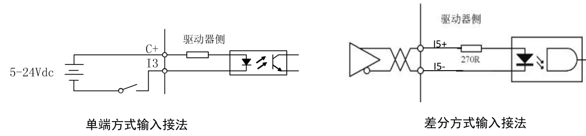

**图 3-2 IO 输入接口**

图中文字：驱动器侧；单端方式输入接法；差分方式输入接法。

输出信号接线和设置如下所示：

（1）外部电源由用户提供，但是必需注意，如果电源的极性接反，会使步进驱动器损坏。

（2）输出为集电极开路形式，最大电流 50mA，外部电源最大电压 25V。因此，开关量输出信号的负载必须满足这个限定要求。如果超过限定要求或输出直接与电源连接，会使步进驱动器损坏。

（3）如果负载是继电器等电感性负载，必须在负载两端反并联续流二极管。如果续流二极管接反，会使步进驱动器损坏。

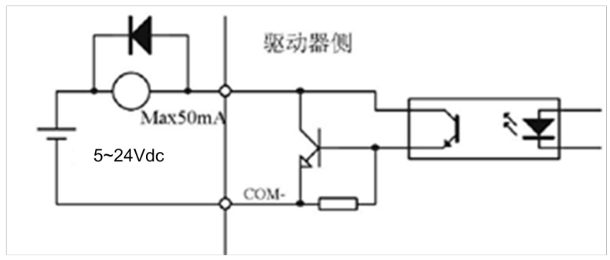

**图 3-3 IO 输出接口**

图中文字：驱动器侧。

#### 3.2.5 EtherCAT 总线接口

| 端子号 | 图示 | 管脚号 | 信号 | 名称 |
| --- | --- | --- | --- | --- |
| CN3（原文如此，即 CN4） | 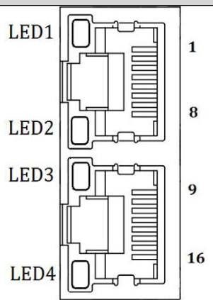 | 1，9 | E_TX+ | EtherCAT 数据发送正端 |
| | | 2，10 | E_TX- | EtherCAT 数据发送负端 |
| | | 3，11 | E_RX+ | EtherCAT 数据接收正端 |
| | | 4，12 | / | / |
| | | 5，13 | / | / |
| | | 6，14 | E_RX- | EtherCAT 数据接收负端 |
| | | 7，15 | / | / |
| | | 8，16 | / | / |
| | | 连接器外壳 | PE | 屏蔽接地 |

备注：
- ① LED1 为 “Link/Activity IN” 状态灯，绿色
- ② LED3 为 “Link/Activity OUT” 状态灯，绿色
- ③ LED2 为 “RUN” 状态灯，绿色
- ④ LED4 为 “ERR” 状态灯，红色

注：EtherCAT 总线节点间的线缆长度建议不超过 100 米。
**推荐使用带双层屏蔽的超五类百兆以太网线缆或者更好线缆。**

**表 3-1 RJ45 网口灯定义说明**

| 名称 | 颜色 | 状态 | 描述 |
| --- | --- | --- | --- |
| RUN | 绿色 | 关 | 初始化状态 |
| | | 闪烁 | 预操作状态 |
| | | 单闪 | 安全操作状态 |
| | | 开 | 操作状态 |
| ERR | 红色 | 关 | 无错误 |
| | | 慢闪烁 | 通信设置错误 |
| | | 单闪 | 同步错误或通信数据错误 |
| | | 双闪 | 请求看门狗超时 |
| | | 快闪烁 | 引导错误 |
| | | 开 | 内部总线看门狗超时 |
| L/A IN | 绿色 | 关 | 物理层链路无建立 |
| | | 开 | 物理层链路建立 |
| | | 闪烁 | 链路建立后交互数据 |
| L/A OUT | 绿色 | 关 | 物理层链路无建立 |
| | | 开 | 物理层链路建立 |
| | | 闪烁 | 链路建立后交互数据 |

**EtherCAT 物理层及线缆连接要求**

| 电气参数 | Type A 线缆（固定） | Type B 线缆（活动） |
| --- | --- | --- |
| 标称/特征阻抗（公差） | 100Ω（15Ω）（IEC61156-5） | ← |
| Balanced or Unbalanced | Balanced | ← |
| 环路电阻 | ≦115Ω/Km | ← |
| 绝缘电阻 | ≧500MΩ/Km | ← |
| 传输阻抗 | ≦50mΩ/m（10MHZ） | ← |
| 最大时延 | ≦550ns/100m | ← |
| 时延偏差 | ≦20ns/100m | ← |
| 屏蔽 | S/FTQ（外层绞合屏蔽/内层） | ← |

固定场合可以使用单芯线缆，活动场合推荐使用多芯线缆。

图中文字：固定场合；活动场合。

**通讯线缆物理规格：**

| 物理参数 | Type A 线缆（固定） | Type B 线缆（活动） |
| --- | --- | --- |
| 导线颜色 | 白（3）；黄（1）；蓝（2）；橙（6） | ← |
| 单根线缆直径 | 6.5mm（+/-0.2mm） | ← |
| 导线截面积 | AWG 22/1（单根实心） | AWG 22/7（7x0.254mm） |
| 导线直径 | 0.64mm（+/-0.1mm） | ← |
| 温度 | ≦60° | ← |

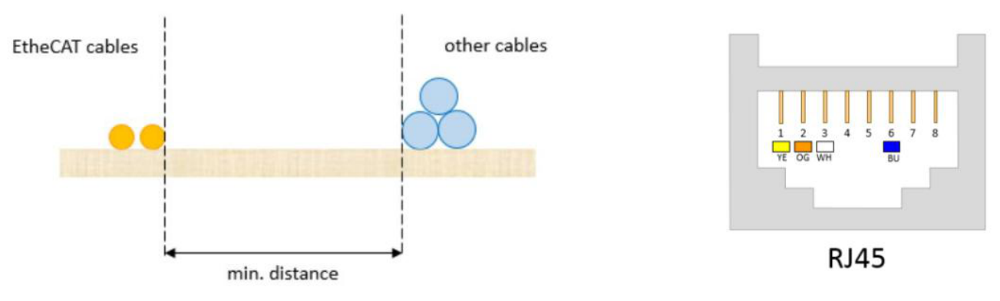

**EtherCAT 物理层连接要求：**

- 通讯信道连接长度越短越好；
- 通讯总长度不超过 100 米（导线和连接器长度之和）；
- 所有连接器总长度不超过 5 米；
- 连接器个数<=6（延长连接器）或 4（转换连接器），且只能位于端点；
- 不建议使用连接器（干扰和衰减）；
- 固定安装的线缆长度最大为 90 米，最多两个 5 米长的连接器；
- 无任何隔离措施情况下，保证 EtherCAT 电缆和动力线缆之间的最小间隔 10mm；
- 推荐使用带双层屏蔽的超五类百兆以太网线缆或者更好线缆。

#### 3.2.6 EtherCAT 站点地址

DM3E 系列支持三种方法设置从站地址：旋码开关设定站点地址、对象字典 2150 设定站点别名和 ESC 设定站点别名，并通过对象字典 2151 来选择。

| 2151h | 2150 | MSD | LSD | 站点地址 |
| --- | --- | --- | --- | --- |
| 0 | 显示 | 0~F | 0~F | 两位旋转开关组合设定 0~255 为节点地址值 |
| 1 | 设置值 | - | - | 对象字典 2150 设置值为节点地址值 |
| 2 | - | 0 | 0 | 主站配置站点别名到 ESC 的 EEPROM 0x0004 字地址 |

DM3E 系列的对象字典 2151 出厂默认值为 0，此时采用 MSD 作高位和 LSD 作低位的 2 个 16 位旋转拨码组合设定值作为节点地址，节点地址范围为 0~255，设定后需重新上电才能生效。例如，当 MSD=1，LSD=4 时，设置站点地址值为 20。

日常使用中，绝大部分主站都会根据从站物理连接位置自动分配节点地址，由此驱动器不需要拨地址。只有极少部分主站，如欧姆龙 PLC，需要从站拨码以设置节点地址。

---

## 第四章 参数说明与设置

### 4.1 对象字典总表

| 对象字典 | 子索引 | 名称 | 属性 | 类型 | 范围 | 默认值 | 单位 | 备注 |
| --- | --- | --- | --- | --- | --- | --- | --- | --- |
| 0x1000 | 00 | 设备类型 | R | UDINT | 0~32767 | 0x40912 | - | 与 CIA 规则一致 |
| 0x1001 | 00 | 错误寄存器 | R | USINT | 0~255 | 0 | -- | 位定义，参见 5.1 |
| 0x1008 | 00 | 设备名称 | R | STRING | 0~32767 | DM3E-X | - | X 表述具体型号，如 556 |
| 0x1009 | 00 | 硬件版本 | R | STRING | 0~32767 | V1.0 | - | 以产品名牌为准 |
| 0x100A | 00 | 软件版本 | R | STRING | 0~32767 | V1.0 | - | 以对象字典 3100 为准 |
| 0x1010 | 00 | 子索引个数 | R | USINT | 0~32767 | 4 | - | 无 |
| 0x1010 | 01 | 保存全部参数 | R/W | UDINT | 0~0xFFFFFFFF | 0 | - | 命令同 1010:04 |
| 0x1010 | 02 | 保存通信参数 | R/W | UDINT | 0~0xFFFFFFFF | 0 | - | 命令同 1010:04 |
| 0x1010 | 03 | 保存运动参数 | R/W | UDINT | 0~0xFFFFFFFF | 0 | - | 命令同 1010:04 |
| 0x1010 | 04 | 保存厂商参数 | R/W | UDINT | 0~0xFFFFFFFF | 0 | - | 保存命令：0x65766173 10 进制：1702257011 保存完成后返回 1 |
| 0x1011 | 00 | 子索引个数 | R | USINT | 0~32767 | 4 | - | 无 |
| 0x1011 | 01 | 恢复全部参数出厂值 | R/W | UDINT | 0~0xFFFFFFFF | 0 | - | 命令同 1011:04 |
| 0x1011 | 02 | 恢复通信参数出厂值 | R/W | UDINT | 0~0xFFFFFFFF | 0 | - | 命令同 1011:04 |
| 0x1011 | 03 | 恢复运动参数出厂值 | R/W | UDINT | 0~0xFFFFFFFF | 0 | - | 命令同 1011:04 |
| 0x1011 | 04 | 恢复用户参数出厂值 | R/W | UDINT | 0~0xFFFFFFFF | 0 | - | 恢复命令：0x64616f6c 10 进制：1684107116 恢复出厂完成后返回 1 |
| 0x1018 | 00 | 子索引个数 | R | USINT | 0~32767 | 4 | - | 无 |
| 0x1018 | 01 | 厂商 ID | R | UDINT | 0~32767 | 4321 | - | LeadShine 标识码 |
| 0x1018 | 02 | 产品代码 | R | UDINT | 0~32767 | 8x00 | - | x=1,2,3,4 依次对应 556, 870, 522, 542 |
| 0x1018 | 03 | 修改编码 | R | UDINT | 0~32767 | 1 | - | 无 |
| 0x1018 | 04 | 序列号 | R | UDINT | 0~32767 | 1 | - | 无 |
| 0x1600 | 00 | 子索引个数 | R/W | USINT | 0~32767 | 3 | - | 组 1 默认映射对象个数 |
| 0x1600 | 01~08 | RXPDO 映射对象组 1 | R/W | UDINT | 0~0xFFFFFFFF | 略 | - | 组 1 默认 rxPDO 映射对象 |
| 0x1601 | 00 | 子索引个数 | R/W | USINT | 0~32767 | 6 | - | 组 2 默认映射对象个数 |
| 0x1601 | 01~08 | RXPDO 映射对象组 2 | R/W | UDINT | 0~0xFFFFFFFF | 略 | - | 组 2 默认 rxPDO 映射对象 |
| 0x1602 | 00 | 子索引个数 | R/W | USINT | 0~32767 | 5 | - | 组 3 默认映射对象个数 |
| 0x1602 | 01~08 | RXPDO 映射对象组 2 | R/W | UDINT | 0~0xFFFFFFFF | 略 | - | 组 3 默认 RXPDO 映射对象 |
| 0x1603 | 00 | 子索引个数 | R/W | USINT | 0~32767 | 7 | - | 组 4 默认映射对象个数 |
| 0x1603 | 01~08 | RXPDO 映射对象组 3 | R/W | UDINT | 0~0xFFFFFFFF | 略 | - | 组 4 默认 RXPDO 映射对象 |
| 0x1A00 | 00 | 子索引个数 | R/W | USINT | 0~32767 | 7 | - | 组 1 默认映射对象个数 |
| 0x1A00 | 01~08 | TXPDO 映射对象组 1 | R/W | UDINT | 0~0xFFFFFFFF | 略 | - | 组 1 默认 TXPDO 映射对象 |
| 0x1A01 | 00 | 子索引个数 | R/W | USINT | 0~32767 | 0 | - | 组 2 默认映射对象个数 |
| 0x1A01 | 01~08 | TXPDO 映射对象组 2 | R/W | UDINT | 0~0xFFFFFFFF | 略 | - | 组 2 默认 TXPDO 映射对象 |
| 0x1C00 | 00 | 子索引个数 | R | USINT | 0~32767 | 4 | - | 无 |
| 0x1C00 | 01 | 邮箱输出类型 | R | USINT | 0~32767 | 1 | - | 无 |
| 0x1C00 | 02 | 邮箱输入类型 | R | USINT | 0~32767 | 2 | - | 无 |
| 0x1C00 | 03 | 过程数据输出类型 | R | USINT | 0~32767 | 3 | - | 无 |
| 0x1C00 | 04 | 过程数据输入类型 | R | USINT | 0~32767 | 4 | - | 无 |
| 0x1C12 | 0~04 | RXPDO 分配 | R/W | UINT | 0~32767 | 1600 | - | 无 |
| 0x1C13 | 0~02 | TXPDO 分配 | R/W | UINT | 0~32767 | 1A00 | - | 无 |
| 0x1C32 | 0~0A | RXPDO 管理参数 | R | UINT | 0~32767 | 略 | - | 无 |
| 0x1C33 | 0~0A | TXPDO 管理参数 | R | UINT | 0~32767 | 略 | - | 无 |
| 0x2000 | 00 | 驱动器峰值电流 | R/W | UINT | 100~7000 | 1000 | mA | 驱动器允许长期运行最大电流 具体峰值与型号有关，**非使能下，请根据需要更改。** 870-7000, 556-5600, 522-2200 |
| 0x2001 | 00 | 电机每转脉冲数 | R/W/S | UINT | 6400~51200 | 50000 | -- | 表示电机运行一转所需要的脉冲个数，**建议非使能下更改。** |
| 0x2002 | 00 | 待机时间 | R/W | UINT | 10~3000 | 500 | ms | 单位：ms |
| 0x2003 | 00 | 待机电流百分比 | R/W | UINT | 0~100 | 50 | % | 电机进入待机后，电流与峰值电流的百分比。 |
| 0x2005 | 01 | 输出口 1 选择 | R/W | USINT | 0~255 | 1 | -- | 参见 4.2 节，默认报警输出 ALM |
| 0x2005 | 02 | 输出口 2 选择 | R/W | USINT | 0~255 | 8 | -- | 参见 4.2 节，默认抱闸输出 \*(1) |
| 0x2007 | 00 | 不使能时动作 | R/W | UINT | 0~1 | 0 | -- | 0--不响应脉冲，电机不锁定；1--不响应脉冲，电机锁定 |
| 0x2008 | 00 | 输出极性配置 | R/W | UINT | 0~255 | 0 | -- | 极性控制，bit0/bit1 分别对应输出 1/2 |
| 0x2009 | 00 | FIR 滤波使能 | R/W | UINT | 0~1 | 0 | -- | 0--不使能；1--使能，**非使能下才允许修改** |
| 0x2010 | 01 | 滤波时间 | R/W | UINT | 50~25600 | 1000 | us | 设定滤波器的滤波时间，**非使能下才允许修改。** |
| 0x2012 | 00 | 电流软启动时间 | R/W | UINT | 10~3000 | 50 | ms | 减小电机上电和使能时转子的振动。 |
| 0x2013 | 00 | 电流环 PI 自动整定使能 | R/W | UINT | 0~2 | 1 | -- | 0--不使能；1--使能 |
| 0x2015 | 00 | 电流环 Kp | R/W | UINT | 50~32767 | 300 | -- | 自整定使能时该项为只读，**不使能时允许用户修改** |
| 0x2016 | 00 | 电流环 Ki | R/W | UINT | 20~2000 | 30 | -- | 自整定使能时该项为只读，**不使能时允许用户修改** |
| 0x2020 | 00 | 电机电阻 | R/W | UINT | 0~20000 | 1000 | mOhms | 暂时无用 |
| 0x2021 | 00 | 电机电感 | R/W | UINT | 0~6000 | 1 | uH | 暂时无用 |
| 0x2039 | 00 | 外部脉冲总数 H | R/W | UINT | 0~32767 | 0 | -- | 接收脉冲数高 16 位 |
| 0x2040 | 00 | 外部脉冲总数 L | R | UINT | 0~32767 | 0 | -- | 接收脉冲数第 16 位； **非使能下可写入 1 清除计数器** |
| 0x2043 | 00 | 速度参考 | R | UINT | 0~32767 | 0 | r/min | 读取当前外部脉冲的对应的电机转速 |
| 0x2048 | 00 | 母线电压 | R | UINT | 0~32767 | 0 | V | 返回母线电压 |
| 0x2051 | 00 | 电机运行方向 | R/W | UINT | 0~1 | 0 | -- | 0--运行方向不变；1--运行方向取反 |
| 0x2056 | 00 | 故障检测选择 | R/W | UINT | 0~65535 | 3 | -- | 参见 5.1 节 |
| 0x2057 | 00 | 清除当前报警 | R/W | UINT | 0~1 | 0 | -- | 0：不清除；1：清除当前报警 |
| 0x2058 | 00 | 软启动使能 | R/W | UINT | 0~1 | 0 | -- | 0--不使能；1--使能 |
| 0x2093 | 00 | 清除故障记录 | R/W | UINT | 0~1 | 0 | -- | 0：不清除；1：清除报警记录 |
| 0x2073 | 00 | 上电自动走位 | R/W | UINT | 0~1 | 0 | -- | 0：上电后电机正常待机 1：上电后先自运行后待机 |
| 0x2150 | 00 | 从站地址 | R/W | UINT | 0~65535 | 1 | -- | 无 |
| 0x2151 | 00 | 从站地址来源 | R/W | UINT | 0~2 | 0 | -- | 0--拨码，1--2150，2--ESC 存储器 |
| 0x2152 | 01 | 输入 1 选择 | R/W | UINT | 0~255 | 32 | -- | 参见 4.2 节，默认探针 1 输入 probe1 |
| 0x2152 | 02 | 输入 2 选择 | R/W | UINT | 0~255 | 1 | -- | 参见 4.2 节，默认近原点输入 HOME |
| 0x2152 | 03 | 输入 3 选择 | R/W | UINT | 0~255 | 2 | -- | 参见 4.2 节，默认正限位输入 POT |
| 0x2152 | 04 | 输入 4 选择 | R/W | UINT | 0~255 | 4 | -- | 参见 4.2 节，默认负限位输入 NOT |
| 0x2152 | 05 | 输入 5 选择 | R/W | UINT | 0~255 | 16 | -- | 参见 4.2 节，默认自定义输入 SI-MON |
| 0x2153 | 01 | 输入 1 滤波时间 | R/W | UINT | 50—60000 | 1000 | us | 设定输入口滤波时间，单位 us。 |
| 0x2153 | 02 | 输入 2 滤波时间 | R/W | UINT | 50—60000 | 1000 | us | 设定输入口滤波时间，单位 us。 |
| 0x2153 | 03 | 输入 3 滤波时间 | R/W | UINT | 50—60000 | 1000 | us | 设定输入口滤波时间，单位 us。 |
| 0x2153 | 04 | 输入 4 滤波时间 | R/W | UINT | 50—60000 | 1000 | us | 设定输入口滤波时间，单位 us。 |
| 0x2153 | 05 | 输入 5 滤波时间 | R/W | UINT | 50—60000 | 1000 | us | 设定输入口滤波时间，单位 us。 |
| 0x2154 | 00 | 输入 IO 极性配置 | R/W | UINT | 0—65535 | 0 | -- | 极性控制，bit0 对应输入 1，依次类推 |
| 0x2155 | 00 | 输入 IO 物理状态 | R | UINT | 0~255 | 0 | -- | 电平状态，bit0 对应输入 1，依次类推 |
| 0x2163 | 00 | PP 模式到位选择 | R/W | UINT | 0~10 | 0 | -- | 0：规划完成即到位 10：到位信号来于驱动 |
| 0x3100 | 01 | 驱动软件版本 | R | UINT | 0~32767 | 301 | -- | 对应驱动侧软件版本 |
| 0x3100 | 02 | FPGA 软件版本 | R | UINT | 0~32767 | 0 | -- | 无 |
| 0x3100 | 03 | 协议栈软件版本 | R | UINT | 0~32767 | 110 | -- | 对应协议栈软件版本 |
| 0x3FFE | 01 | 最近报警 | R | UINT | 0~32767 | 0 | -- | 无 |
| 0x3FFE | 02-0A | 历史报警 1~9 | R | UINT | 0~32767 | 0 | -- | 无 |
| 0x4003 | 00 | 抱闸释放延时 | R/W | UINT | 0~3000 | 50 | ms | 使能到释放抱闸信号时间 |
| 0x4004 | 00 | 抱闸锁定延时 | R/W | UINT | 0~3000 | 50 | ms | 不使能到关闭 PWM 输出时间 |
| 0x5001 | 00 | 内部使能 | R | UINT | 0~32767 | 0 | -- | 内部调试用 |
| 0x5002 | 00 | ESC 控制寄存器 | R/w | UINT | 0~32767 | 0 | -- | 内部调试用 |
| 0x5003 | 00 | ESC 数据寄存器 | R | UINT | 0~32767 | 0 | -- | 内部调试用 |
| 0x5004 | 00 | DC 看门狗计数器 | R | UINT | 0~255 | 0 | -- | 内部调试用 |
| 0x5010 | 00 | DC 看门狗时间 | R/w | UINT | 0~32767 | 0 | -- | 内部调试用 |
| 0x5012 | 04 | 回零设置 | R/w | UINT | 0~32767 | 5 | -- | Bit0=0：不开启回零保护 Bit0=1：开启回零保护； （回零保护：当启动回原点时，如限位信号生效，bit0=0 时，可以正常回原点；bit0=1 时，处于限位保护无法回原点。） Bit2=0：到位后电机当前值=607Ch Bit2=1：607Ch 的数据作为运动偏移，最终 6064h = 0 Bit3=0：到位后 6064h= 607Ch Bit3=1：到位后 6064h = - 607Ch |
| 0x5013 | 00 | 电机不工作代码 | R | UINT | 0~32767 | 0 | -- | 30：指令超最大速度限制值 23：不支持当前模式 |
| 0x5014 | 00 | 超速极限值 | R/W | UINT | 0~3000 | 3000 | r/min | 当指令超过此值时，被忽略为 0 |
| 0x5300 | 00 | 硬件错误 SP | R | UDINT | 0~all F | 0 | -- | 内部调试用 |
| 0x5301 | 00 | 硬件错误 LR | R | UDINT | 0~all F | 0 | -- | 内部调试用 |
| 0x5302 | 00 | 硬件错误 PC | R | UDINT | 0~all F | 0 | -- | 内部调试用 |
| 0x5303 | 00 | 用户错误 LR | R | UDINT | 0~all F | 0 | -- | 内部调试用 |
| 0x5304 | 00 | 用户错误 PC | R | UDINT | 0~all F | 0 | -- | 内部调试用 |
| 0x5305 | 00 | 总线错误 LR | R | UDINT | 0~all F | 0 | -- | 内部调试用 |
| 0x603F | 00 | 错误寄存器 | R | UINT | 0~65535 | 0 | -- | 无 |
| 0x6040 | 00 | 控制字 | R/W | UINT | 0~65535 | 0 | -- | 参见 6.1 |
| 0x6041 | 00 | 状态字 | R | UINT | 0~65535 | 0 | -- | 参见 6.1 |
| 0x605A | 00 | 快速停止代码 | R/W | INT | 0~65535 | 6 | -- | -- |
| 0x6060 | 00 | 操作模式 | R/W | USINT | 0~255 | 8 | -- | 1—pp，3—pv，6—Home，8--CSP |
| 0x6061 | 00 | 操作模式显示 | R | USINT | 0~255 | 8 | -- | 无 |
| 0x6062 | 00 | 命令位置 | R | DINT | -2147483648~2147483647 | 0 | P | P 表示脉冲单位 |
| 0x6064 | 00 | 实际位置 | R | DINT | -2147483648~2147483647 | 0 | P | 无 |
| 0x606B | 00 | 命令速度 | R | DINT | -2147483648~2147483647 | 0 | P/s | 无 |
| 0x606C | 00 | 实际速度 | R | DINT | -2147483648~2147483647 | 0 | P/S | 无 |
| 0x607C | 00 | 原点偏移 | R/W | DINT | -2147483648~2147483647 | 0 | P | Home 模式 6 原点偏移量 |
| 0x607D | 01 | 负向软限位 | R/W | DINT | -2147483648~2147483647 | 0 | P | -- |
| 0x607D | 02 | 正向软限位 | R/W | DINT | -2147483648~2147483647 | 0 | P | -- |
| 0x607A | 00 | 目标位置 | R | DINT | -2147483648~2147483647 | 0 | P | pp 模式 1 目标位置指令 |
| 0x60FF | 00 | 目标速度 | R | DINT | -2147483648~2147483647 | 0 | P/S | pv 模式 3 的参考指令 |
| 0x6080 | 00 | 最大限制速度 | R/W | UDINT | -2147483648~2147483647 | 3000 | rpm | 各模式最大速度 |
| 0x6081 | 00 | 梯形速度 | R/W | UDINT | -2147483648~2147483647 | 50000 | P/S | pp 模式 1 最大速度 |
| 0x6082 | 00 | 起止速度 | R/W | UDINT | -2147483648~2147483647 | 0 | P/S | pp 模式 1 起跳速度 |
| 0x6083 | 00 | 加速度 | R/W | UDINT | -2147483648~2147483647 | 500000 | P/S^2 | pp、pv 模式 1、3 加速度 |
| 0x6084 | 00 | 减速度 | R/W | UDINT | -2147483648~2147483647 | 500000 | P/S^2 | pp、pv 模式 1、3 减速度 |
| 0x6085 | 00 | 急停减速度 | R/W | UDINT | -2147483648~2147483647 | 5000000 | P/S^2 | 急停减速度(pp、pv、Home) |
| 0x6098 | 00 | 原点方法 | R/W | SINT | 1~100 | 19 | 无 | Home 模式 6 原点方法，附录 1 |
| 0x6099 | 01 | 寻原点速度 1 | R/W | UDINT | -2147483648~2147483647 | 50000 | P/S | Home 模式 6 找极限开关速度 |
| 0x6099 | 02 | 寻原点速度 2 | R/W | UDINT | -2147483648~2147483647 | 25000 | P/S | Home 模式 6 找原点信号速度 |
| 0x609A | 00 | 回零加减速度 | R/W | UDINT | -2147483648~2147483647 | 25000 | P/S^2 | Home 模式 6 加减速度 |
| 0x60B8 | 00 | 探针控制字 | R/W | UINT | 0~65535 | 0 | 无 | 设置探针功能，参见 6.3 |
| 0x60B9 | 00 | 探针状态字 | R | UINT | 0~65535 | 0 | 无 | 探针动作状态，参见 6.3 |
| 0x60BA | 00 | 探针数据 1 | R | DINT | -2147483648~2147483647 | 0 | P | probe1 上升沿捕获数据 |
| 0x60BB | 00 | 探针数据 2 | R | DINT | -2147483648~2147483647 | 0 | P | probe1 下升沿捕获数据 |
| 0x60BC | 00 | 探针数据 3 | R | DINT | -2147483648~2147483647 | 0 | P | probe2 上升沿捕获数据 |
| 0x60BD | 00 | 探针数据 4 | R | DINT | -2147483648~2147483647 | 0 | P | probe2 下升沿捕获数据 |
| 0x60C2 | 01 | 插补时间值 | R/W | USINT | 0~255 | 2 | -- | 内部调试用 |
| 0x60C2 | 02 | 插补时间单位 | R/W | SINT | -128-127 | 0 | -- | 内部调试用 |
| 0x60D5 | 00 | 探针 1 上升沿触发计数器 | R | UINT | 0~65535 | 0 | -- | probe1 上升沿捕获次数 |
| 0x60D6 | 00 | 探针 1 下升沿触发计数器 | R | UINT | 0~65535 | 0 | -- | probe1 下升沿捕获次数 |
| 0x60D7 | 00 | 探针 2 上升沿触发计数器 | R | UINT | 0~65535 | 0 | -- | probe2 上升沿捕获次数 |
| 0x60D8 | 00 | 探针 2 下升沿触发计数器 | R | UINT | 0~65535 | 0 | -- | probe2 下升沿捕获次数 |
| 0x60FD | 00 | 输入 IO 状态 | R | UDINT | 0~4294967296 | 0 | -- | 输入 IO 功能逻辑状态，参见 4.2 |
| 0x60FE | 01 | 物理输出开启 | R/W | UDINT | 0~4294967296 | 0 | -- | 主站输出信号控制字，参见 4.2 |
| 0x60FE | 02 | 物理输出使能 | R/W | UDINT | 0~4294967296 | 0 | -- | 主站输出信号控制字，参见 4.2 |
| 0x6502 | 00 | 支持操作模式 | R | UDINT | 0~4294967296 | 165 | -- | 驱动器所支持控制模式 |

### 4.2 I/O 功能配置

注：举例说明，以下列表中，
2152+01，表示对象字典为 2152，子索引为 01；
2154.01，表示对象字典为 2154，01 表示 bit1；

#### 4.2.1 输入信号

| 端口 | 对应对象字典 | 输入口极性配置 | 默认设定值及功能 | 输入口物理状态 2155 对应关系 | 滤波时间设置 |
| --- | --- | --- | --- | --- | --- |
| IN1 | 2152+01 | 2154.00=0 常开； 2154.00=1 常闭 | 32：探针 1(Probe1) | 2155.00 | 2153+01 |
| IN2 | 2152+02 | 2154.01=0 常开； 2154.01=1 常闭 | 1：原点输入(HOME) | 2155.01 | 2153+02 |
| IN3 | 2152+03 | 2154.02=0 常开； 2154.02=1 常闭 | 2：正限位输入(POT) | 2155.02 | 2153+03 |
| IN4 | 2152+04 | 2154.03=0 常开； 2154.03=1 常闭 | 4：负限位输入(NOT) | 2155.03 | 2153+04 |
| IN5 | 2152+05 | 2154.04=0 常开； 2154.04=1 常闭 | 16：自定义输入(SI-MON) | 2155.04 | 2153+05 |

| 输入口功能 | 0x2152 功能设定值 | 与 0x60FD 对应关系 |
| --- | --- | --- |
| 无效 | 0 | 无 |
| 探针 1(Probe1) | 32 | 60FD.26 |
| 原点输入(HOME) | 1 | 60FD.02 |
| 正限位输入(POT) | 2 | 60FD.01 |
| 负限位输入(NOT) | 4 | 60FD.00 |
| 急停（E-stop） | 8 | 60FD.16 |
| 自定义输入(SI-MON) | 16 | IN1 设为自定义时 → 60FD.17 IN2 设为自定义时 → 60FD.18 IN3 设为自定义时 → 60FD.19 IN4 设为自定义时 → 60FD.20 IN5 设为自定义时 → 60FD.21 |

#### 4.2.2 输出信号

默认输出配置：

| 输出口 | 记号 | 信号名称 | 0x2005 功能选择 | 版本信息 |
| --- | --- | --- | --- | --- |
| OUT1 | ALM | 报警输出 | 1 | - |
| OUT2 | BRK-OFF | 抱闸输出 | 8 | 自 MS11B 起 |

输出口功能设定：

| 输出口功能 | 0x2005 功能设定值 |
| --- | --- |
| 无效 | 0 |
| 报警输出(ALM) | 1 |
| 抱闸输出\*(BRK-OFF) | 8 |
| 到位输出(INP) | 4 |
| 自定义输出(EX-OUT) | 16 |

自定义输出又称为通用输出、主控输出，用法如下：

| 端口 | 对应对象字典 | 输出口极性配置 | 0x2005 功能设定值 | 主控输出功能开启 | 主控端口输出 |
| --- | --- | --- | --- | --- | --- |
| OUT1 | 2005+01 | 2008.00=0 常开； 2008.00=1 常闭 | 16（十进制） | 60FE+01.16=1 | 60FE+02.16=1 |
| OUT2 | 2005+02 | 2008.01=0 常开； 2008.01=1 常闭 | 16（十进制） | 60FE+01.17=1 | 60FE+02.16=1 |

举例：设置 OUT2 进行自定义输出操作。

- 先设置 2005+02 为 16（即 bit4=1），开启端口功能；
- 再对 60FE+01、60FE+02 都写 0x20000（即 bit17=1），此时 OUT2 输出。

抱闸输出接线：

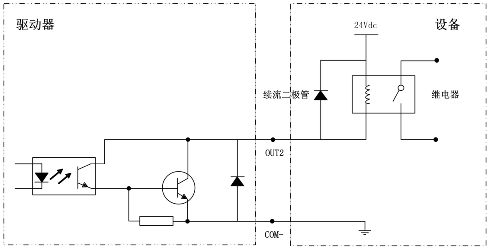

图中文字：驱动器；设备；续流二极管；继电器。

- **自 MS11B 版本起，OUT2 输出口默认功能为抱闸输出；**
- 抱闸相关的两个对象字典，4003、4004，分别用作抱闸释放延时和抱闸锁定延时，可根据需要设定；
- 如果使用抱闸输出功能，则必须外部配合继电器使用，且在继电器两端需要反向并联续流二极管，如接线图所示。

### 4.3 XML 设备描述文件

设备描述文件也有叫 ESI 文件，是连接驱动器与主站之间的桥梁，在使用主站软件之前，需要先安装 XML 文件。XML 设备描述文件由驱动器厂家提供，其导入方法请遵照各主站软件。雷赛 DM3E 系列驱动器 XML 文件可从官网产品中心下载获得。

各主站厂家的 XML 文件导入方法各有不同。小部分厂家的设备描述文件不是 XML 文件格式的，需根据要求进行转换。图下所示为欧姆龙 NJ 系列的 XML 文件导入方法，仅供参考：

图中路径：C:\Program Files (x86)\OMRON\Sysmac Studio\IODeviceProfiles\EsiFiles\UserEsiFiles，文件 DM3E_V1.70（XML 文档）。

---

## 第五章 故障及处理

### 5.1 驱动器故障

当出现报警时，驱动器会开启保护功能，电机停止运转，ALM 指示灯会红色闪烁不同次数，表示不同的报警显示。驱动器发生报警后，应排除故障后清除报警或重新上电，尤其是过流、过压故障。

| 603F 代码 | 含义 | 3FFE 代码 | 可清除性 | 2056 故障检测位 | ALM 闪烁次数 |
| --- | --- | --- | --- | --- | --- |
| 0x2211 | 过流故障 | 0x0e0 | 否 | bit0 | 1 |
| 0x3150 | A 相运放故障 | 0x0a0 | 否 | bit11 | 12 |
| 0x3151 | B 相运放故障 | 0x0a1 | 否 | bit11 | 12 |
| 0x3211 | 母线过压故障 | 0x0c0 | 是 | bit1 | 2 |
| 0x8402 | 指令超速故障 | 0x1a0 | 是 | bit3 | 5 |
| 0x5530 | 保存参数错误 | 0x240 | 是 | bit2 | 8 |
| 0x8403 | PWM 周期内指令脉冲增量过大 | 0x1a1 | 是 | bit4 | 3 |
| 0x7122 | 缺相报警 | 0x5f0 | 否 | bit7 | 7 |
| - | 硬件中断保护 | - | - | - | 长亮 |

故障代码列表：

| 3FFE 对象 | 603Fh 对象 | 含义 | 解决措施 |
| --- | --- | --- | --- |
| 0x0e0 | 0x2211 | 过流故障 | 确保驱动器输出线未短路；确保电机未损坏 |
| 0x0e1 | 0x2212 | 智能功率模块(IPM)过流 | 确保驱动器输出线未短路；确保电机未损坏 |
| 0x0c0 | 0x3211 | 直流母线电压过高 | 减小驱动器供电电压；运动过程中报过压，可增大加减速时间 |
| 0x0a0 | 0x3150 | A 相运放故障 | 确保电机接线正确；返厂维修 |
| 0x0a1 | 0x3151 | B 相运放故障 | 确保电机接线正确；返厂维修 |
| 0x0a2 | 0x3152 | 模拟量输入回路错误 | / |
| 0x0a3 | 0x3153 | 模拟量输入回路错误 | / |
| 0x0a4 | 0x3154 | 模拟量输入回路错误 | / |
| 0x0a5 | 0x3201 | 直流母线回路错误 | 确保驱动器供电电压在合适范围内 |
| 0x0a6 | 0x4201 | 温度检测回路错误 | 确保驱动器供电电压在合适范围内 |
| 0x0b0 | 0x3205 | 控制电压过低 | |
| 0x0d0 | 0x3221 | 直流母线电压过低 | 增大驱动器供电电压；牢固端子接线 |
| 0x0e1 | 0x2212 | 智能功率模块(IPM)过流 | 确保驱动器输出线未短路；确保电机未损坏 |
| 0x100 | 0x8311 | 电机过载 | 减小负载；增大加减速时间；调整接线 |
| 0x120 | 0x7701 | 电阻泄放回路过载 | 降低电机转速；减小负载惯量 |
| 0x121 | 0x7702 | 泄放电阻故障 | |
| 0x190 | 0x8401 | 振动过大 | |
| 0x1a0 | 0x8402 | 指令超速故障 | 调整指令速度大小；修改指令脉冲的输入频率；对象字典 2056 写值 7，可解决； |
| 0x1a1 | 0x8403 | 速度失控 | 检查电机绕组线是否正确接线 |
| 0x1b0 | 0x8612 | 位置指令频率过大 | 确保正确输入位置指令 |
| 0x1b1 | 0x8503 | 电子齿轮设置错误 | |
| 0x210 | 0x6321 | I/F 输入端口分配错误 | |
| 0x211 | 0x6322 | I/F 输入端口功能设定错误 | |
| 0x212 | 0x6323 | I/F 输出端口功能设定错误 | |
| 0x240 | 0x5530 | EEPROM 参数保存错误 | 恢复出厂设置；重新保存参数 |
| 0x260 | 0x7329 | 正/负超程输入有效 | |
| 0x570 | 0x5441 | 强制报警输入有效 | 确保输入信号正确接线 |
| 0x5f0 | 0x7122 | 缺相故障 | 检查电机接线是否正确接线；确保电机无异常； |
| 0x801 | 0x8201 | ESM 状态机转换失败 | |
| 0x802 | 0x5510 | 内存溢出 | |
| 0x807 | 0x8207 | 映射对象不存在 | |
| 0x808 | 0x8208 | PDO 映射对象长度错误 | |
| 0x809 | 0x8209 | PDO 映射对象无映射属性 | |
| 0x811 | 0xA001 | 无效的 ESM 转换请求 | |
| 0x812 | 0xA002 | 未知的 ESM 转换请求 | |
| 0x813 | 0x8213 | 引导状态请求保护 | |
| 0x816 | 0x8216 | 预操作状态无效的邮箱配置 | |
| 0x815 | 0x8215 | 引导状态无效的邮箱配置 | |
| 0x818 | 0x8211 | 无有效的输入数据 | |
| 0x819 | 0x8212 | 无有效的输出数据 | |
| 0x81a | 0xFF02 | 同步错误 | 同步模式错误 |
| 0x81b | 0x821B | 同步管理器 2 看门狗超时 | 网络断线，检查通讯连接 |
| 0x81c | 0x821C | 无效的同步管理器类型 | |
| 0x81d | 0x821D | 无效的输出配置 | |
| 0x81e | 0x821E | 无效的输入配置 | |
| 0x821 | 0xA003 | 等待 ESM 初始状态 | |
| 0x822 | 0xA004 | 等待 ESM 预操作状态 | |
| 0x823 | 0xA005 | 等待 ESM 安全操作状态 | |
| 0x824 | 0x8224 | 无效过程数据输入映射 | |
| 0x825 | 0x8225 | 无效过程数据输出映射 | |
| 0x827 | 0x8727 | 不支持自由运行模式 | |
| 0x828 | 0x8728 | 不支持同步模式 | |
| 0x82b | 0x8210 | 无效的输入和输出 | |
| 0x82c | 0x872C | 致命的同步错误 | |
| 0x82d | 0x872D | 无同步错误 | |
| 0x82e | 0x872E | 同步周期过小 | |
| 0x830 | 0x8730 | 无效的 DC 同步配置 | |
| 0x832 | 0x8732 | DC 锁相环故障 | |
| 0x833 | 0x8733 | DC 同步 IO 错误 | |
| 0x834 | 0x8734 | DC 同步超时 | |
| 0x835 | 0x8735 | DC 周期无效 | |
| 0x836 | 0x8736 | 无效的 DC 同步周期 | |
| 0x850 | 0x5550 | EEPROM 无法访问 | |
| 0x851 | 0x5551 | EEPROM 错误 | |
| 0x852 | 0x5552 | 硬件未准备好 | |
| 0x870 | 0x5201 | 不支持的模式下使能了 | 设置了不支持的模式，并且做了使能操作；检查 6061 的值； |

### 5.2 故障说明

当出现报警时，驱动器会开启保护功能，电机停止运转。在数码管显示的同时，驱动器内部的对象字典也可用于故障诊断。驱动器发生报警后，应排除故障再清除报警或重新上电，尤其是过流、过压故障。

部分上位机的故障代码以十进制显示，此时，您需要转化成 16 进制后，再来对照。
例如上位机报 8721，此时，通过计算器上的进制转换后显示为 16 进制的 2211，对照此表，说明驱动器报过流故障。

**报警指示：**

- 对象字典 3FFE+01 **指示最近的故障报警**，其他子索引指示为历史报警。
- 对象字典 1001 和 603F **指示当前报警状态；**
- 其中 603Fh 指示的为 IEC 61800 规格的错误码；1001h 指示的为 CIA 规格的错误码。
- 当存在多个报警时，DM3-EC 所有关联的故障选项都将更新到最新的报警状态。可清除性表示是驱动器不断电的情况下是否可以清除报警：

**报警清除：**

- **向对象字典 6040 写入 128（10 进制），可清除当前可清除的报警；**
- **向对象字典 2093 写入 1，可清除故障记录，3FFE 所有子索引将全部清零；**
- 另外驱动器报警均能保存。

**过流报警清除：**

默认情况下，过流故障属于重大报警，不可清除，但如果清楚报警原因，需要清除报警的话，则可以操作参数实现：
向对象字典 2074 写值 1，再向 0x1010，子索引 04 写入命令 0x65766173 进行保存操作，之后，即可开启软件清除过流报警功能。
**注：过流报警清除功能，只在 MS13A 及以后版本中才支持。**

**指令超速报警：**

报警显示 E1A0 为指令超速故障，对对象字典 2056 写入 7，即可清除该报警，不影响驱动器运行。

**缺相报警：**

对对象字典 2056 的 bit7 置位为 1，可以开启缺相报警功能。设完参数并保存后，重上电生效。
缺相报警是在电机上电时检测的，电机运行过程中产生的缺相不会触发缺相报警，改接电机线后，需要重上电才可以再次进行故障检测。
缺相报警时，前面板 ALM 指示灯红色闪烁 7 次。

### 5.3 EtherCAT 通讯报警

当 DM3E 发生网络通讯故障时，通讯 ERR LED 状态、1001h 对象及 603Fh 对象的关联性如下表所列。网络通讯故障部分可保存，都是可清除的。

| 603F 代码 | 1001 代码 | 含义 | 3FFE 显示 | 可清除否 | 是否保存 | ERR LED |
| --- | --- | --- | --- | --- | --- | --- |
| 0x5201 | 0x10 | 不支持模式下使能 | 0x870 | 1 | 否 | 不闪烁 |
| 0x8207 | 0x10 | 映射对象不存在 | 0x807 | 1 | 否 | 不闪烁 |
| 0x8208 | 0x10 | PDO 映射对象长度错误 | 0x808 | 1 | 否 | 不闪烁 |
| 0x8209 | 0x10 | PDO 映射对象无映射属性 | 0x809 | 1 | 否 | 不闪烁 |
| 0x8213 | 0x10 | BOOT 不支持 | | 1 | 否 | 快闪烁 |
| 0x8215 | 0x10 | BOOT 模式配置无效 | 空白不保存 | 1 | 否 | 快闪烁 |
| 0x8216 | 0x10 | Preop 无效配置 | | 1 | 否 | 快闪烁 |
| 0x8217 | 0x10 | 无效 SM 配置 | | 1 | 否 | 快闪烁 |
| 0x821B | 0x10 | SM 看门狗超时 | 0x081B | 1 | 是 | 双闪 |
| 0x821C | 0x10 | 无效 SM 类型 | 0x081C | 1 | 是 | 慢闪烁 |
| 0x821D | 0x10 | 无效输出配置 | | 1 | 否 | 慢闪烁 |
| 0x821E | 0x10 | 无效输入配置 | | 1 | 否 | 慢闪烁 |
| 0x821F | 0x10 | 无效看门狗配置 | | 1 | 否 | 慢闪烁 |
| 0x8224 | 0x10 | TPDO 映射无效 | | 1 | 否 | 慢闪烁 |
| 0x8225 | 0x10 | RPDO 映射无效 | | 1 | 否 | 慢闪烁 |
| 0x871A | 0x10 | 同步模式错误 | 0x081A | 1 | 是 | 单闪 |
| 0x8727 | 0x10 | 不支持自由运行模式 | | 1 | 否 | 慢闪烁 |
| 0x8728 | 0x10 | 不支持同步模式 | | 1 | 否 | 慢闪烁 |
| 0x872C | 0x10 | 致命同步错误 | | 1 | 是 | 慢闪烁 |
| 0x872D | 0x10 | 无同步错误 | | 1 | 否 | 单闪 |
| 0x872E | 0x10 | 同步周期过小 | | 1 | 否 | 慢闪烁 |
| 0x8730 | 0x10 | 无效的 DC 配置 | | 1 | 否 | 慢闪烁 |
| 0x8732 | 0x10 | DC PLL 错误 | 0x0832 | 1 | 是 | 单闪 |
| 0x8733 | 0x10 | DC 同步 IO 错误 | 0x0833 | 1 | 是 | 单闪 |
| 0x8734 | 0x10 | DC 同步超时 | 0x0834 | 1 | 是 | 单闪 |
| 0x8735 | 0x10 | DC 周期无效 | | 1 | 否 | 慢闪烁 |
| 0x8736 | 0x10 | sync0 周期无效 | | 1 | 否 | 慢闪烁 |
| 0xA001 | 0x10 | 无效的 ESM 状态转换 | 0x0811 | 1 | 是 | 慢闪烁 |
| 0xA002 | 0x10 | 未知的 ESM 转换请求 | 0x0812 | 1 | 是 | 慢闪烁 |
| 0xA003 | 0x10 | 从站等待初始化请求 | 0x0821 | 1 | 是 | 慢闪烁 |
| 0xA004 | 0x10 | 从站等待预操作请求 | 0x0822 | 1 | 是 | 慢闪烁 |
| 0xA005 | 0x10 | 从站等待安全操作请求 | 0x0823 | 1 | 是 | 慢闪烁 |

---

## 第六章 常用功能

### 6.1 参数保存和恢复出厂值

向 0x1010 子索引写入命令 **0x65766173**，可以将相应类别参数保存到 EEPROM 中；

向 0x1011 子索引写入命令 **0x64616F6C**，可以恢复相应类别参数的出厂设置。

**写入保存命令后，请勿立即关闭电源，特别是保存所有参数时，需等待 10s 左右才能断电，确保所有参数保存成功。**

**表 6.1**

| 操作动作 | 对象字典 | 命令（16 进制） | 结果状态 | 备注 |
| --- | --- | --- | --- | --- |
| **保存 2000~5000 系列参数** | **1010:04** | **0x65766173** | **返回 1** | **保存厂商参数** |
| 保存 6000 系列参数 | 1010:03 | 0x65766173 | 返回 1 | 保存运动参数 |
| 保存 1000 系列参数 | 1010:02 | 0x65766173 | 返回 1 | 保存通讯参数 |
| 保存所有系列参数 | 1010:01 | 0x65766173 | 返回 1 | 保存所有系列参数 |
| 恢复 2000~5000 系列参数 | 1011:04 | 0x64616F6C | 返回 1 | 恢复厂商参数 |
| 恢复 6000 系列参数 | 1011:03 | 0x64616F6C | 返回 1 | 恢复运动参数 |
| 恢复 1000 系列参数 | 1011:02 | 0x64616F6C | 返回 1 | 恢复通讯参数 |
| 恢复所有系列参数 | 1011:01 | 0x64616F6C | 返回 1 | 恢复所有系列参数 |

### 6.2 控制字和运行模式

DM3E 支持同步模式和非同步模式，在同步运动模式下，主站进行轨迹规划并输出周期指令，驱动器按同步周期接收主站的规划指令，适合进行多轴的同步运动。DM3E 同步运动模式支持循环同步位置模式(CSP)。循环同步位置模式(CSP)下，轨迹规划在主站完成，DM3E 根据同步周期接收主站发送的位置信息，在同步信号到达时立即将位置信息输送到驱动执行。DM3E 支持的同步周期为：**250 us, 500 us, 750us, 1000 us, 2000 us, 4000 us，（MS11B 版本起能支持到 8000us 以上）**。各模式下步进环路控制整体结构如图所示。

在非同步运动模式下，主站只负责发送运动参数和控制命令；DM3E 步进驱动器在收到主站的运动启动命令后，将按主站发送的运动参数进行轨迹规划；在非同步运动模式下，每个电机轴之间的运动是异步的。DM3E 非同步运动模式包含协议位置模式(PP)、协议速度模式(PV)及原点模式(HM)。

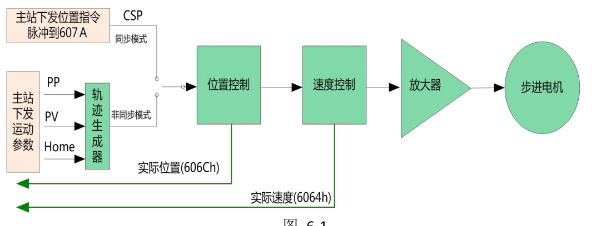

**图 6-1**

图中文字：主站下发位置指令脉冲到 607A；同步模式；非同步模式；主站下发运动参数（PP、PV、Home）；轨迹生成器；位置控制；速度控制；放大器；步进电机；实际位置(606Ch)；实际速度(6064h)。

无论哪种控制模式，EtherCAT 总线主从站间数据交互都通过对象字典来实现，数据传输方式有 PDO 和 SDO 两种方式，一般情况只能二选一，根据控制需要按数据传递实时性要求及重要性分为三个级别：必须>建议>可以。“必须”表示该模式下，对应的对象字典必须配置为 PDO 传输方式。“建议”表示该模式下，对应的对象字典被建议配置为 PDO 传输方式，保障数据实时性，以获得更好的控制需求；如果控制要求不高，也可以通过 SDO 通信方式进行数据传输。“可以”表示该模式下，对应的对象字典一般通过 SDO 通信方式进行数据传输，不必一定要配置为 PDO。各个控制模式所关联的对象字典如表 6.2 所示。

**表 6.2 各控制模式关联对象字典**

| 控制模式 | 索引+子索引 | 名称 | 数据类型 | 访问类型 | 单位 | PDO 配置 | SDO 通信 |
| --- | --- | --- | --- | --- | --- | --- | --- |
| CSP 模式（8） | 6040-00h | 控制字 | U16 | RW | — | 必须 | - |
| | 607A-00h | 目标位置 | I32 | RW | P | 必须 | - |
| | 6041-00h | 状态字 | U16 | RO | — | 必须 | - |
| | 6064-00h | 实际位置 | I32 | RO | P | 必须 | - |
| | 606C-00h | 实际速度 | I32 | RO | P/S | 可以 | 可以 |
| PP 模式（1） | 607A-00h | 目标位置 | I32 | RW | P | 建议 | 可以 |
| | 6081-00h | 最大速度 | U32 | RW | P | 可以 | 可以 |
| PV 模式（3） | 60FF-00h | 目标速度 | I32 | RW | P | 建议 | 可以 |
| PP 模式（1）、PV 模式（3）共有 | 6040-00h | 控制字 | U16 | RW | — | 建议 | 可以 |
| | 6083-00h | 加速度 | I32 | RW | P/S | 可以 | 可以 |
| | 6084-00h | 减速度 | U32 | RW | P/S | 可以 | 可以 |
| HOME 模式（6） | 6040-00h | 控制字 | U16 | RW | — | 建议 | 可以 |
| | 6098-00h | 回零方法 | I8 | RW | — | 可以 | 可以 |
| | 6099-01h | 原点快速 | U32 | RW | P/S | 可以 | 可以 |
| | 6099-02h | 原点慢速 | U32 | RW | P/S | 可以 | 可以 |
| | 609A-00h | 原点加速度 | U32 | RW | P/S² | 可以 | 可以 |
| | 607C-00h | 原点偏移 | U32 | RW | P | 可以 | 可以 |
| PP、PV 和 HOME 模式共有 | 6041-00h | 状态字 | U16 | RO | — | 建议 | 可以 |
| | 6064-00h | 实际位置 | I32 | RO | P | 建议 | 可以 |
| | 606C-00h | 实际速度 | I32 | RO | P/S | 可以 | 可以 |
| 所有模式共有 | 60B8-00h | 探针功能 | U16 | RW | — | 建议 | 可以 |
| | 60B9-00h | 探针状态 | U16 | RO | — | 建议 | 可以 |
| | 60BA-00h | 探针 1 捕获值 | I32 | RO | P | 可以 | 可以 |
| | 60FD-00h | 数字输入 | U32 | RO | — | 建议 | 可以 |
| | 603F-00h | 最新错误代码 | U16 | RO | P | 建议 | 可以 |
| 其他关联参数 | 6060-00h | 操作模式 | I8 | RW | — | 可以 | 可以 |
| | 60B0-00h | 位置偏移 | I32 | RW | — | 可以 | 可以 |
| | 6082-00h | 起跳速度 | U32 | RW | P/S | 可以 | 可以 |
| | 6085-00h | 急停减速度 | U32 | RW | P/S | 可以 | 可以 |
| | 6061-00h | 操作模式显示 | I8 | RO | — | 可以 | 可以 |

无论采用哪种控制模式来实现对执行机构的驱动控制，都离不开控制字 6040h 和状态字 6041h 两个对象字典的读写，主从站通过这两个对象字典作为媒介实现指令下发和状态监视。以下重点介绍这两个对象字典各个位的定义。

控制字(6040h)定义如表 6.3 所示。表中左半边描述 bit4~6 和 bit8，其含义视操作模式而定，主要管控各个模式的运行执行或停止等；表中右半边描述 bit0~3 和 bit7，这几位组合管理着 402 状态机的状态跃迁变化，从而满足复杂多样的控制需求。状态字(6041h)定义如表 6.4 所示。bit0~bit7 主要显示 402 状态机跃迁状态，bit8~bit15 主要显示各个控制模式下运动执行或停止状态。使能的典型状态跃迁如下：

初始(00h)-----得电(06h)-----启动(07h)-----使能(0fh)-----执行运行或暂停(视操作模式，结合 bit4~6 和 bit8 下发相关的控制指令)。各控制模式下触发运行控制的状态跃迁如表 6.5 所示。

**表 6.3 控制字(6040h)位定义**

| 模式/位 | 15~9 | 8 | 6 | 5 | 4 | 7 | 3 | 2 | 1 | 0 | 典型值 | 动作结果 |
| --- | --- | --- | --- | --- | --- | --- | --- | --- | --- | --- | --- | --- |
| 共有 | - | 暂停 | 视操作模式而定 | ← | ← | 错误复位 | 允许操作 | 快速停止 | 电压输出 | 启动 | | |
| CSP 模式 8 | - | 无效 | 无效 | 无效 | 无效 | 0 | 0(x) | 1 | 1 | 0 | 06h | 得电 |
| PP 模式 1 | - | 减速停止 | 绝对/相对 | 立即触发 | 新位置点 | 0 | 0 | 1 | 1 | 1 | 07h | 启动 |
| PV 模式 3 | - | 减速停止 | 无效 | 无效 | 无效 | 0 | 0(x) | 0 | 1 | 0(x) | 02h | 快停 |
| HM 模式 6 | - | 减速停止 | 无效 | 无效 | 启动运动 | 0 | 1 | 1 | 1 | 1 | 0fh | 使能 |
| 无 | | | | | | 1 | 0(x) | 0(x) | 0(x) | 0(x) | 80h | 清错 |
| 无 | | | | | | 0 | 0 | 0 | 0 | 0 | 0 | 初始 |

**其他位的补充说明：**

- 位 2 快速停止触发逻辑是 0 有效，注意与其他触发的逻辑区分开。
- 位 7 错误复位触发逻辑是上升沿有效
- 位 5 立即触发触发逻辑是上升沿有效

**表 6.4 状态字(6041h)位定义**

| 模式/低 8 位 | 7 | 6 | 5 | 4 | 3 | 2 | 1 | 0 |
| --- | --- | --- | --- | --- | --- | --- | --- | --- |
| 共用 | 保留 | 未启动 | 快速停止 | 上电 | 错误 | 允许操作 | 启动 | 准备启动 |

| 模式/高 8 位 | 15 | 14 | 13 | 12 | 10 | 8 | 11 | 9 |
| --- | --- | --- | --- | --- | --- | --- | --- | --- |
| 共用 | 视操作模式而定 | ← | ← | ← | ← | ← | 限位有效 | 远程 |
| CSP 模式 8 | 无效 | 无效 | 无效 | 跟随有效 | 无效 | 异常停止 | 在硬件限位有效时会置位 | PreOP 以下为 0 |
| PP 模式 1 | 可触发应答 | 参数有 0 | 无效 | 新位置点应答 | 位置到达 | 异常停止 | 在硬件限位有效时会置位 | PreOP 以下为 0 |
| PV 模式 3 | 无效 | 参数有 0 | 无效 | 速度为 0 | 速度到达 | 快速停止 | 在硬件限位有效时会置位 | PreOP 以下为 0 |
| HM 模式 6 | 可触发应答 | 参数有 0 | 原点错误 | 原点完成 | 位置到达 | 异常停止 | 在硬件限位有效时会置位 | PreOP 以下为 0 |

**其他位的补充说明：**

- 当驱动器投入电源后位 4 将置位。
- 位 5 快速停止激活，是在逻辑 0 下才有效，与其他位的逻辑相反。
- 位 9 远程，显示通讯状态机状态，在 PreOP 以下时为 0，此时控制字(6040h)的命令将无法执行。
- 位 11 限位，在硬件限位有效时才置位。
- 位 8 非正常停止，一般在硬件限位、减速停止及快速停止触发状态下有效。
- 位 12 跟随主站，在 CSP 下若驱动器未使能或者不再跟随主站的指令，该位置 0。

**表 6.5 各模式控制运行的状态跃迁**

| 模式 | 步骤/动作 | 0 预备工作 | 1 初始 | 2 得电 | 3 启动 | 4 使能 | 5 启动运行 | 6 变位 | 7 停止 | 8 故障 |
| --- | --- | --- | --- | --- | --- | --- | --- | --- | --- | --- |
| CSP 模式 8 | 6040 | 建立通信 OP 状态，激活 NC 轴 | 00h | 06h | 07h | 0fh | 1fh 主站发送指令 | 主站控制 | 主站停止位置指令 | - |
| | 6041 | | 250h | 231h | 233h | 1237h | 1237h | 1237h | 1237h | 238h |
| PP 模式 1 | 6040 | 建立通信 OP 状态，设置运动参数 | 00h | 06h | 07h | 0fh | - | 2fh->3fh | 10fh | - |
| | 6041 | | 250h | 231h | 233h | 8237h | 1237h | 1637h->1237h | 1737h | 1238h |
| PV 模式 3 | 6040 | 建立通信 OP 状态，设置运动参数 | 00h | 06h | 07h | 0fh | 使能后即运行 | 变更速度即可 | 10fh | - |
| | 6041 | | 250h | 231h | 233h | 1637h | 1637h | 1637h | 1737h | 1638h |
| HM 模式 6 | 6040 | 建立通信 OP 状态，设置运动参数 | 00h | 06h | 07h | 0fh | 1fh | 无效 | 10fh | - |
| | 6041 | | 250h | 231h | 233h | 8337h | 237h | 237h | 737h | 238 |

**其他位的补充说明：**

PP 模式变更位置时，需要给控制字的 bit5 上升沿，才能启动新的位置运动；

### 6.3 探针捕获功能

探针功能是利用具有探针功能的输入信号来捕获电机实际位置，并记录下来。CL3-EC507 驱动器有两路输入 IO 信号支持探针功能，并可同时启用。探针功能相关对象字典如表 6.6 所示。

**表 6.6 探针功能相关对象字典**

60B8h（探针控制字）：

| 位 | 7~6 | 5 | 4 | 3 | 2 | 1 | 0 |
| --- | --- | --- | --- | --- | --- | --- | --- |
| 含义 | - | 探针 1 下降沿触发 | 探针 1 上升沿触发 | - | - | 探针 1 模式 | 探针 1 使能 |

| 位 | 15~14 | 13 | 12 | 11 | 10 | 9 | 8 |
| --- | --- | --- | --- | --- | --- | --- | --- |
| 含义 | - | 探针 2 下降沿触发 | 探针 2 上升沿触发 | - | - | 探针 2 模式 | 探针 2 使能 |

60B9h（探针状态字）：

| 位 | 7 | 6 | 5~3 | 2 | 1 | 0 |
| --- | --- | --- | --- | --- | --- | --- |
| 含义 | - | - | - | 探针 1 下升沿触发完成 | 探针 1 上升沿触发完成 | 探针 1 动作中 |

| 位 | 15 | 14 | 13~11 | 10 | 9 | 8 |
| --- | --- | --- | --- | --- | --- | --- |
| 含义 | 探针 2 的实际电平 | 探针 1 的实际电平 | - | 探针 2 下升沿触发完成 | 探针 2 上升沿触发完成 | 探针 2 动作中 |

| 对象字典 | 含义 |
| --- | --- |
| 60BAh | 探针 1 上升沿捕获数据值寄存器 |
| 60BBh | 探针 1 下升沿捕获数据值寄存器 |
| 60BCh | 探针 2 上升沿捕获数据值寄存器 |
| 60BDh | 探针 2 下升沿捕获数据值寄存器 |
| 60FDh | bit26 状态为 60B9 的 bit1 和 bit2 与逻辑，bit27 状态为 60B9 的 bit9 和 bit10 与逻辑 |
| 2152h | 可将其子索引 01h 和 02h 写入 17 或 18 配置为探针 1 或探针 2 功能 |

**其他位的补充说明：**

- 60B8h 的 bit0 和 bit8：分别是探针 1 和探针 2 的启用、停止控制位，上升沿有效。
- 60B8h 的 bit1 和 bit9：探针模式分为单次模式和连续模式，为 0 时是单次模式，为 1 时是连续模式。
- 单次模式：探针启动后，只在第一个触发信号下捕获。为了再次捕获新位置值，必须给 60B8 对象的 bit0/bit8 一个上升沿信号，以重新起动探针动作。
- 连续模式：探针启动后，每个触发信号下都进行捕获动作。

**探针对象字典详解：**

| 对象字典 | 参数名称 | 操作 | 备注 |
| --- | --- | --- | --- |
| 60B8 | 探针控制字 | 赋值 | IO 端口设为 a 接（常开接法） （1）设置 60B8 为 0x0011，探针 1 开启单次上升沿锁存； （2）设置 60B8 为 0x0013，探针 1 开启连续上升沿锁存； （3）设置 60B8 为 0x0033，探针 1 开启连续上升和下降沿锁存； （1）设置 60B8 为 0x1100，探针 2 开启单次上升沿锁存； （2）设置 60B8 为 0x1300，探针 2 开启连续上升沿锁存； （3）设置 60B8 为 0x3300，探针 2 开启连续上升和下降沿锁存； |
| 60B9 | 探针状态字 | 读取 | 60B8 未开启探针功能时： 60B9 在探针 1 端口有高电平输入时为 0x4000， 60B9 在探针 2 端口有高电平输入时为 0x8000； 60B8 开启探针 1 功能后，60B9 显示为 0x0001， 探针 1 有上升沿完成锁存后，60B9 显示为 0x4003， 探针 1 有下降沿完成锁存后，60B9 显示为 0x0005， 探针 1 有上升沿及下降沿均完成锁存后，60B9 显示为 0x0007（探针 1 端口为低电平，若为高电平则为 0x4007）； 60B8 开启探针 2 功能后，60B9 显示为 0x0100， 探针 2 有上升沿完成锁存后，60B9 显示为 0x8300， 探针 2 有下降沿完成锁存后，60B9 显示为 0x0500， 探针 2 有上升沿及下降沿均完成锁存后，60B9 显示为 0x0700（探针 2 端口为低电平，若为高电平则为 0x8700）。 |
| 60BA | 探针数据 1 | 读取 | 探针 1 的上升沿锁存开启后，探针 1 端口电平由低变高时 60BA 数据相应变化； 若 60B8 设置探针 1 为单次锁存，则 60BA 只锁存一次，后续电平由低至高不再变化； 若 60B8 设置探针 1 为连续锁存，则 60BA 跟随电平变化，探针 1 端口电平由低至高变化 1 次则锁存位置相应变化 1 次； |
| 60BB | 探针数据 2 | 读取 | 探针 1 的下降沿锁存开启后，探针 1 端口电平由高变低时 60BB 数据相应变化； 若 60B8 设置探针 1 为单次锁存，则 60BB 只锁存一次，后续电平由高至低不再变化； 若 60B8 设置探针 1 为连续锁存，则 60BA 跟随电平变化，探针 1 端口电平由高至低变化 1 次则锁存位置相应变化 1 次 |
| 60BC | 探针数据 3 | 读取 | 探针 2 的上升沿锁存开启后，探针 2 端口电平由低变高时 60BC 数据相应变化； 若 60B8 设置探针 2 为单次锁存，则 60BC 只锁存一次，后续电平由低至高不再变化； 若 60B8 设置探针 2 为连续锁存，则 60BC 跟随电平变化，探针 2 端口电平由低至高变化 1 次则锁存位置相应变化 1 次 |
| 60BD | 探针数据 4 | 读取 | 探针 2 的下降沿锁存开启后，探针 2 端口电平由高变低时 60BD 数据相应变化； 若 60B8 设置探针 2 为单次锁存，则 60BD 只锁存一次，后续电平由高至低不再变化； 若 60B8 设置探针 2 为连续锁存，则 60BD 跟随电平变化，探针 2 端口电平由高至低变化 1 次则锁存位置相应变化 1 次 |
| 60D5 | 探针 1 上升沿触发计数器 | 读取 | 探针 1 上升沿有变化时，60D5 相应累加 1 次。 |
| 60D6 | 探针 1 下降沿触发计数器 | 读取 | 探针 1 下降沿有变化时，60D6 相应累加 1 次。 |
| 60D7 | 探针 2 上升沿触发计数器 | 读取 | 探针 2 上升沿有无变化，60D7 相应累加 1 次。 |
| 60D8 | 探针 2 下降沿触发计数器 | 读取 | 探针 2 下降沿有变化时，60D8 相应累加 1 次。 |
| 60FD | IO 口设置为探针输入 1 后输入 IO 状态 | 读取 | IO 口 1 设为探针 1，当 60B8 开启探针 1 功能且探针 1 有锁存状态完成时，60FD 的 bit26 为 1，且此 bit 位状态跟随物理电平变化，如单次上升沿锁存，锁存完成后再次有上升沿变化，60BA 值不再变化，但 60FD 状态变化 |
| 60FD | IO 口设置为探针输入 2 后输入 IO 状态 | 读取 | IO 口 2 设为探针 2，当 60B8 开启探针 2 功能且探针 2 有锁存状态完成时，60FD 的 bit27 为 1，且此 bit 位状态跟随物理电平变化，如单次上升沿锁存，锁存完成后再次有上升沿变化，60BC 值不再变化，但 60FD 状态变化 |

---

## 附录 1 原点方法

DM3E 系列驱动产品支持 17~30,35/37 的回原点方式，具体定义和回原点的过程如下描述。

- Negative Limit：负限位
- Positive Limit：正限位
- Negative direction：负方向
- Positive direction：正方向

图中：粗线为 6099h-01h（寻原点速度 1），细线为 6099h-02h（寻原点速度 2）。

### 方法 17

如果未激活负限位开关，电机初始运动方向为负方向。
碰到负限位开关后，电机减速反向运转，原点检出位置为负限位开关状态变化的位置。

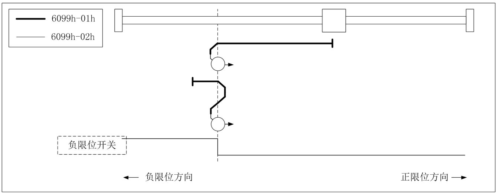

**方法 17 图示**（图中文字：负限位开关；负限位方向；正限位方向）

### 方法 18

如果未激活负限位开关，电机初始运动方向为正方向。
碰到负限位开关后，电机减速反向运转，原点检出位置为正限位开关状态变化的位置。

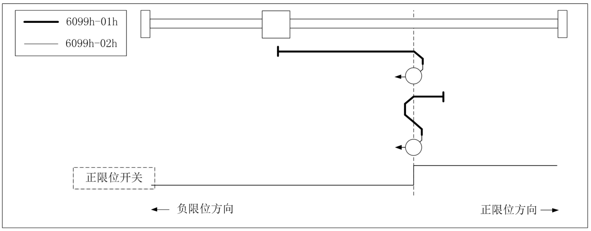

**方法 18 图示**（图中文字：正限位开关；负限位方向；正限位方向）

### 方法 19、20

基于启动时原点开关的状态以决定初始化运转方向。
原点检出位置是原点开关的状态变化后的负方向侧、或者负方向侧。

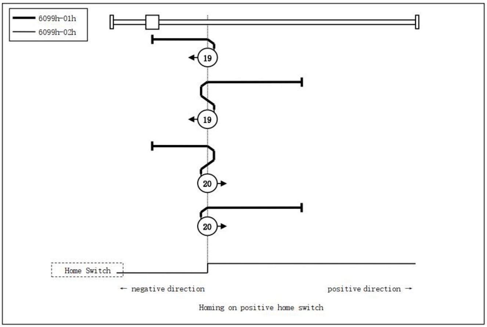

**方法 19、20 图示**

### 方法 21、22

此方法类似方法 19/20。
基于启动时原点开关的状态以决定初始化运转方向。
原点检出位置是原点开关的状态变化后的正方向侧、或者负方向侧。

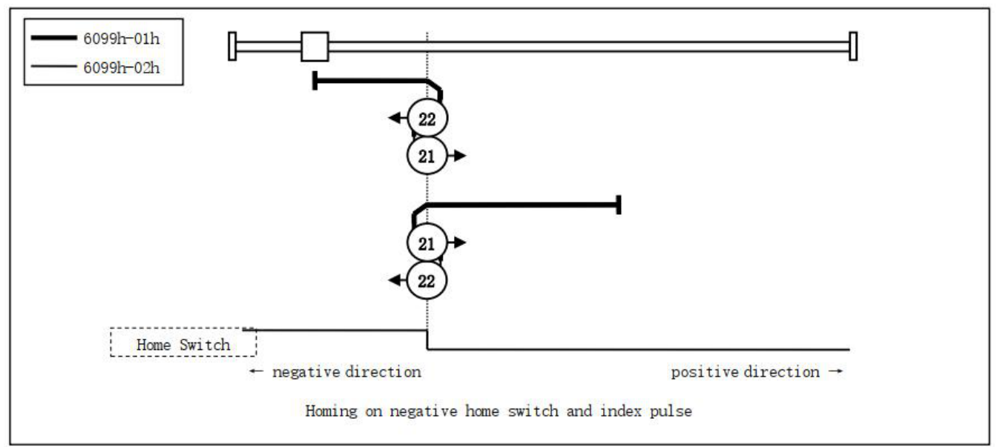

**方法 21、22 图示**

### 方法 23、24、25、26

此方法中，使用原点开关和正信号。
方法 23、24 的初始化动作方向是原点开关如果在开始时已经激活，则为负方向；
方法 25、26 的初始化动作方向是原点开关如果在开始时已经激活，则为正方向；
原点检出位置是原点开关状态变化的位置。（请参照下图）

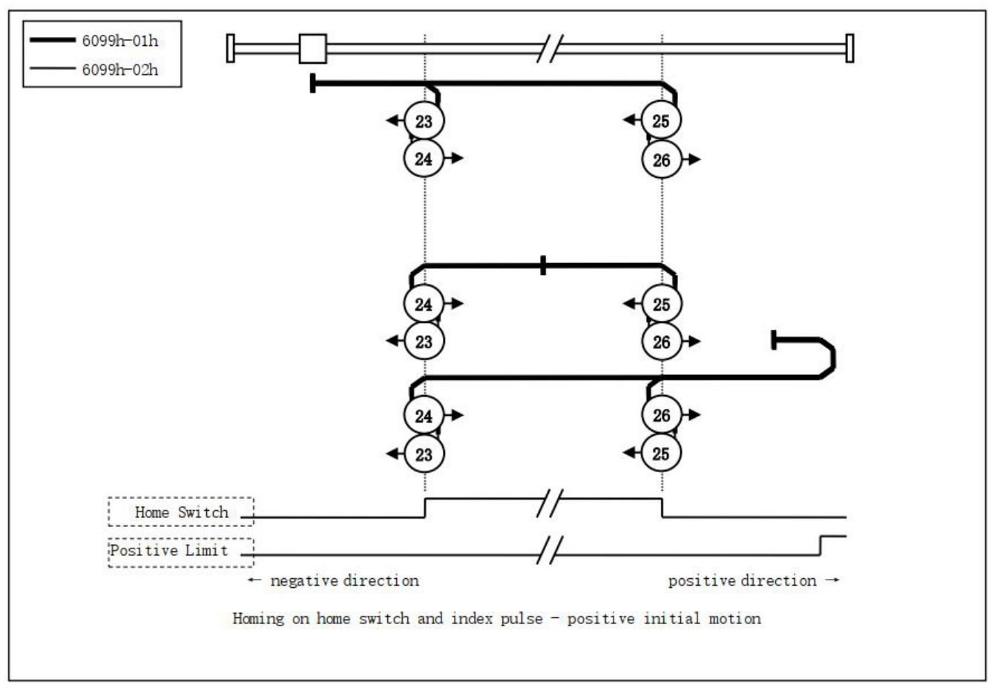

**方法 23、24、25、26 图示**

### 方法 27、28、29、30

此方法中，使用原点开关和负信号。
方法 27、28 的初始化动作方向是原点开关如果在开始时已经激活，则为正方向；
方法 29、30 的初始化动作方向是原点开关如果在开始时已经激活，则为负方向；
原点检出位置是原点开关状态变化的位置。（请参照下图）

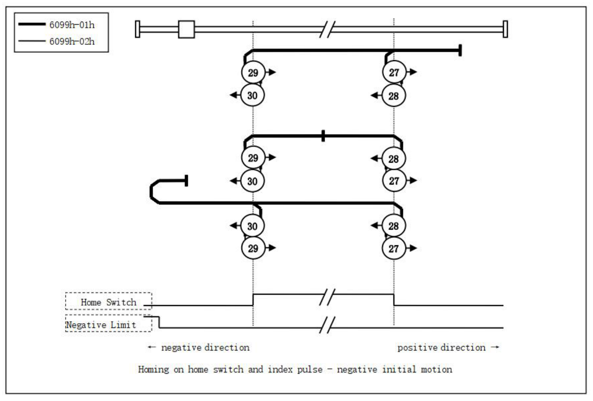

**方法 27、28、29、30 图示**

### 方法 33、34

此方法中，仅使用 Z 信号。
在图中所示方向动作后检出 Z 信号作为原点位置。

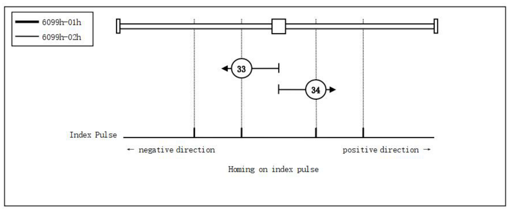

**方法 33、34 图示**

### 方法 35、37

以当前点作为原点。
35 和 37 功能相同，但基于 ETG 规格，推荐使用 37。

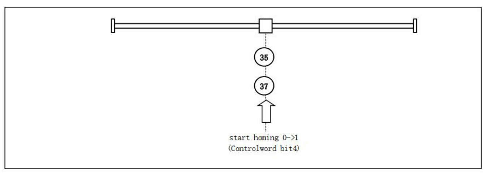

**方法 35、37 图示**

---

## 附录 2 端子配件选型

- MS11E 及之前的版本：成品线为**黑色壳子成品线**（电源线+电机绕组线）；
- MS13A 及之后的版本：成品线为**透明壳子成品线**，也可用于老版本驱动器上。

**1、黑色壳端子成品线料号：**

- 15cm 长电源线，雷赛料号：82200070
- 15cm 长电机绕组线，雷赛料号：82200069

| 图示 | 雷赛料号 | 描述 | 备注 |
| --- | --- | --- | --- |
| 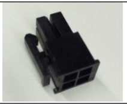 | 11600385 | 5557-2\*2P 公壳 | 对应电机绕组线 **每个驱动器要 1 个** |
| 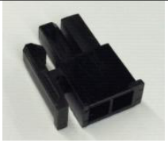 | 11600386 | 5557-2\*1P 公壳 | 对应电源线 **每个驱动器要 1 个** |
| 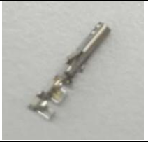 | 11600387 | 5557-T 母端 插针 | 一个料号对应一根插针， **每台驱动器要 6 个插针** |

**2、透明壳端子成品线料号：**

- 15cm 长电源线，雷赛料号：82200072
- 15cm 长电机绕组线，雷赛料号：82200071

| 图示 | 雷赛料号 | 描述 | 备注 |
| --- | --- | --- | --- |
| 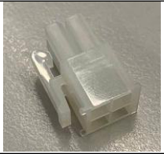 | 11600416 | MOLEX 2\*2P 公壳 | 对应电机绕组线 **每个驱动器要 1 个** |
|  | 11600415 | MOLEX 2\*1P 公壳 | 对应电源线 **每个驱动器要 1 个** |
| 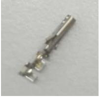 | 11600414 | 母端 金属插针 | 一个料号对应一根插针， **每个驱动器要 6 个插针** |

**10PIN 双排端子：**

| 图示 | 描述 | 料号 |
| --- | --- | --- |
| 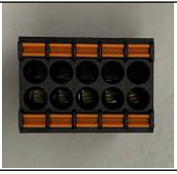 | **10 PIN 双排端子** | **11600058** |

**2、端子接线作业指导：**

为了保证连接安全可靠，线材规格建议采用线径约 0.3mm2~0.75mm2，线规在 AWG18~AWG22 之间，推荐 0.5mm2 以上。按照如下图示把线和针放置好，为了防止脱落，可以先用尖嘴钳初步压好。线缆剥线长度约 3mm，压线时注意 5557 针放置的位置和方向，避免压错位置或者方向放反。

专用的压线钳将线和针压好，注意：不要将图中描述部分压弯，同时注意压线的方向，不要反了。

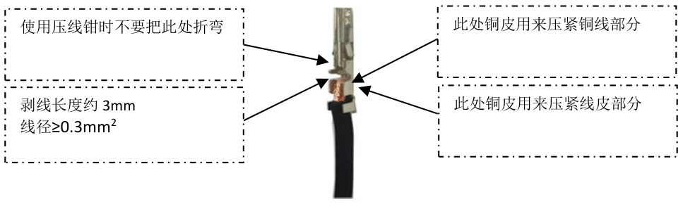

图中文字：使用压线钳时不要把此处折弯；此处铜皮用来压紧铜线部分；剥线长度约 3mm，线径≥0.3mm²；此处铜皮用来压紧线皮部分。

推荐使用压线钳作业，压线请注意，针放置的位置：压线钳的凹槽有高低位置，注意 5557 针的放置方向。

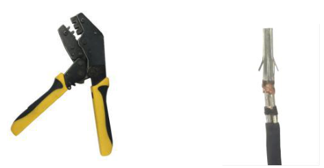

将压好的针安装到针座，安装时尖刺朝上，如下图所示：

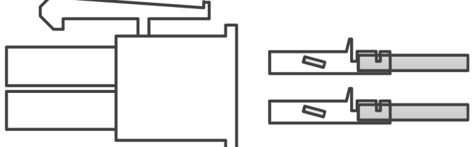

作业结果如下图所示：

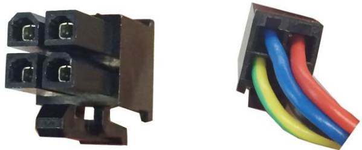

如果针与针座安装错误，可以用 ***5557 退针器*** 进行拆卸，或者用较小的镊子进行操作。（5557 退针器可在淘宝网购买）

---

## 附录 3 常见故障处理

### 一、组网时节点无法正常通讯，或节点报通讯错误

1. 如果是第一次使用该型号产品，检查 XML(设备描述文件)的版本是否正确。大部分主站支持扫描从站，建议以扫描的方式建立组态，可以避免或快速定位问题。
2. 部分主站区分物理连接的 IN 和 OUT，检查 IN 或 OUT 是否正确。
3. 检查主站与从站设置的 PDO 同步周期是否一致。
4. 不支持的 PDO 同步周期(Ethercat 通讯周期)，如 1.1ms、0.9ms 等，常见 PDO 同步周期为 250us/500us/1ms/2ms/4ms 等。咨询厂商是否支持你设定的同步周期。
5. 部分主站需要设置从站节点号，检查节点号拨的是否与组态设定一致且没有重复。大部分主站支持扫描从站，建议以扫描的方式建立组态，可以避免或快速定位问题。
6. 网线有问题或接触不好，更换网线。与可以正常连接的节点上的网线进行对调，可以快速定位问题。
7. 驱动器本身问题。通过更换或对调可以正常连接的驱动器，可以快速定位问题。

### 二、主站操作，从站不使能

1. 查看驱动器状态。正常情况下，驱动器 IN 和 OUT 网口 L/A 快速闪烁，run 灯常量，Err 灯熄灭。驱动器的 Power 灯常亮，ALM 灯熄灭。
2. PDO 配置或 PDO 映射错误。可以参考应用指导手册，按照说明正确配置 PDO 或 PDO 映射。
3. 查看监视对象字典 6040 的值是否为 16#F，监视字典 6040 的 bit0~bit3 是否为 0111。
4. 检查主站是否有警告或错误。清除主站报警或警告。
5. 主站显示使能完成，而电机没有使能。检查电机线接线是否接错或断线。检查驱动器电流参数是否设置正确。

### 三、定位运行便报错

1. 查看驱动器是否有报警。检查驱动器 ALM 灯和 EtherCat 网口 err 灯是否有闪烁，如有报警，查看驱动器使用手册，根据报警说明定位问题。
2. 操作模式不对。监视对象字典 6060 是否为 8(CSP 模式)。
3. PDO 配置异常。部分主站需要检查从站对象字典 6061 返回的值是否正确，如果 6061 没有配置，从站可能会不动或者主站报警。
4. 限位信号有效。检查限位信号状态与主站设定的逻辑是否一致。从站输入端口极性是否与使用的限位开关一致。限位开光是否损坏。限位开关与从站之间的接线是否正确。对象字典 60FD 的 bit 位与主站之间的映射错误。

### 四、电机不转

1. 上位机指令没有给到。查看对象字典 607A(指令位置)的值有没有变化，如没有变化，则客户需检查程序是否有异常，或者限位是否生效。
2. 限位信号生效。检查限位信号状态与主站设定的逻辑是否一致。从站输入端口极性是否与使用的限位开关一致。限位开光是否损坏。限位开关与从站之间的接线是否正确。对象字典 60FD 的 bit 位与主站之间的映射错误。
3. 上位机指令正常，电机不转。电流设置太小，电机没有力，带不动负载。负载太重，电机选型错误。速度设置太大，导致电机堵转。加减速度设置太大，导致电机堵转。电机本身异常。以上可能都可以通过让电机空载，且设定电机速度为 60rpm，加减速时间不小于 200ms 进行测试来定位问题。

### 五、回原点无法完成

1. 回原点方法错误。目前回原点可分为采用主站回原点方法，回原点时 6060 等于 8；采用从站回原点方法，回原点时 6060 等于 6；采用主从配合的回原点方法，回原点时 6060 等于 8 然后等 6。询问主站厂商，其主站回原点方式，并仔细查看所选择的回原点方法，回原点相关参数，方向是否正确及所选回原点方法中所涉及到的传感器信号是否正常。
2. 停在感应器上，一直处理 Busy 状态。由于定位未完成(详见第五点描述)，回原点无法继续往下进行导致。部分主站的回原点是主从站结合方式(松下和基恩士)，通过主站回原点方法找到原点位置后，切换至从站回原点方法进行坐标清零，此时需要修改 6060=6 至回原点模式，如 PDO 内无 6060 或没有配置或从站回原点方法配置错误，均会导致回原点无法完成。

### 六、运行中偶尔掉线

1. 总线是固定的那个驱动器掉线。网线问题。网线与驱动器接口接触不良。上一台驱动器的 OUT 口问题。驱动器本身问题。以上可能都可以通过对调驱动器或对调网线来定位问题。
2. 驱动器随机性掉线。干扰问题：网线质量差，建议使用超五类及以上，工业级网线，带双绞屏蔽。保证设备接地良好。电气柜布局时，强弱电注意分离。远离大功率强干扰器件，如等离子分生器，激光发生器，变频器等。

### 七、常见数码管报警显示

| 数码管显示 | 含义 | 603Fh 对象 | 解决措施 |
| --- | --- | --- | --- |
| E0e0 | 过流故障 | 0x2211 | 确保驱动器输出线未短路；确保电机未损坏 |
| E0e1 | 智能功率模块(IPM)过流 | 0x2212 | 确保驱动器输出线未短路；确保电机未损坏 |
| E0c0 | 直流母线电压过高 | 0x3211 | 减小驱动器供电电压；运动过程中报过压，可增大加减速时间 |
| E0a0 | 电流检测回路错误 | 0x3150 | 确保电机接线正确 |
| E0a1 | 电流检测回路错误 | 0x3151 | 确保电机接线正确 |
| E0d0 | 直流母线电压过低 | 0x3221 | 增大驱动器供电电压；牢固端子接线 |
| E100 | 电机过载 | 0x8311 | 减小负载；增大加减速时间；调整接线 |
| E1a0 | 指令超速故障 | 0x8402 | 调整指令速度大小；修改指令脉冲的输入频率；确保编码器接线正确； 对象字典 2056 写值 7，可屏蔽该故障； |
| E240 | EEPROM 参数保存错误 | 0x5530 | 恢复出厂设置；重新保存参数 |
| E5f0 | 缺相故障 | 0x7712 | 检查电机接线是否正确接线；确保电机无异常； |
| E816 | 预操作状态无效的邮箱配置 | 0x8216 | 检查主站配置 |
| E81a | 同步错误 | 0xFF02 | 同步模式错误 |
| E81b | 同步管理器 2 看门狗超时 | 0x821B | 网络断线，检查通讯连接；驱动器损坏 |
| E870 | 不支持的模式下使能 | 0x5201 | 设置了不支持的模式，并且做了使能操作；检查 6061 的值； |

---

## 手册版本说明

| 版本 | 更新时间 | 更新内容 | 更新者 |
| --- | --- | --- | --- |
| V1.00 | 20170302 | 初版 | PC/LYJ |
| V1.01 | 20170405 | 增加 EtherCAT 一致性认证标识 | PC/LYJ |
| V1.02 | 20170511 | 10B 版本下添加保存参数、修改默认参数、报警 | LYJ |
| V2.01 | 20180515 | 11A 版本下重新整理完善、增加部分功能说明 | LYJ |
| V2.02 | 20180808 | 对故障代码进行补充，对调试软件安装步骤进行更新 | LYJ |
| V2.03 | 20181010 | 调整部分串口调试相关内容 | LYJ |
| V2.04 | 20200220 | 新增一个驱动器尺寸图，修改网口定义部分的内容，更改对象字典列表结构，更改回零方法，更新软件版本说明，加入 OD 5012-04，加入 OD 5014、6080，加入对象字典总表；增加附录 4；修改故障章节部分内容；修改 4.2 节； | LYJ |
| V2.05 | 20200408 | 更改第四章 4.1 节内容； 更改 17、18 号回零方法； | LYJ |
| V2.06 | 20200423 | 修改滤波时间 2010-01 处的描述错误 | LYJ |
| V2.07 | 20200722 | 修改对象字典数据类型 | LYJ |

注：V2.05 版手册可适用于 MS10_、MS11_、MS13_版本的系列驱动器。产品若有更新，暂不做另行通知。

## 驱动器版本说明

驱动器版本查看铭牌，软件版本查看对象字典 3100h：01 和 3100h：03。

| DM3E-556/522 版本 | DM3E-870 版本 | 驱动软件版本 | 协议栈软件版本 |
| --- | --- | --- | --- |
| MS 10D | MS 10D | 110 | 204 |
| MS 10E | --- | 111 | 204 |
| MS 10F | MS 10E | 110 | 204 |
| MS 10H | MS 10H | 116 | 204 |
| MS 10I | MS 10I | 117 | 204 |
| MS 11B | MS 11B | 200 | 208 |
| MS13A | MS13A | 300 | 109 |
| MS13B | MS13B | 300 | 109 |
| MS13C | MS13C | 300 | 109 |
| MS13D | MS13D | 301 | 110 |
| MS13E | MS13E | 301 | 110 |
