# Driver động cơ bước dòng DM3E - Hướng dẫn sử dụng

（Phiên bản tài liệu: V2.07）

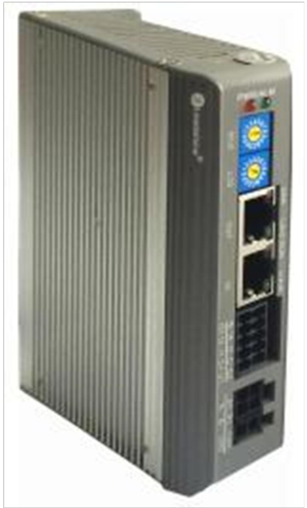

Sản phẩm DM3E đã đạt chứng nhận tương thích (conformance test) của phòng thí nghiệm ETC.

EtherCAT® là nhãn hiệu đã đăng ký và công nghệ được cấp bằng sáng chế, được cấp phép bởi Beckhoff Automation GmbH, Đức.

---

## Lời nói đầu

Trước tiên, xin cảm ơn quý khách đã mua và sử dụng driver động cơ bước dòng DM3E tích hợp bus EtherCAT của công ty Leadshine.

Dòng DM3E là dòng sản phẩm được Leadshine bổ sung tính năng truyền thông bus dựa trên nền tảng driver động cơ bước kỹ thuật số hiệu suất cao. Truyền thông bus sử dụng giao diện truyền thông bus EtherCAT, dựa trên công nghệ slave (trạm tớ) EtherCAT, thực hiện điều khiển thời gian thực và truyền dữ liệu thời gian thực cho hệ thống bước, giúp bus trường đạt tốc độ truyền 100Mb/s. Sản phẩm có các đặc điểm như dễ sử dụng, ổn định tin cậy, hiệu suất vượt trội. Hỗ trợ nhiều hệ thống điều khiển master (trạm chủ) bao gồm Leadshine, Beckhoff, Omron, Trio, Inovance, Advantech, ADLINK, Keyence, LNC, Zmotion, Kingstar, v.v., và được ứng dụng rộng rãi trong các ngành như quang điện (photovoltaic), dệt may, dân dụng, robot, thiết bị pin lithium, điện tử 3C.

Tài liệu này chỉ giới thiệu các thông số kỹ thuật và ứng dụng của driver động cơ bước loại bus EtherCAT. Nếu có bất kỳ thắc mắc nào về việc sử dụng bus EtherCAT, vui lòng liên hệ với nhân viên kỹ thuật của công ty chúng tôi để được hỗ trợ.

Cảm ơn quý khách đã lựa chọn sản phẩm driver động cơ bước dòng DM3E của Công ty Cổ phần Điều khiển Thông minh Leadshine Thâm Quyến, tài liệu này cung cấp các kiến thức cần thiết và các lưu ý khi sử dụng sản phẩm này.

> **Thao tác không đúng cách có thể gây ra sự cố ngoài ý muốn, trước khi sử dụng sản phẩm này, vui lòng đọc kỹ hướng dẫn sử dụng**

Do cải tiến sản phẩm, nội dung tài liệu có thể thay đổi mà không cần thông báo trước.
Nhà sản xuất chúng tôi sẽ không chịu bất kỳ trách nhiệm nào đối với bất kỳ sự thay đổi nào của người dùng đối với sản phẩm, và phiếu bảo hành của sản phẩm sẽ bị vô hiệu lực.

Khi đọc tài liệu này, xin đặc biệt lưu ý các cảnh báo sau:

> ⚠️ **Cảnh báo**
>
> - Chỉ nhân viên kỹ thuật mới được lắp đặt, chạy thử hoặc bảo trì sản phẩm này
> - Đảm bảo nối dây chính xác trước khi cấp điện thử nghiệm
> - Điện áp hoặc cực tính nguồn điện sai có thể làm hỏng driver hoặc gây ra các sự cố khác

---

## Chương 1 Tổng quan

### 1.1 Giới thiệu sản phẩm

Driver động cơ bước dòng DM3E là dòng sản phẩm driver động cơ bước dạng bus toàn phần kỹ thuật số do Công ty Cổ phần Điều khiển Thông minh Leadshine Thâm Quyến tự nghiên cứu và phát triển, dựa trên giao thức ETG CoE + CANopen DSP402, có thể kết nối liền mạch với các bộ điều khiển/driver hỗ trợ giao thức tiêu chuẩn này.

So với động cơ bước loại xung, các sản phẩm bước dòng DM3E có các ưu điểm sau:

- **Giảm nhiễu truyền thông, kéo dài khoảng cách truyền thông**
  Ở phương thức truyền thông xung, do cáp truyền tín hiệu xung rất dễ bị nhiễu điện từ làm giảm độ tin cậy truyền thông. Trong khi đó, truyền thông bus EtherCAT nhờ giao thức có tích hợp cơ chế phát hiện, giới hạn và xử lý lỗi nên có thể nâng cao rõ rệt độ tin cậy truyền thông, giảm thiểu ảnh hưởng của nhiễu đối với lệnh và kéo dài khoảng cách truyền thông.
- **Nâng cao hiệu suất chuyển động**
  Quy hoạch quỹ đạo ở chế độ đồng bộ phi chu kỳ của động cơ bước loại truyền thông bus được thực hiện bên trong driver, bộ điều khiển chỉ cần truyền các thông tin như vị trí mục tiêu, vận tốc, gia tốc đến driver. Do đó, driver có thể dự đoán trước các tham số chuyển động ở thời điểm tiếp theo trong nội bộ, từ đó áp dụng các biện pháp bù tiến (feedforward) để nâng cao hiệu suất chuyển động.
- **Giảm độ phức tạp đấu dây của hệ thống**
  Ở phương thức truyền thông xung, bộ điều khiển cần kết nối truyền thông với từng driver qua cáp xung, thường dẫn đến dây cáp trong máy móc dày đặc và đấu nối phức tạp. Ở phương thức truyền thông bus EtherCAT, bộ điều khiển chỉ cần kết nối cáp với một driver trong số đó, các driver còn lại chỉ cần kết nối dạng chuỗi (daisy chain) với driver đó.
- **Giảm yêu cầu về số lượng cổng của bộ điều khiển, từ đó giảm chi phí**
  Nhiều driver động cơ bước dạng bus chỉ cần một cổng duy nhất để kết nối với bộ điều khiển chuyển động (bộ điều khiển chuyển động hoặc card điều khiển chuyển động), không cần mô-đun xung, cũng không cần tăng số lượng card điều khiển do số lượng driver nhiều, từ đó không cần bận tâm về giới hạn số lượng khe cắm của máy tính. Có thể tiết kiệm chi phí cho mô-đun xung, card điều khiển và máy tính công nghiệp.

### 1.2 Kiểm tra khi nhận hàng

1. Sau khi nhận hàng, phải tiến hành các kiểm tra sau:
   - （1）Hộp đóng gói có nguyên vẹn không, hàng hóa có bị hư hại do vận chuyển không?
   - （2）Đối chiếu nhãn mác driver động cơ bước, hàng hóa nhận được có đúng là hàng đã đặt không?
   - （3）Đối chiếu phiếu đóng gói, phụ kiện có đầy đủ không?
2. Danh mục phụ kiện
   Phụ kiện tiêu chuẩn của driver động cơ bước dòng DM3E bao gồm:
   - （1）Tài liệu hướng dẫn vắn tắt 1 trang
   - （2）Dây cáp thành phẩm nguồn 1 sợi
   - （3）Dây cáp thành phẩm cuộn dây động cơ 1 sợi
   - （4）Đầu nối dạng nhấn 10 chân (10PIN) cho tín hiệu điều khiển 1 cái

> ⚠️ **Chú ý**
>
> - Hệ thống bước bị hư hại hoặc thiếu linh kiện tuyệt đối không được tiến hành lắp đặt.
> - Driver động cơ bước phải được sử dụng đồng bộ với động cơ bước có hiệu suất phù hợp.
> - Nếu có bất kỳ thắc mắc nào sau khi nhận hàng, vui lòng liên hệ với nhà cung cấp hoặc công ty chúng tôi.

3. Ý nghĩa mã model
   Ý nghĩa mã model driver động cơ bước dòng DM3E, lấy DM3E-556 làm ví dụ minh họa.

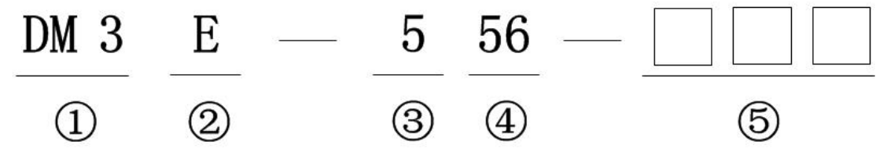

**Bảng 1.1 Ý nghĩa mã model driver động cơ bước dòng DM3E**

| STT | Ý nghĩa | Giải thích |
| --- | --- | --- |
| ① | Tên dòng sản phẩm | DM3: Driver kỹ thuật số thế hệ thứ 3 của Leadshine |
| ② | Tên dòng sản phẩm | E: Giao thức truyền thông là EtherCAT |
| ③ | Điện áp tối đa | 5: Nhân với 10, biểu thị điện áp đầu vào cao nhất là 50V |
| ④ | Dòng điện tối đa | 56: Chia cho 10, biểu thị dòng điện đỉnh đầu ra tối đa là 5.6A |
| ⑤ | Model đặt riêng | Dùng cho mục đích đặc biệt |

### 1.3 Thông số kỹ thuật và ngoại quan sản phẩm

**Bảng 1.2 Bảng thông số kỹ thuật driver dòng DM3E**

| Tham số | | DM3E-522 | DM3E-556 | DM3E-870 |
| --- | --- | --- | --- | --- |
| Dòng điện đầu ra (đỉnh) | | 0.5~2.2A | 2.1~5.6A | 2.1~7.0A |
| Động cơ tương thích | | Frame 20, 28, 35, 42 | Frame 57, 60 | Frame 86（*） |
| Điện áp nguồn | | 24~48Vdc | 24~48Vdc | 24~70Vdc |
| Kích thước (H\*W\*L mm) | | 118\*90.4\*34 | 118\*90.4\*34 | 118\*90.4\*34 |
| Trọng lượng (kg) | | 0.57 | 0.57 | 0.57 |
| Tín hiệu đầu vào | | Đầu vào gốc (home), giới hạn hành trình (limit) chiều dương, giới hạn hành trình chiều âm, dừng khẩn cấp, đầu dò (probe), tùy chỉnh | ← | ← |
| Tín hiệu đầu ra | | Đầu ra phanh (brake), đầu ra cảnh báo (alarm), đầu ra đạt vị trí | ← | ← |
| Chức năng cảnh báo (alarm) | | Quá dòng/quá áp, giới hạn hành trình (limit), mất pha, v.v. | ← | ← |
| Môi trường sử dụng | Vị trí | Không được đặt cạnh các thiết bị phát nhiệt khác, cần tránh bụi bẩn, sương dầu, khí ăn mòn, độ ẩm quá cao và nơi rung lắc mạnh, cấm khí gas dễ cháy và bụi dẫn điện; | ← | ← |
| Môi trường sử dụng | Nhiệt độ làm việc | 0~50℃ | ← | ← |
| Môi trường sử dụng | Nhiệt độ bảo quản | -20℃ ~ 65℃ | ← | ← |
| Môi trường sử dụng | Độ ẩm | 40~90%RH | ← | ← |
| Môi trường sử dụng | Rung động | 10~55Hz/0.15mm | ← | ← |
| Môi trường sử dụng | Lắp đặt | Lắp đặt thẳng đứng hoặc lắp đặt nằm ngang | ← | ← |

（*）Ghi chú: Nếu quý khách kết hợp với động cơ frame 86 từ 4.5 Nm trở lên, khuyến nghị sử dụng model driver DM3-EC882AC.

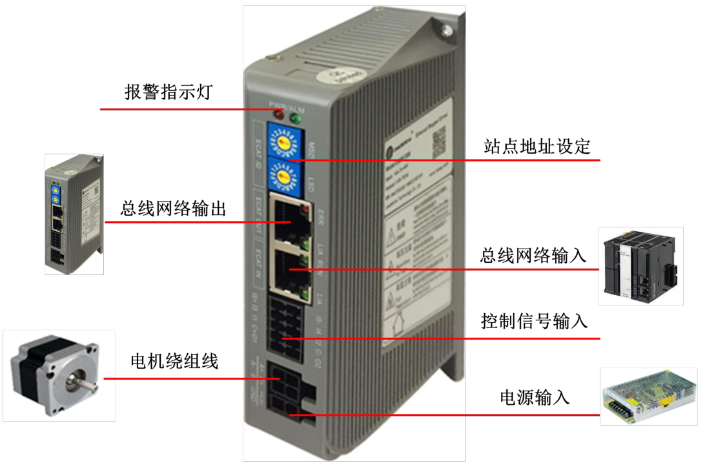

**Hình 1-3 Ngoại quan sản phẩm driver**

Chữ trong hình: Đèn chỉ báo cảnh báo (alarm); Cài đặt địa chỉ trạm; Đầu ra mạng bus; Đầu vào mạng bus; Đầu vào tín hiệu điều khiển; Dây cuộn dây động cơ; Đầu vào nguồn điện.

---

## Chương 2 Lắp đặt

### 2.1 Môi trường lưu trữ và lắp đặt

**Bảng 1 Môi trường lưu trữ và lắp đặt của driver dòng DM3E**

| Hạng mục | | Yêu cầu |
| --- | --- | --- |
| Nhiệt độ bảo quản | | -20℃ ~ 65℃ |
| Cấp độ bảo vệ | | IP20 |
| Môi trường sử dụng | Vị trí | Không được đặt cạnh các thiết bị phát nhiệt khác, cần tránh bụi bẩn, sương dầu, khí ăn mòn, độ ẩm quá cao và nơi rung lắc mạnh, cấm khí gas dễ cháy và bụi dẫn điện; |
| Môi trường sử dụng | Nhiệt độ | 0~50℃ |
| Môi trường sử dụng | Độ ẩm | 40~90%RH |
| Môi trường sử dụng | Rung động | 10~55Hz/0.15mm |

### 2.2 Lắp đặt driver

> ⚠️ **Chú ý**
>
> - Driver động cơ bước phải được lắp đặt bên trong tủ điện có khả năng bảo vệ tốt.
> - Driver động cơ bước phải được lắp đặt theo đúng hướng và khoảng cách quy định, đồng thời đảm bảo điều kiện tản nhiệt tốt.
> - Không được lắp đặt trên hoặc gần các vật dễ cháy để phòng ngừa hỏa hoạn.

#### 2.2.1 Kích thước driver

**Các phiên bản driver từ MS13A trở xuống, lỗ lắp đặt đều là lỗ tròn:**

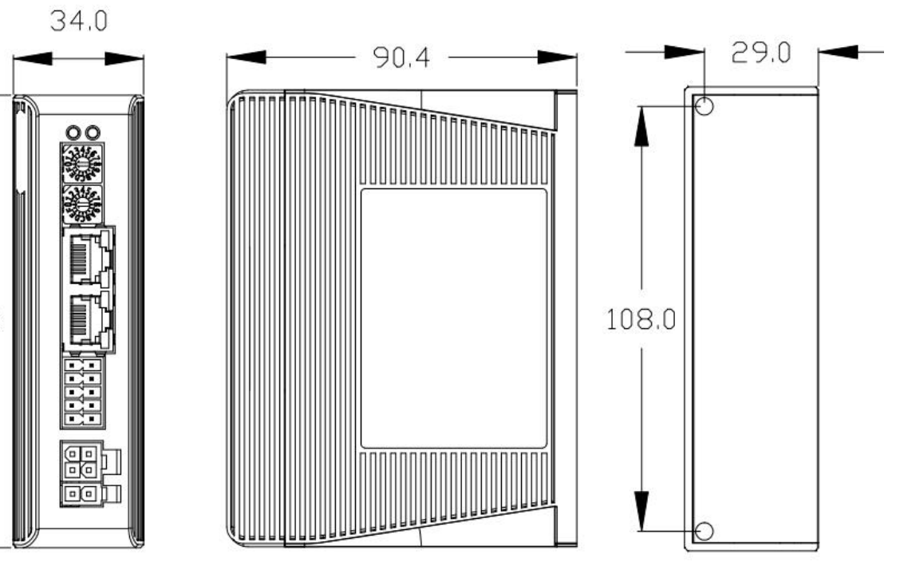

**Hình 2-1 Bản vẽ kích thước lắp đặt DM3E-522/556/870 (đơn vị: mm)**

※ Khi thiết kế kích thước lắp đặt, cần chú ý tính toán đến kích thước đầu nối và việc đi dây!

**Các phiên bản driver từ MS13A trở lên, lỗ lắp đặt đều là lỗ chữ U:**

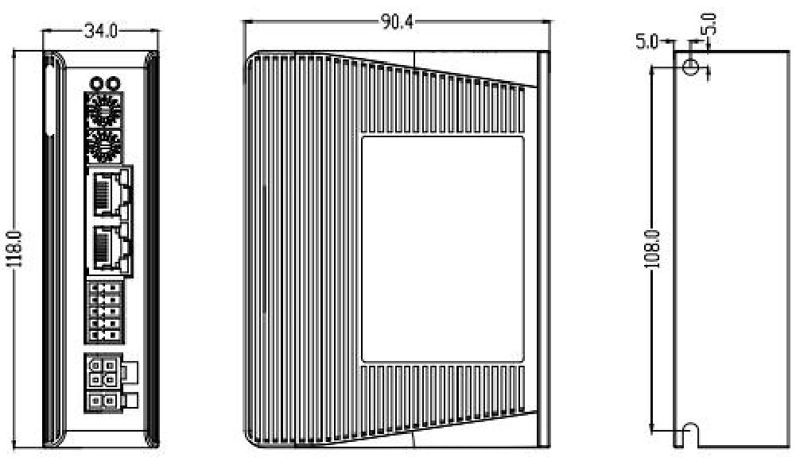

**Hình 2-2 Bản vẽ kích thước lắp đặt DM3E-522/556/870 (đơn vị: mm)**

※ Khi thiết kế kích thước lắp đặt, cần chú ý tính toán đến kích thước đầu nối và việc đi dây!

#### 2.2.2 Phương pháp lắp đặt

Người dùng có thể áp dụng phương pháp lắp đặt kiểu tấm đế hoặc lắp đặt kiểu mặt bảng, hướng lắp đặt vuông góc với bề mặt lắp đặt. Để đảm bảo điều kiện tản nhiệt tốt, trong lắp đặt thực tế phải cố gắng dự phòng khoảng cách lắp đặt lớn nhất có thể, giữa driver với driver phải chừa ra khoảng cách tối thiểu 30mm, đồng thời duy trì điều kiện thông gió tản nhiệt tốt bên trong tủ điện.

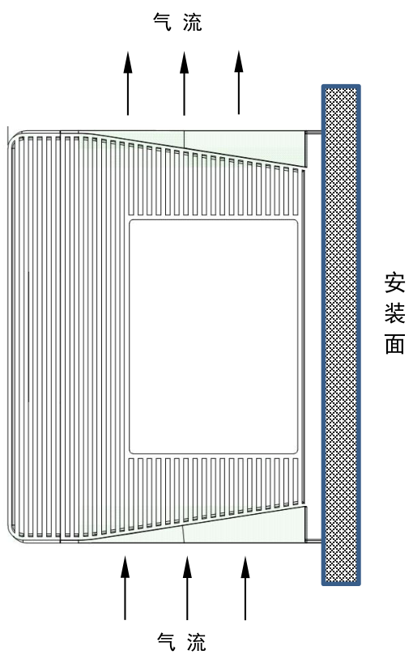

**Hình 2-3 Sơ đồ minh họa phương pháp lắp đặt driver**

Chữ trong hình: Luồng khí; Bề mặt lắp đặt.

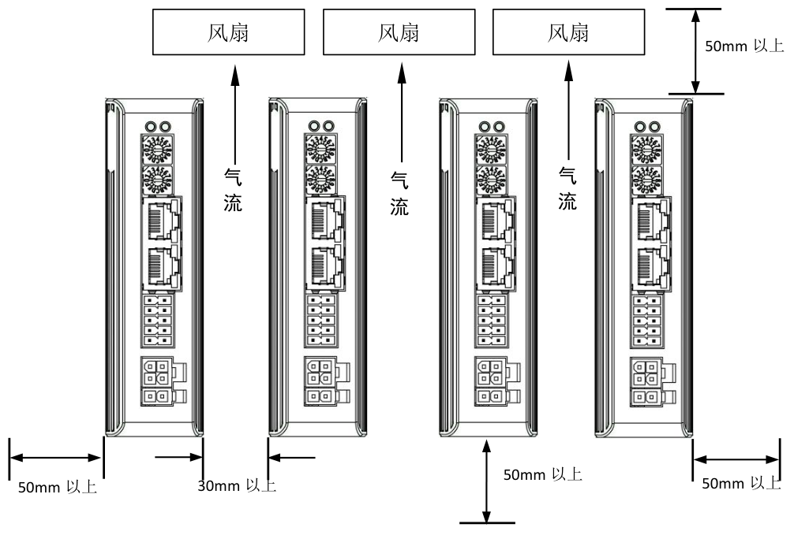

**Hình 2-4 Sơ đồ minh họa khoảng cách lắp đặt driver**

Chữ trong hình: Quạt; Luồng khí; Trên 50mm; Trên 30mm.

---

## Chương 3 Thông số kỹ thuật giao diện

> ⚠️ **Cảnh báo**
>
> - Nhân viên tham gia đấu dây hoặc kiểm tra đều phải có đầy đủ năng lực để thực hiện công việc này.
> - Việc đấu dây và kiểm tra driver phải được tiến hành sau khi ngắt nguồn điện ít nhất 5 phút để phòng ngừa điện giật.

> ⚠️ **Cẩn trọng**
>
> - Phải đấu dây đúng theo điện áp và cực tính của đầu nối để phòng tránh hư hỏng thiết bị hoặc chấn thương cho con người. Phiên bản DC của driver tuyệt đối không được đấu ngược nguồn điện.
> - Driver và động cơ bước phải được nối đất tiếp địa tốt.
> - Cáp và dây dẫn phải được cố định chắc chắn, đồng thời tránh đặt gần bộ tản nhiệt của driver và động cơ để tránh làm giảm hiệu suất cách điện do bị phát nhiệt.
> - Bên trong driver điện áp cao có tụ điện hóa dung lượng lớn, ngay cả sau khi ngắt điện vẫn duy trì điện áp cao, trong vòng 5 phút sau khi ngắt điện tuyệt đối không chạm vào driver và động cơ.

### 3.1 Sơ đồ đấu dây động cơ bước dạng bus

**Phương pháp đấu dây cho DM3E-522/556/870 là như nhau, hiển thị như dưới đây:**

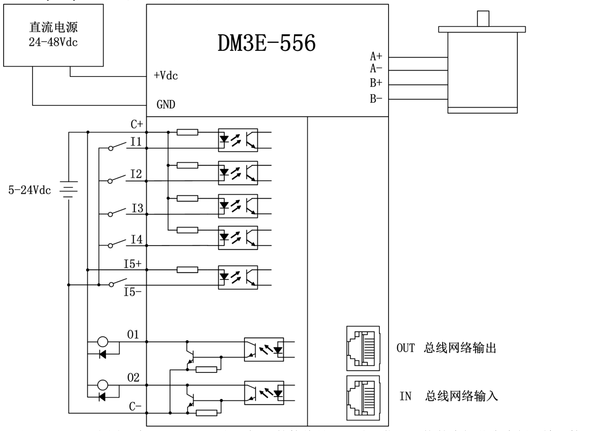

Chữ trong hình: Nguồn điện một chiều 24-48Vdc; OUT Đầu ra mạng bus; IN Đầu vào mạng bus.

Ghi chú: 1）Việc đấu dây các cổng đầu nối truyền thông EtherCAT trong hình trên lấy ví dụ khi driver nằm ở node trung gian của mạng, đầu vào nối vào cổng IN, đầu ra tới thiết bị tiếp theo nối vào cổng OUT.

### 3.2 Thuyết minh về đầu nối và công tắc xoay (rotary switch)

#### 3.2.1 Định nghĩa đầu nối

| Số hiệu đầu nối | Mô tả |
| --- | --- |
| CN1 | Đầu nối nguồn |
| CN2 | Đầu nối động cơ |
| CN3 | Đầu nối tín hiệu điều khiển |
| CN4 | Đầu nối giao diện bus EtherCAT |
| SW1 | Công tắc xoay (rotary switch), cùng SW2 thiết lập địa chỉ truyền thông |
| SW2 | Công tắc xoay (rotary switch), cùng SW1 thiết lập địa chỉ truyền thông |
| PWR | Đèn chỉ báo nguồn, sáng liên tục khi cấp nguồn, tắt khi ngắt nguồn |
| ALM | Đèn chỉ báo cảnh báo (alarm), nhấp nháy khi xảy ra sự cố, số lần nhấp nháy biểu thị các loại sự cố khác nhau, xem mục 5.1 |

#### 3.2.2 Đầu nối nguồn

| Số cổng | Sơ đồ | Số chân | Tín hiệu | Tên gọi |
| --- | --- | --- | --- | --- |
| CN1 | 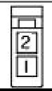 | 2 | VDC | Cực dương nguồn đầu vào |
| | | 1 | GND | Mass nguồn |

Lưu ý: Tiết diện dây ≥ 0,3 mm² (AWG15-22). Khuyến nghị cấp nguồn qua bộ lọc nhiễu (noise filter) để nâng cao khả năng chống nhiễu.

#### 3.2.3 Đầu nối cuộn dây động cơ

| Số cổng | Sơ đồ | Số chân | Tín hiệu | Tên gọi |
| --- | --- | --- | --- | --- |
| CN2 | 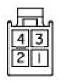 | 4 | A+ | Cực dương pha A cuộn dây động cơ |
| | | 3 | B+ | Cực dương pha B cuộn dây động cơ |
| | | 2 | A- | Cực âm pha A cuộn dây động cơ |
| | | 1 | B- | Cực âm pha B cuộn dây động cơ |

Lưu ý: Tiết diện dây ≥ 0,3 mm² (AWG15-22).

#### 3.2.4 Đầu nối tín hiệu điều khiển

| Số cổng | Sơ đồ | Số chân | Tín hiệu | Tên gọi |
| --- | --- | --- | --- | --- |
| CN3 | 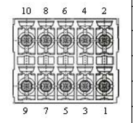 | 1 | OUT1 | Tín hiệu đầu ra số 1, kiểu single-ended, chung COM-, đầu ra OC, kéo lên tối đa 24VDC, 50mA, mặc định là đầu ra cảnh báo (alarm) |
| | | 2 | OUT2 | Tín hiệu đầu ra số 2, kiểu single-ended, chung COM-, đầu ra OC, kéo lên tối đa 24VDC, 50mA, mặc định là đầu ra phanh (brake) |
| | | 3 | COM+ | Cực dương nguồn chung cấp cho tín hiệu điều khiển đầu vào bên ngoài, 5~24Vdc |
| | | 4 | COM- | Mass chung cho tín hiệu đầu ra số |
| | | 5 | IN1 | Tín hiệu đầu vào số 1, kiểu single-ended, 5～24VDC, mặc định là đầu vào đầu dò (probe) Probe1 |
| | | 6 | IN2 | Tín hiệu đầu vào số 2, kiểu single-ended, 5～24VDC, mặc định là đầu vào gốc (home) Home |
| | | 7 | IN3 | Tín hiệu đầu vào số 3, kiểu single-ended, 5～24VDC, mặc định là đầu vào giới hạn hành trình (limit) thuận POT |
| | | 8 | IN4 | Tín hiệu đầu vào số 4, kiểu single-ended, 5～24VDC, mặc định là đầu vào giới hạn hành trình (limit) nghịch NOT |
| | | 9 | IN5+ | Cực dương tín hiệu đầu vào số 5, kiểu vi sai (differential), 5～24VDC, mặc định là đầu vào tùy chỉnh |
| | | 10 | IN5- | Cực âm tín hiệu đầu vào số 5, kiểu vi sai (differential), 5～24VDC, mặc định là đầu vào tùy chỉnh |

Lưu ý: Tiết diện dây ≥ 0,12 mm² (AWG24-26). Khuyến nghị sử dụng cáp xoắn đôi chống nhiễu, chiều dài cáp càng ngắn càng tốt, khuyến nghị không vượt quá 3 mét. Cố gắng đi dây cách xa đường dây động lực để chống nhiễu xâm nhập. Vui lòng lắp linh kiện triệt xung sét/sụt áp (surge absorber) cho các phần tử cảm kháng (như cuộn dây) trong mạch liên quan; cuộn dây DC mắc song song ngược cực diode triệt xung (flyback diode), cuộn dây AC mắc song song mạch dập RC.

**Cấu hình chức năng tín hiệu IO và giải thích thông số, xem chi tiết tại Chương 4.2.** Tín hiệu đầu vào có hai phương thức: single-ended và vi sai, do nguồn ngoài cung cấp, DC 5～24V, dòng điện ≥ 100mA; nếu đấu ngược cực tính nguồn sẽ khiến driver động cơ bước không hoạt động được. Đấu dây và cài đặt như hình dưới đây:

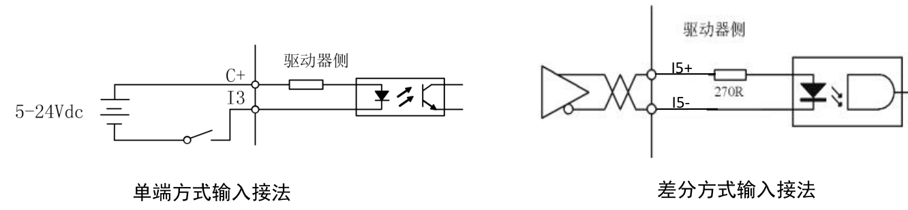

**Hình 3-2 Giao diện đầu vào IO**

Chữ trong hình: Phía driver; Cách đấu nối đầu vào kiểu single-ended; Cách đấu nối đầu vào kiểu vi sai.

Đấu dây và cài đặt tín hiệu đầu ra như dưới đây:

（1）Nguồn điện bên ngoài do người dùng tự cung cấp, tuy nhiên bắt buộc phải lưu ý: nếu cực tính nguồn điện bị đấu ngược sẽ làm hỏng driver động cơ bước.

（2）Đầu ra ở dạng collector hở (OC), dòng điện tối đa 50mA, điện áp nguồn ngoài tối đa 25V. Do đó, tải của tín hiệu đầu ra switching (ON/OFF) bắt buộc phải đáp ứng yêu cầu giới hạn này. Nếu vượt quá giới hạn định mức hoặc đầu ra được nối trực tiếp vào nguồn điện sẽ làm hỏng driver động cơ bước.

（3）Nếu tải là các tải cảm kháng như rơ le, bắt buộc phải mắc song song ngược cực một diode triệt xung ở hai đầu tải. Nếu diode triệt xung bị đấu ngược cực sẽ làm hỏng driver động cơ bước.

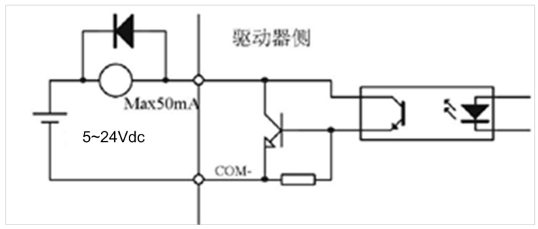

**Hình 3-3 Giao diện đầu ra IO**

Chữ trong hình: Phía driver.

#### 3.2.5 Giao diện bus EtherCAT

| Số cổng | Sơ đồ | Số chân | Tín hiệu | Tên gọi |
| --- | --- | --- | --- | --- |
| CN3 (nguyên văn như vậy, tức CN4) | 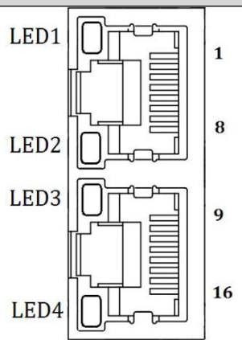 | 1，9 | E_TX+ | Cực dương truyền dữ liệu EtherCAT |
| | | 2，10 | E_TX- | Cực âm truyền dữ liệu EtherCAT |
| | | 3，11 | E_RX+ | Cực dương nhận dữ liệu EtherCAT |
| | | 4，12 | / | / |
| | | 5，13 | / | / |
| | | 6，14 | E_RX- | Cực âm nhận dữ liệu EtherCAT |
| | | 7，15 | / | / |
| | | 8，16 | / | / |
| | | Vỏ đầu nối | PE | Nối đất chống nhiễu (Shield GND) |

Ghi chú:
- ① LED1 là đèn trạng thái “Link/Activity IN”, màu xanh lục
- ② LED3 là đèn trạng thái “Link/Activity OUT”, màu xanh lục
- ③ LED2 là đèn trạng thái “RUN”, màu xanh lục
- ④ LED4 là đèn trạng thái “ERR”, màu đỏ

Lưu ý: Chiều dài cáp giữa các nút mạng trên bus EtherCAT khuyến nghị không vượt quá 100 mét.
**Khuyến nghị sử dụng cáp mạng Fast Ethernet Cat5e có hai lớp chống nhiễu hoặc cáp tốt hơn.**

**Bảng 3-1 Bảng giải thích định nghĩa đèn cổng mạng RJ45**

| Tên gọi | Màu sắc | Trạng thái | Mô tả |
| --- | --- | --- | --- |
| RUN | Xanh lục | Tắt | Trạng thái khởi tạo (Init) |
| | | Nhấp nháy | Trạng thái tiền vận hành (Pre-Operational) |
| | | Nhấp nháy đơn | Trạng thái vận hành an toàn (Safe-Operational) |
| | | Bật | Trạng thái vận hành (Operational) |
| ERR | Đỏ | Tắt | Không có lỗi |
| | | Nhấp nháy chậm | Lỗi cài đặt truyền thông |
| | | Nhấp nháy đơn | Lỗi đồng bộ hoặc lỗi dữ liệu truyền thông |
| | | Nhấp nháy đôi | Quá thời gian chờ watchdog yêu cầu |
| | | Nhấp nháy nhanh | Lỗi khởi động (Boot) |
| | | Bật | Quá thời gian chờ watchdog bus nội bộ |
| L/A IN | Xanh lục | Tắt | Chưa thiết lập liên kết tầng vật lý |
| | | Bật | Đã thiết lập liên kết tầng vật lý |
| | | Nhấp nháy | Đang trao đổi dữ liệu sau khi thiết lập liên kết |
| L/A OUT | Xanh lục | Tắt | Chưa thiết lập liên kết tầng vật lý |
| | | Bật | Đã thiết lập liên kết tầng vật lý |
| | | Nhấp nháy | Đang trao đổi dữ liệu sau khi thiết lập liên kết |

**Yêu cầu tầng vật lý và kết nối cáp EtherCAT**

| Thông số điện | Cáp Type A (cố định) | Cáp Type B (chuyển động) |
| --- | --- | --- |
| Trở kháng đặc tính/định mức (dung sai) | 100Ω (15Ω) (IEC61156-5) | ← |
| Balanced or Unbalanced | Balanced | ← |
| Điện trở mạch vòng | ≦115Ω/Km | ← |
| Điện trở cách điện | ≧500MΩ/Km | ← |
| Trở kháng truyền dẫn | ≦50mΩ/m (10MHZ) | ← |
| Độ trễ truyền dẫn tối đa | ≦550ns/100m | ← |
| Độ lệch trễ | ≦20ns/100m | ← |
| Lớp chống nhiễu | S/FTQ (Lớp bện xoắn ngoài/lớp trong) | ← |

Trường hợp cố định có thể sử dụng cáp lõi đặc đơn (solid), trường hợp chuyển động khuyến nghị sử dụng cáp nhiều sợi (stranded).

Chữ trong hình: Trường hợp cố định; Trường hợp chuyển động.

**Quy cách vật lý của cáp truyền thông:**

| Thông số vật lý | Cáp Type A (cố định) | Cáp Type B (chuyển động) |
| --- | --- | --- |
| Màu dây dẫn | Trắng (3); Vàng (1); Lam (2); Cam (6) | ← |
| Đường kính cáp đơn | 6.5mm (+/-0.2mm) | ← |
| Tiết diện dây dẫn | AWG 22/1 (Lõi đơn đặc) | AWG 22/7 (7x0.254mm) |
| Đường kính dây dẫn | 0.64mm (+/-0.1mm) | ← |
| Nhiệt độ | ≦60° | ← |

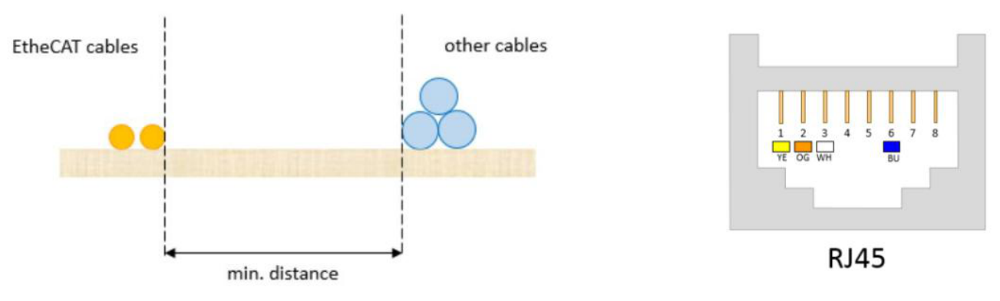

**Yêu cầu kết nối tầng vật lý EtherCAT:**

- Chiều dài kết nối kênh truyền thông càng ngắn càng tốt;
- Tổng chiều dài truyền thông không vượt quá 100 mét (tổng chiều dài của dây dẫn và đầu nối);
- Tổng chiều dài tất cả các đầu nối không vượt quá 5 mét;
- Số lượng đầu nối <= 6 (đầu nối dài) hoặc 4 (đầu nối chuyển tiếp), và chỉ được đặt ở các điểm đầu/cuối;
- Không khuyến nghị sử dụng đầu nối ghép (do gây nhiễu và suy hao tín hiệu);
- Chiều dài cáp lắp đặt cố định tối đa là 90 mét, tối đa hai đầu nối dài 5 mét;
- Trong trường hợp không có bất kỳ biện pháp cách ly nào, phải đảm bảo khoảng cách tối thiểu giữa cáp EtherCAT và cáp nguồn động lực là 10mm;
- Khuyến nghị sử dụng cáp mạng Fast Ethernet Cat5e có hai lớp chống nhiễu hoặc cáp tốt hơn.

#### 3.2.6 Địa chỉ trạm EtherCAT

Dòng DM3E hỗ trợ ba phương pháp cài đặt địa chỉ trạm tớ (slave): công tắc xoay (rotary switch) cài đặt địa chỉ trạm, từ điển đối tượng (Object Dictionary) 2150 cài đặt bí danh trạm (station alias) và ESC cài đặt bí danh trạm, được lựa chọn thông qua từ điển đối tượng 2151.

| 2151h | 2150 | MSD | LSD | Địa chỉ trạm |
| --- | --- | --- | --- | --- |
| 0 | Hiển thị | 0~F | 0~F | Tổ hợp 2 công tắc xoay cài đặt dải 0~255 làm giá trị địa chỉ nút |
| 1 | Giá trị cài đặt | - | - | Giá trị cài đặt trong từ điển đối tượng 2150 làm giá trị địa chỉ nút |
| 2 | - | 0 | 0 | Master (trạm chủ) cấu hình bí danh trạm vào địa chỉ từ 0x0004 của EEPROM trên ESC |

Giá trị xuất xưởng mặc định của từ điển đối tượng 2151 trên dòng DM3E là 0. Khi đó, giá trị tổ hợp cài đặt của 2 công tắc xoay 16 vị trí (với MSD là hàng cao và LSD là hàng thấp) được dùng làm địa chỉ nút, phạm vi địa chỉ nút là 0~255, sau khi cài đặt cần khởi động lại nguồn mới có hiệu lực. Ví dụ: khi MSD=1, LSD=4, giá trị địa chỉ trạm được cài đặt là 20.

Trong sử dụng hàng ngày, phần lớn các trạm chủ (master) đều tự động phân bổ địa chỉ nút theo vị trí kết nối vật lý của trạm tớ (slave), do đó driver không cần phải xoay cài đặt địa chỉ. Chỉ một số rất ít trạm chủ, ví dụ như PLC Omron, mới yêu cầu trạm tớ phải xoay công tắc để cài đặt địa chỉ nút.

---

## Chương 4 Giải thích và cài đặt thông số

### 4.1 Bảng tổng hợp từ điển đối tượng (Object Dictionary)

| Đối tượng từ điển (Object Dictionary) | Chỉ mục phụ (sub-index) | Tên | Thuộc tính | Kiểu | Phạm vi | Giá trị mặc định | Đơn vị | Ghi chú |
| --- | --- | --- | --- | --- | --- | --- | --- | --- |
| 0x1000 | 00 | Loại thiết bị | R | UDINT | 0~32767 | 0x40912 | - | Nhất quán với quy tắc CIA |
| 0x1001 | 00 | Thanh ghi lỗi | R | USINT | 0~255 | 0 | -- | Định nghĩa bit, xem 5.1 |
| 0x1008 | 00 | Tên thiết bị | R | STRING | 0~32767 | DM3E-X | - | X biểu thị model cụ thể, ví dụ 556 |
| 0x1009 | 00 | Phiên bản phần cứng | R | STRING | 0~32767 | V1.0 | - | Căn cứ theo nhãn sản phẩm |
| 0x100A | 00 | Phiên bản phần mềm | R | STRING | 0~32767 | V1.0 | - | Căn cứ theo từ điển đối tượng 3100 |
| 0x1010 | 00 | Số lượng chỉ mục phụ | R | USINT | 0~32767 | 4 | - | Không |
| 0x1010 | 01 | Lưu toàn bộ tham số | R/W | UDINT | 0~0xFFFFFFFF | 0 | - | Lệnh giống 1010:04 |
| 0x1010 | 02 | Lưu tham số truyền thông | R/W | UDINT | 0~0xFFFFFFFF | 0 | - | Lệnh giống 1010:04 |
| 0x1010 | 03 | Lưu tham số chuyển động | R/W | UDINT | 0~0xFFFFFFFF | 0 | - | Lệnh giống 1010:04 |
| 0x1010 | 04 | Lưu tham số nhà sản xuất | R/W | UDINT | 0~0xFFFFFFFF | 0 | - | Lệnh lưu: 0x65766173 Hệ thập phân: 1702257011 Trả về 1 sau khi hoàn thành lưu |
| 0x1011 | 00 | Số lượng chỉ mục phụ | R | USINT | 0~32767 | 4 | - | Không |
| 0x1011 | 01 | Khôi phục giá trị xuất xưởng toàn bộ tham số | R/W | UDINT | 0~0xFFFFFFFF | 0 | - | Lệnh giống 1011:04 |
| 0x1011 | 02 | Khôi phục giá trị xuất xưởng tham số truyền thông | R/W | UDINT | 0~0xFFFFFFFF | 0 | - | Lệnh giống 1011:04 |
| 0x1011 | 03 | Khôi phục giá trị xuất xưởng tham số chuyển động | R/W | UDINT | 0~0xFFFFFFFF | 0 | - | Lệnh giống 1011:04 |
| 0x1011 | 04 | Khôi phục giá trị xuất xưởng tham số người dùng | R/W | UDINT | 0~0xFFFFFFFF | 0 | - | Lệnh khôi phục: 0x64616f6c Hệ thập phân: 1684107116 Trả về 1 sau khi hoàn thành khôi phục xuất xưởng |
| 0x1018 | 00 | Số lượng chỉ mục phụ | R | USINT | 0~32767 | 4 | - | Không |
| 0x1018 | 01 | ID nhà sản xuất | R | UDINT | 0~32767 | 4321 | - | Mã định danh LeadShine |
| 0x1018 | 02 | Mã sản phẩm | R | UDINT | 0~32767 | 8x00 | - | x=1,2,3,4 lần lượt tương ứng với 556, 870, 522, 542 |
| 0x1018 | 03 | Mã sửa đổi | R | UDINT | 0~32767 | 1 | - | Không |
| 0x1018 | 04 | Số sê-ri | R | UDINT | 0~32767 | 1 | - | Không |
| 0x1600 | 00 | Số lượng chỉ mục phụ | R/W | USINT | 0~32767 | 3 | - | Số lượng đối tượng ánh xạ mặc định của nhóm 1 |
| 0x1600 | 01~08 | Đối tượng ánh xạ RXPDO nhóm 1 | R/W | UDINT | 0~0xFFFFFFFF | Lược | - | Đối tượng ánh xạ rxPDO mặc định của nhóm 1 |
| 0x1601 | 00 | Số lượng chỉ mục phụ | R/W | USINT | 0~32767 | 6 | - | Số lượng đối tượng ánh xạ mặc định của nhóm 2 |
| 0x1601 | 01~08 | Đối tượng ánh xạ RXPDO nhóm 2 | R/W | UDINT | 0~0xFFFFFFFF | Lược | - | Đối tượng ánh xạ rxPDO mặc định của nhóm 2 |
| 0x1602 | 00 | Số lượng chỉ mục phụ | R/W | USINT | 0~32767 | 5 | - | Số lượng đối tượng ánh xạ mặc định của nhóm 3 |
| 0x1602 | 01~08 | Đối tượng ánh xạ RXPDO nhóm 2 | R/W | UDINT | 0~0xFFFFFFFF | Lược | - | Đối tượng ánh xạ RXPDO mặc định của nhóm 3 |
| 0x1603 | 00 | Số lượng chỉ mục phụ | R/W | USINT | 0~32767 | 7 | - | Số lượng đối tượng ánh xạ mặc định của nhóm 4 |
| 0x1603 | 01~08 | Đối tượng ánh xạ RXPDO nhóm 3 | R/W | UDINT | 0~0xFFFFFFFF | Lược | - | Đối tượng ánh xạ RXPDO mặc định của nhóm 4 |
| 0x1A00 | 00 | Số lượng chỉ mục phụ | R/W | USINT | 0~32767 | 7 | - | Số lượng đối tượng ánh xạ mặc định của nhóm 1 |
| 0x1A00 | 01~08 | Đối tượng ánh xạ TXPDO nhóm 1 | R/W | UDINT | 0~0xFFFFFFFF | Lược | - | Đối tượng ánh xạ TXPDO mặc định của nhóm 1 |
| 0x1A01 | 00 | Số lượng chỉ mục phụ | R/W | USINT | 0~32767 | 0 | - | Số lượng đối tượng ánh xạ mặc định của nhóm 2 |
| 0x1A01 | 01~08 | Đối tượng ánh xạ TXPDO nhóm 2 | R/W | UDINT | 0~0xFFFFFFFF | Lược | - | Đối tượng ánh xạ TXPDO mặc định của nhóm 2 |
| 0x1C00 | 00 | Số lượng chỉ mục phụ | R | USINT | 0~32767 | 4 | - | Không |
| 0x1C00 | 01 | Loại đầu ra Mailbox | R | USINT | 0~32767 | 1 | - | Không |
| 0x1C00 | 02 | Loại đầu vào Mailbox | R | USINT | 0~32767 | 2 | - | Không |
| 0x1C00 | 03 | Loại đầu ra dữ liệu quá trình | R | USINT | 0~32767 | 3 | - | Không |
| 0x1C00 | 04 | Loại đầu vào dữ liệu quá trình | R | USINT | 0~32767 | 4 | - | Không |
| 0x1C12 | 0~04 | Phân bổ RXPDO | R/W | UINT | 0~32767 | 1600 | - | Không |
| 0x1C13 | 0~02 | Phân bổ TXPDO | R/W | UINT | 0~32767 | 1A00 | - | Không |
| 0x1C32 | 0~0A | Tham số quản lý RXPDO | R | UINT | 0~32767 | Lược | - | Không |
| 0x1C33 | 0~0A | Tham số quản lý TXPDO | R | UINT | 0~32767 | Lược | - | Không |
| 0x2000 | 00 | Dòng điện đỉnh driver | R/W | UINT | 100~7000 | 1000 | mA | Dòng điện tối đa driver cho phép vận hành lâu dài Giá trị đỉnh cụ thể liên quan đến model, **khi không kích hoạt, vui lòng thay đổi theo nhu cầu.** 870-7000, 556-5600, 522-2200 |
| 0x2001 | 00 | Số xung mỗi vòng quay động cơ | R/W/S | UINT | 6400~51200 | 50000 | -- | Biểu thị số lượng xung cần thiết để động cơ quay một vòng, **khuyến nghị thay đổi khi không kích hoạt.** |
| 0x2002 | 00 | Thời gian chờ | R/W | UINT | 10~3000 | 500 | ms | Đơn vị: ms |
| 0x2003 | 00 | Phần trăm dòng điện chờ | R/W | UINT | 0~100 | 50 | % | Tỷ lệ phần trăm giữa dòng điện và dòng điện đỉnh sau khi động cơ chuyển sang chế độ chờ. |
| 0x2005 | 01 | Lựa chọn cổng đầu ra 1 | R/W | USINT | 0~255 | 1 | -- | Xem mục 4.2, mặc định là đầu ra cảnh báo ALM |
| 0x2005 | 02 | Lựa chọn cổng đầu ra 2 | R/W | USINT | 0~255 | 8 | -- | Xem mục 4.2, mặc định là đầu ra phanh \*(1) |
| 0x2007 | 00 | Hành động khi không kích hoạt | R/W | UINT | 0~1 | 0 | -- | 0--không đáp ứng xung, động cơ không khóa; 1--không đáp ứng xung, động cơ khóa |
| 0x2008 | 00 | Cấu hình cực tính đầu ra | R/W | UINT | 0~255 | 0 | -- | Điều khiển cực tính, bit0/bit1 lần lượt tương ứng với đầu ra 1/2 |
| 0x2009 | 00 | Kích hoạt bộ lọc FIR | R/W | UINT | 0~1 | 0 | -- | 0--không kích hoạt; 1--kích hoạt, **chỉ cho phép sửa đổi khi không kích hoạt** |
| 0x2010 | 01 | Thời gian lọc | R/W | UINT | 50~25600 | 1000 | us | Cài đặt thời gian lọc của bộ lọc, **chỉ cho phép sửa đổi khi không kích hoạt.** |
| 0x2012 | 00 | Thời gian khởi động mềm dòng điện | R/W | UINT | 10~3000 | 50 | ms | Giảm rung chấn của rotor khi động cơ cấp điện và kích hoạt. |
| 0x2013 | 00 | Kích hoạt tự động hiệu chỉnh PI vòng dòng điện | R/W | UINT | 0~2 | 1 | -- | 0--không kích hoạt; 1--kích hoạt |
| 0x2015 | 00 | Kp vòng dòng điện | R/W | UINT | 50~32767 | 300 | -- | Mục này ở chế độ chỉ đọc khi kích hoạt tự hiệu chỉnh, **cho phép người dùng sửa đổi khi không kích hoạt** |
| 0x2016 | 00 | Ki vòng dòng điện | R/W | UINT | 20~2000 | 30 | -- | Mục này ở chế độ chỉ đọc khi kích hoạt tự hiệu chỉnh, **cho phép người dùng sửa đổi khi không kích hoạt** |
| 0x2020 | 00 | Điện trở động cơ | R/W | UINT | 0~20000 | 1000 | mOhms | Tạm thời chưa dùng |
| 0x2021 | 00 | Điện cảm động cơ | R/W | UINT | 0~6000 | 1 | uH | Tạm thời chưa dùng |
| 0x2039 | 00 | Tổng số xung ngoài H | R/W | UINT | 0~32767 | 0 | -- | 16 bit cao của số xung nhận được |
| 0x2040 | 00 | Tổng số xung ngoài L | R | UINT | 0~32767 | 0 | -- | 16 bit số xung nhận được; **Khi không kích hoạt (enable) có thể ghi 1 để xóa bộ đếm** |
| 0x2043 | 00 | Tham chiếu tốc độ | R | UINT | 0~32767 | 0 | r/min | Đọc tốc độ quay động cơ tương ứng với xung ngoài hiện tại |
| 0x2048 | 00 | Điện áp bus DC | R | UINT | 0~32767 | 0 | V | Trả về điện áp bus DC |
| 0x2051 | 00 | Chiều quay động cơ | R/W | UINT | 0~1 | 0 | -- | 0--Chiều quay không đổi; 1--Đảo chiều quay |
| 0x2056 | 00 | Lựa chọn phát hiện lỗi | R/W | UINT | 0~65535 | 3 | -- | Xem mục 5.1 |
| 0x2057 | 00 | Xóa cảnh báo (alarm) hiện tại | R/W | UINT | 0~1 | 0 | -- | 0: Không xóa; 1: Xóa cảnh báo (alarm) hiện tại |
| 0x2058 | 00 | Kích hoạt (enable) khởi động mềm | R/W | UINT | 0~1 | 0 | -- | 0--Không kích hoạt (enable); 1--Kích hoạt (enable) |
| 0x2093 | 00 | Xóa lịch sử lỗi | R/W | UINT | 0~1 | 0 | -- | 0: Không xóa; 1: Xóa lịch sử cảnh báo (alarm) |
| 0x2073 | 00 | Tự động chạy vị trí khi cấp nguồn | R/W | UINT | 0~1 | 0 | -- | 0: Sau khi cấp nguồn, động cơ ở trạng thái chờ bình thường 1: Sau khi cấp nguồn, tự chạy trước rồi mới ở trạng thái chờ |
| 0x2150 | 00 | Địa chỉ slave (trạm tớ) | R/W | UINT | 0~65535 | 1 | -- | Không có |
| 0x2151 | 00 | Nguồn địa chỉ slave (trạm tớ) | R/W | UINT | 0~2 | 0 | -- | 0--Công tắc xoay (rotary switch), 1--2150, 2--Bộ nhớ ESC |
| 0x2152 | 01 | Lựa chọn đầu vào 1 | R/W | UINT | 0~255 | 32 | -- | Xem mục 4.2, mặc định là đầu vào đầu dò (probe) 1 probe1 |
| 0x2152 | 02 | Lựa chọn đầu vào 2 | R/W | UINT | 0~255 | 1 | -- | Xem mục 4.2, mặc định là đầu vào cận gốc (home) HOME |
| 0x2152 | 03 | Lựa chọn đầu vào 3 | R/W | UINT | 0~255 | 2 | -- | Xem mục 4.2, mặc định là đầu vào giới hạn hành trình (limit) dương POT |
| 0x2152 | 04 | Lựa chọn đầu vào 4 | R/W | UINT | 0~255 | 4 | -- | Xem mục 4.2, mặc định là đầu vào giới hạn hành trình (limit) âm NOT |
| 0x2152 | 05 | Lựa chọn đầu vào 5 | R/W | UINT | 0~255 | 16 | -- | Xem mục 4.2, mặc định là đầu vào tùy chỉnh SI-MON |
| 0x2153 | 01 | Thời gian lọc đầu vào 1 | R/W | UINT | 50—60000 | 1000 | us | Cài đặt thời gian lọc cổng đầu vào, đơn vị us. |
| 0x2153 | 02 | Thời gian lọc đầu vào 2 | R/W | UINT | 50—60000 | 1000 | us | Cài đặt thời gian lọc cổng đầu vào, đơn vị us. |
| 0x2153 | 03 | Thời gian lọc đầu vào 3 | R/W | UINT | 50—60000 | 1000 | us | Cài đặt thời gian lọc cổng đầu vào, đơn vị us. |
| 0x2153 | 04 | Thời gian lọc đầu vào 4 | R/W | UINT | 50—60000 | 1000 | us | Cài đặt thời gian lọc cổng đầu vào, đơn vị us. |
| 0x2153 | 05 | Thời gian lọc đầu vào 5 | R/W | UINT | 50—60000 | 1000 | us | Cài đặt thời gian lọc cổng đầu vào, đơn vị us. |
| 0x2154 | 00 | Cấu hình cực tính IO đầu vào | R/W | UINT | 0—65535 | 0 | -- | Điều khiển cực tính, bit0 tương ứng với đầu vào 1, các bit tiếp theo tương tự |
| 0x2155 | 00 | Trạng thái vật lý IO đầu vào | R | UINT | 0~255 | 0 | -- | Trạng thái mức logic, bit0 tương ứng với đầu vào 1, các bit tiếp theo tương tự |
| 0x2163 | 00 | Lựa chọn đến vị trí chế độ PP | R/W | UINT | 0~10 | 0 | -- | 0: Hoàn thành quy hoạch coi như đến vị trí 10: Tín hiệu đến vị trí lấy từ driver |
| 0x3100 | 01 | Phiên bản phần mềm driver | R | UINT | 0~32767 | 301 | -- | Tương ứng với phiên bản phần mềm phía driver |
| 0x3100 | 02 | Phiên bản phần mềm FPGA | R | UINT | 0~32767 | 0 | -- | Không có |
| 0x3100 | 03 | Phiên bản phần mềm ngăn xếp giao thức | R | UINT | 0~32767 | 110 | -- | Tương ứng với phiên bản phần mềm ngăn xếp giao thức |
| 0x3FFE | 01 | Cảnh báo (alarm) gần nhất | R | UINT | 0~32767 | 0 | -- | Không có |
| 0x3FFE | 02-0A | Lịch sử cảnh báo (alarm) 1~9 | R | UINT | 0~32767 | 0 | -- | Không có |
| 0x4003 | 00 | Độ trễ nhả phanh (brake) | R/W | UINT | 0~3000 | 50 | ms | Thời gian từ khi kích hoạt (enable) đến khi phát tín hiệu nhả phanh (brake) |
| 0x4004 | 00 | Độ trễ khóa phanh (brake) | R/W | UINT | 0~3000 | 50 | ms | Thời gian từ khi không kích hoạt (enable) đến khi ngắt đầu ra PWM |
| 0x5001 | 00 | Kích hoạt (enable) nội bộ | R | UINT | 0~32767 | 0 | -- | Dùng cho gỡ lỗi (debug) nội bộ |
| 0x5002 | 00 | Thanh ghi điều khiển ESC | R/w | UINT | 0~32767 | 0 | -- | Dùng cho gỡ lỗi (debug) nội bộ |
| 0x5003 | 00 | Thanh ghi dữ liệu ESC | R | UINT | 0~32767 | 0 | -- | Dùng cho gỡ lỗi (debug) nội bộ |
| 0x5004 | 00 | Bộ đếm watchdog DC | R | UINT | 0~255 | 0 | -- | Dùng cho gỡ lỗi (debug) nội bộ |
| 0x5010 | 00 | Thời gian watchdog DC | R/w | UINT | 0~32767 | 0 | -- | Dùng cho gỡ lỗi (debug) nội bộ |
| 0x5012 | 04 | Cài đặt về gốc (homing) | R/w | UINT | 0~32767 | 5 | -- | Bit0=0: Không bật bảo vệ về gốc (homing) Bit0=1: Bật bảo vệ về gốc (homing); (Bảo vệ về gốc (homing): Khi bắt đầu về gốc (homing), nếu tín hiệu giới hạn hành trình (limit) có hiệu lực, khi bit0=0 có thể về gốc bình thường; khi bit0=1 sẽ ở trạng thái bảo vệ giới hạn hành trình không thể về gốc.) Bit2=0: Sau khi đến vị trí, giá trị hiện tại của động cơ = 607Ch Bit2=1: Dữ liệu của 607Ch làm độ lệch chuyển động, kết quả 6064h = 0 Bit3=0: Sau khi đến vị trí 6064h = 607Ch Bit3=1: Sau khi đến vị trí 6064h = - 607Ch |
| 0x5013 | 00 | Mã động cơ không hoạt động | R | UINT | 0~32767 | 0 | -- | 30: Lệnh vượt quá giá trị giới hạn tốc độ tối đa 23: Không hỗ trợ chế độ hiện tại |
| 0x5014 | 00 | Giá trị giới hạn quá tốc độ | R/W | UINT | 0~3000 | 3000 | r/min | Khi lệnh vượt quá giá trị này, sẽ bị bỏ qua và tính là 0 |
| 0x5300 | 00 | Lỗi phần cứng SP | R | UDINT | 0~all F | 0 | -- | Dùng cho gỡ lỗi (debug) nội bộ |
| 0x5301 | 00 | Lỗi phần cứng LR | R | UDINT | 0~all F | 0 | -- | Dùng cho gỡ lỗi (debug) nội bộ |
| 0x5302 | 00 | Lỗi phần cứng PC | R | UDINT | 0~all F | 0 | -- | Dùng cho gỡ lỗi (debug) nội bộ |
| 0x5303 | 00 | Lỗi người dùng LR | R | UDINT | 0~all F | 0 | -- | Dùng cho gỡ lỗi (debug) nội bộ |
| 0x5304 | 00 | Lỗi người dùng PC | R | UDINT | 0~all F | 0 | -- | Dùng cho gỡ lỗi (debug) nội bộ |
| 0x5305 | 00 | Lỗi bus LR | R | UDINT | 0~all F | 0 | -- | Dùng cho gỡ lỗi (debug) nội bộ |
| 0x603F | 00 | Thanh ghi lỗi | R | UINT | 0~65535 | 0 | -- | Không có |
| 0x6040 | 00 | Từ điều khiển (controlword) | R/W | UINT | 0~65535 | 0 | -- | Xem mục 6.1 |
| 0x6041 | 00 | Từ trạng thái (statusword) | R | UINT | 0~65535 | 0 | -- | Xem mục 6.1 |
| 0x605A | 00 | Mã dừng nhanh | R/W | INT | 0~65535 | 6 | -- | -- |
| 0x6060 | 00 | Chế độ hoạt động | R/W | USINT | 0~255 | 8 | -- | 1—pp, 3—pv, 6—Home, 8--CSP |
| 0x6061 | 00 | Hiển thị chế độ hoạt động | R | USINT | 0~255 | 8 | -- | Không có |
| 0x6062 | 00 | Vị trí lệnh | R | DINT | -2147483648~2147483647 | 0 | P | P biểu thị đơn vị xung |
| 0x6064 | 00 | Vị trí thực tế | R | DINT | -2147483648~2147483647 | 0 | P | Không có |
| 0x606B | 00 | Tốc độ lệnh | R | DINT | -2147483648~2147483647 | 0 | P/s | Không có |
| 0x606C | 00 | Tốc độ thực tế | R | DINT | -2147483648~2147483647 | 0 | P/S | Không có |
| 0x607C | 00 | Độ lệch gốc (home) | R/W | DINT | -2147483648~2147483647 | 0 | P | Lượng lệch gốc chế độ Home 6 |
| 0x607D | 01 | Giới hạn hành trình (limit) mềm hướng âm | R/W | DINT | -2147483648~2147483647 | 0 | P | -- |
| 0x607D | 02 | Giới hạn hành trình (limit) mềm hướng dương | R/W | DINT | -2147483648~2147483647 | 0 | P | -- |
| 0x607A | 00 | Vị trí mục tiêu | R | DINT | -2147483648~2147483647 | 0 | P | Lệnh vị trí mục tiêu chế độ pp 1 |
| 0x60FF | 00 | Tốc độ mục tiêu | R | DINT | -2147483648~2147483647 | 0 | P/S | Lệnh tham chiếu của chế độ pv 3 |
| 0x6080 | 00 | Tốc độ giới hạn tối đa | R/W | UDINT | -2147483648~2147483647 | 3000 | rpm | Tốc độ tối đa của các chế độ |
| 0x6081 | 00 | Tốc độ hình thang | R/W | UDINT | -2147483648~2147483647 | 50000 | P/S | Tốc độ tối đa chế độ pp 1 |
| 0x6082 | 00 | Tốc độ khởi động/dừng | R/W | UDINT | -2147483648~2147483647 | 0 | P/S | Tốc độ bắt đầu (jump speed) chế độ pp 1 |
| 0x6083 | 00 | Gia tốc | R/W | UDINT | -2147483648~2147483647 | 500000 | P/S^2 | Gia tốc chế độ pp, pv 1, 3 |
| 0x6084 | 00 | Độ giảm tốc | R/W | UDINT | -2147483648~2147483647 | 500000 | P/S^2 | Độ giảm tốc chế độ pp, pv 1, 3 |
| 0x6085 | 00 | Độ giảm tốc dừng khẩn cấp | R/W | UDINT | -2147483648~2147483647 | 5000000 | P/S^2 | Độ giảm tốc dừng khẩn cấp (pp, pv, Home) |
| 0x6098 | 00 | Phương pháp về gốc | R/W | SINT | 1~100 | 19 | Không | Phương pháp về gốc chế độ Home 6, Phụ lục 1 |
| 0x6099 | 01 | Tốc độ tìm gốc 1 | R/W | UDINT | -2147483648~2147483647 | 50000 | P/S | Tốc độ tìm công tắc giới hạn hành trình chế độ Home 6 |
| 0x6099 | 02 | Tốc độ tìm gốc 2 | R/W | UDINT | -2147483648~2147483647 | 25000 | P/S | Tốc độ tìm tín hiệu gốc chế độ Home 6 |
| 0x609A | 00 | Gia tốc/giảm tốc về gốc | R/W | UDINT | -2147483648~2147483647 | 25000 | P/S^2 | Gia tốc/giảm tốc chế độ Home 6 |
| 0x60B8 | 00 | Từ điều khiển đầu dò (probe controlword) | R/W | UINT | 0~65535 | 0 | Không | Cài đặt chức năng đầu dò, xem 6.3 |
| 0x60B9 | 00 | Từ trạng thái đầu dò (probe statusword) | R | UINT | 0~65535 | 0 | Không | Trạng thái hoạt động của đầu dò, xem 6.3 |
| 0x60BA | 00 | Dữ liệu đầu dò 1 | R | DINT | -2147483648~2147483647 | 0 | P | Dữ liệu bắt sườn lên probe1 |
| 0x60BB | 00 | Dữ liệu đầu dò 2 | R | DINT | -2147483648~2147483647 | 0 | P | Dữ liệu bắt sườn xuống probe1 |
| 0x60BC | 00 | Dữ liệu đầu dò 3 | R | DINT | -2147483648~2147483647 | 0 | P | Dữ liệu bắt sườn lên probe2 |
| 0x60BD | 00 | Dữ liệu đầu dò 4 | R | DINT | -2147483648~2147483647 | 0 | P | Dữ liệu bắt sườn xuống probe2 |
| 0x60C2 | 01 | Giá trị thời gian nội suy | R/W | USINT | 0~255 | 2 | -- | Dùng cho gỡ lỗi nội bộ |
| 0x60C2 | 02 | Đơn vị thời gian nội suy | R/W | SINT | -128-127 | 0 | -- | Dùng cho gỡ lỗi nội bộ |
| 0x60D5 | 00 | Bộ đếm kích hoạt sườn lên đầu dò 1 | R | UINT | 0~65535 | 0 | -- | Số lần bắt sườn lên probe1 |
| 0x60D6 | 00 | Bộ đếm kích hoạt sườn xuống đầu dò 1 | R | UINT | 0~65535 | 0 | -- | Số lần bắt sườn xuống probe1 |
| 0x60D7 | 00 | Bộ đếm kích hoạt sườn lên đầu dò 2 | R | UINT | 0~65535 | 0 | -- | Số lần bắt sườn lên probe2 |
| 0x60D8 | 00 | Bộ đếm kích hoạt sườn xuống đầu dò 2 | R | UINT | 0~65535 | 0 | -- | Số lần bắt sườn xuống probe2 |
| 0x60FD | 00 | Trạng thái IO đầu vào | R | UDINT | 0~4294967296 | 0 | -- | Trạng thái logic chức năng IO đầu vào, xem 4.2 |
| 0x60FE | 01 | Bật đầu ra vật lý | R/W | UDINT | 0~4294967296 | 0 | -- | Từ điều khiển tín hiệu đầu ra của master, xem 4.2 |
| 0x60FE | 02 | Kích hoạt (enable) đầu ra vật lý | R/W | UDINT | 0~4294967296 | 0 | -- | Từ điều khiển tín hiệu đầu ra của master, xem 4.2 |
| 0x6502 | 00 | Chế độ hoạt động được hỗ trợ | R | UDINT | 0~4294967296 | 165 | -- | Các chế độ điều khiển driver hỗ trợ |

### 4.2 Cấu hình chức năng I/O

Lưu ý: Ví dụ minh họa, trong danh sách dưới đây:
2152+01: biểu thị từ điển đối tượng (Object Dictionary) là 2152, chỉ mục phụ (sub-index) là 01;
2154.01: biểu thị từ điển đối tượng là 2154, 01 biểu thị bit1;

#### 4.2.1 Tín hiệu đầu vào

| Cổng | Từ điển đối tượng tương ứng | Cấu hình cực tính cổng vào | Giá trị cài đặt mặc định và chức năng | Mối quan hệ tương ứng trạng thái vật lý cổng vào 2155 | Cài đặt thời gian lọc |
| --- | --- | --- | --- | --- | --- |
| IN1 | 2152+01 | 2154.00=0 Thường mở; 2154.00=1 Thường đóng | 32: Đầu dò 1 (Probe1) | 2155.00 | 2153+01 |
| IN2 | 2152+02 | 2154.01=0 Thường mở; 2154.01=1 Thường đóng | 1: Đầu vào gốc (HOME) | 2155.01 | 2153+02 |
| IN3 | 2152+03 | 2154.02=0 Thường mở; 2154.02=1 Thường đóng | 2: Đầu vào giới hạn dương (POT) | 2155.02 | 2153+03 |
| IN4 | 2152+04 | 2154.03=0 Thường mở; 2154.03=1 Thường đóng | 4: Đầu vào giới hạn âm (NOT) | 2155.03 | 2153+04 |
| IN5 | 2152+05 | 2154.04=0 Thường mở; 2154.04=1 Thường đóng | 16: Đầu vào tùy chỉnh (SI-MON) | 2155.04 | 2153+05 |

| Chức năng cổng vào | Giá trị cài đặt chức năng 0x2152 | Mối quan hệ tương ứng với 0x60FD |
| --- | --- | --- |
| Vô hiệu | 0 | Không |
| Đầu dò 1 (Probe1) | 32 | 60FD.26 |
| Đầu vào gốc (HOME) | 1 | 60FD.02 |
| Đầu vào giới hạn dương (POT) | 2 | 60FD.01 |
| Đầu vào giới hạn âm (NOT) | 4 | 60FD.00 |
| Dừng khẩn cấp (E-stop) | 8 | 60FD.16 |
| Đầu vào tùy chỉnh (SI-MON) | 16 | Khi IN1 đặt là tùy chỉnh → 60FD.17 Khi IN2 đặt là tùy chỉnh → 60FD.18 Khi IN3 đặt là tùy chỉnh → 60FD.19 Khi IN4 đặt là tùy chỉnh → 60FD.20 Khi IN5 đặt là tùy chỉnh → 60FD.21 |

#### 4.2.2 Tín hiệu đầu ra

Cấu hình đầu ra mặc định:

| Cổng ra | Ký hiệu | Tên tín hiệu | Lựa chọn chức năng 0x2005 | Thông tin phiên bản |
| --- | --- | --- | --- | --- |
| OUT1 | ALM | Đầu ra cảnh báo | 1 | - |
| OUT2 | BRK-OFF | Đầu ra phanh | 8 | Từ bản MS11B trở đi |

Cài đặt chức năng cổng ra:

| Chức năng cổng ra | Giá trị cài đặt chức năng 0x2005 |
| --- | --- |
| Vô hiệu | 0 |
| Đầu ra cảnh báo (ALM) | 1 |
| Đầu ra phanh*(BRK-OFF) | 8 |
| Đầu ra đến vị trí (INP) | 4 |
| Đầu ra tùy chỉnh (EX-OUT) | 16 |

Đầu ra tùy chỉnh còn được gọi là đầu ra thông dụng (general-purpose output), đầu ra điều khiển master, cách sử dụng như sau:

| Cổng | Từ điển đối tượng tương ứng | Cấu hình cực tính cổng ra | Giá trị cài đặt chức năng 0x2005 | Bật chức năng đầu ra master | Đầu ra cổng master |
| --- | --- | --- | --- | --- | --- |
| OUT1 | 2005+01 | 2008.00=0 Thường mở; 2008.00=1 Thường đóng | 16 (thập phân) | 60FE+01.16=1 | 60FE+02.16=1 |
| OUT2 | 2005+02 | 2008.01=0 Thường mở; 2008.01=1 Thường đóng | 16 (thập phân) | 60FE+01.17=1 | 60FE+02.16=1 |

Ví dụ: Cài đặt OUT2 để thực hiện thao tác đầu ra tùy chỉnh.

- Trước tiên đặt 2005+02 thành 16 (tức bit4=1) để bật chức năng cổng;
- Sau đó ghi 0x20000 vào cả 60FE+01 và 60FE+02 (tức bit17=1), lúc này OUT2 sẽ xuất tín hiệu.

Đấu dây đầu ra phanh:

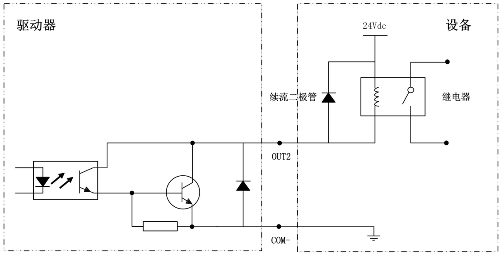

Chữ trong hình: driver; thiết bị; diode dập xung (freewheeling diode); rơ-le.

- **Từ phiên bản MS11B trở đi, chức năng mặc định của cổng ra OUT2 là đầu ra phanh;**
- Hai từ điển đối tượng liên quan đến phanh là 4003, 4004, lần lượt được dùng cho thời gian trễ nhả phanh và thời gian trễ khóa phanh, có thể cài đặt theo nhu cầu;
- Nếu sử dụng chức năng đầu ra phanh, bắt buộc phải kết hợp với rơ-le bên ngoài, đồng thời cần mắc song song ngược chiều một diode dập xung ở hai đầu rơ-le như trong sơ đồ đấu dây.

### 4.3 Tệp mô tả thiết bị XML

Tệp mô tả thiết bị còn được gọi là tệp ESI, là cầu nối giữa driver và master. Trước khi sử dụng phần mềm master, cần phải cài đặt tệp XML trước. Tệp mô tả thiết bị XML do nhà sản xuất driver cung cấp, phương pháp import vui lòng tuân theo từng phần mềm master. Tệp XML của driver dòng Leadshine DM3E có thể tải về từ trung tâm sản phẩm trên trang web chính thức.

Phương pháp import tệp XML của các hãng master là khác nhau. Tệp mô tả thiết bị của một số ít nhà sản xuất không ở định dạng tệp XML, cần phải chuyển đổi theo yêu cầu. Hình dưới đây thể hiện phương pháp import tệp XML của dòng Omron NJ, chỉ mang tính chất tham khảo:

Đường dẫn trong hình: C:\Program Files (x86)\OMRON\Sysmac Studio\IODeviceProfiles\EsiFiles\UserEsiFiles, tệp DM3E_V1.70 (tài liệu XML).

---

## Chương 5 Sự cố và xử lý

### 5.1 Lỗi driver

Khi xuất hiện cảnh báo (alarm), driver sẽ kích hoạt chức năng bảo vệ, động cơ dừng quay, đèn chỉ báo ALM sẽ nhấp nháy đỏ với số lần khác nhau để biểu thị các cảnh báo khác nhau. Sau khi driver phát cảnh báo, cần khắc phục sự cố rồi mới xóa cảnh báo hoặc cấp nguồn lại, đặc biệt là các lỗi quá dòng, quá áp.

| Mã 603F | Ý nghĩa | Mã 3FFE | Khả năng xóa | Bit phát hiện lỗi 2056 | Số lần nhấp nháy ALM |
| --- | --- | --- | --- | --- | --- |
| 0x2211 | Lỗi quá dòng | 0x0e0 | Không | bit0 | 1 |
| 0x3150 | Lỗi op-amp pha A | 0x0a0 | Không | bit11 | 12 |
| 0x3151 | Lỗi op-amp pha B | 0x0a1 | Không | bit11 | 12 |
| 0x3211 | Lỗi quá áp bus DC | 0x0c0 | Có | bit1 | 2 |
| 0x8402 | Lỗi lệnh vượt quá tốc độ | 0x1a0 | Có | bit3 | 5 |
| 0x5530 | Lỗi lưu tham số | 0x240 | Có | bit2 | 8 |
| 0x8403 | Lượng tăng xung lệnh trong chu kỳ PWM quá lớn | 0x1a1 | Có | bit4 | 3 |
| 0x7122 | Cảnh báo mất pha | 0x5f0 | Không | bit7 | 7 |
| - | Bảo vệ ngắt phần cứng | - | - | - | Sáng liên tục |

Danh sách mã lỗi:

| Đối tượng 3FFE | Đối tượng 603Fh | Ý nghĩa | Biện pháp xử lý |
| --- | --- | --- | --- |
| 0x0e0 | 0x2211 | Lỗi quá dòng | Đảm bảo dây ngõ ra driver không bị ngắn mạch; đảm bảo động cơ không bị hỏng |
| 0x0e1 | 0x2212 | Quá dòng mô-đun công suất thông minh (IPM) | Đảm bảo dây ngõ ra driver không bị ngắn mạch; đảm bảo động cơ không bị hỏng |
| 0x0c0 | 0x3211 | Điện áp bus DC quá cao | Giảm điện áp cấp nguồn cho driver; nếu báo quá áp trong quá trình chuyển động, có thể tăng thời gian tăng/giảm tốc |
| 0x0a0 | 0x3150 | Lỗi op-amp pha A | Đảm bảo đấu dây động cơ chính xác; gửi về nhà máy sửa chữa |
| 0x0a1 | 0x3151 | Lỗi op-amp pha B | Đảm bảo đấu dây động cơ chính xác; gửi về nhà máy sửa chữa |
| 0x0a2 | 0x3152 | Lỗi mạch đầu vào tương tự (analog) | / |
| 0x0a3 | 0x3153 | Lỗi mạch đầu vào tương tự (analog) | / |
| 0x0a4 | 0x3154 | Lỗi mạch đầu vào tương tự (analog) | / |
| 0x0a5 | 0x3201 | Lỗi mạch bus DC | Đảm bảo điện áp cấp nguồn cho driver nằm trong phạm vi thích hợp |
| 0x0a6 | 0x4201 | Lỗi mạch phát hiện nhiệt độ | Đảm bảo điện áp cấp nguồn cho driver nằm trong phạm vi thích hợp |
| 0x0b0 | 0x3205 | Điện áp điều khiển quá thấp | |
| 0x0d0 | 0x3221 | Điện áp bus DC quá thấp | Tăng điện áp cấp nguồn cho driver; siết chặt đấu dây đầu nối |
| 0x0e1 | 0x2212 | Quá dòng mô-đun công suất thông minh (IPM) | Đảm bảo dây ngõ ra driver không bị ngắn mạch; đảm bảo động cơ không bị hỏng |
| 0x100 | 0x8311 | Quá tải động cơ | Giảm tải; tăng thời gian tăng/giảm tốc; điều chỉnh đấu dây |
| 0x120 | 0x7701 | Quá tải mạch xả điện trở | Giảm tốc độ quay động cơ; giảm quán tính tải |
| 0x121 | 0x7702 | Lỗi điện trở xả | |
| 0x190 | 0x8401 | Rung động quá mức | |
| 0x1a0 | 0x8402 | Lỗi lệnh vượt quá tốc độ | Điều chỉnh độ lớn tốc độ lệnh; sửa đổi tần số ngõ vào của xung lệnh; ghi giá trị 7 vào từ điển đối tượng 2056 có thể giải quyết; |
| 0x1a1 | 0x8403 | Mất kiểm soát tốc độ | Kiểm tra xem cuộn dây động cơ đã đấu đúng cách hay chưa |
| 0x1b0 | 0x8612 | Tần số lệnh vị trí quá cao | Đảm bảo nhập đúng lệnh vị trí |
| 0x1b1 | 0x8503 | Cài đặt bánh răng điện tử (electronic gear) bị lỗi | |
| 0x210 | 0x6321 | Lỗi phân bổ cổng vào I/F | |
| 0x211 | 0x6322 | Lỗi cài đặt chức năng cổng vào I/F | |
| 0x212 | 0x6323 | Lỗi cài đặt chức năng cổng ra I/F | |
| 0x240 | 0x5530 | Lỗi lưu tham số EEPROM | Khôi phục cài đặt gốc; lưu lại tham số |
| 0x260 | 0x7329 | Tín hiệu vào vượt hành trình (overtravel) dương/âm kích hoạt | |
| 0x570 | 0x5441 | Tín hiệu vào cảnh báo cưỡng bức kích hoạt | Đảm bảo tín hiệu đầu vào được đấu dây chính xác |
| 0x5f0 | 0x7122 | Lỗi mất pha | Kiểm tra dây động cơ xem có được đấu chính xác hay không; đảm bảo động cơ không có bất thường; |
| 0x801 | 0x8201 | Chuyển đổi máy trạng thái ESM thất bại | |
| 0x802 | 0x5510 | Tràn bộ nhớ | |
| 0x807 | 0x8207 | Đối tượng ánh xạ không tồn tại | |
| 0x808 | 0x8208 | Độ dài đối tượng ánh xạ PDO bị lỗi | |
| 0x809 | 0x8209 | Đối tượng ánh xạ PDO không có thuộc tính ánh xạ | |
| 0x811 | 0xA001 | Yêu cầu chuyển đổi ESM không hợp lệ | |
| 0x812 | 0xA002 | Yêu cầu chuyển đổi ESM không xác định | |
| 0x813 | 0x8213 | Bảo vệ yêu cầu trạng thái Boot | |
| 0x816 | 0x8216 | Cấu hình hộp thư (mailbox) không hợp lệ ở trạng thái Pre-Operational | |
| 0x815 | 0x8215 | Cấu hình hộp thư không hợp lệ ở trạng thái Boot | |
| 0x818 | 0x8211 | Không có dữ liệu đầu vào hợp lệ | |
| 0x819 | 0x8212 | Không có dữ liệu đầu ra hợp lệ | |
| 0x81a | 0xFF02 | Lỗi đồng bộ | Lỗi chế độ đồng bộ |
| 0x81b | 0x821B | Quá thời gian watchdog Bộ quản lý đồng bộ 2 | Ngắt kết nối mạng, kiểm tra kết nối truyền thông |
| 0x81c | 0x821C | Loại bộ quản lý đồng bộ không hợp lệ | |
| 0x81d | 0x821D | Cấu hình đầu ra không hợp lệ | |
| 0x81e | 0x821E | Cấu hình đầu vào không hợp lệ | |
| 0x821 | 0xA003 | Đang chờ trạng thái ESM Init | |
| 0x822 | 0xA004 | Đang chờ trạng thái ESM Pre-Operational | |
| 0x823 | 0xA005 | Đang chờ trạng thái ESM Safe-Operational | |
| 0x824 | 0x8224 | Ánh xạ đầu vào dữ liệu quá trình không hợp lệ | |
| 0x825 | 0x8225 | Ánh xạ đầu ra dữ liệu quá trình không hợp lệ | |
| 0x827 | 0x8727 | Không hỗ trợ chế độ Free-Run | |
| 0x828 | 0x8728 | Không hỗ trợ chế độ đồng bộ | |
| 0x82b | 0x8210 | Đầu vào và đầu ra không hợp lệ | |
| 0x82c | 0x872C | Lỗi đồng bộ nghiêm trọng | |
| 0x82d | 0x872D | Không có lỗi đồng bộ | |
| 0x82e | 0x872E | Chu kỳ đồng bộ quá nhỏ | |
| 0x830 | 0x8730 | Cấu hình đồng bộ DC không hợp lệ | |
| 0x832 | 0x8732 | Lỗi vòng khóa pha (PLL) của DC | |
| 0x833 | 0x8733 | Lỗi I/O đồng bộ DC | |
| 0x834 | 0x8734 | Quá thời gian đồng bộ DC | |
| 0x835 | 0x8735 | Chu kỳ DC không hợp lệ | |
| 0x836 | 0x8736 | Chu kỳ đồng bộ DC không hợp lệ | |
| 0x850 | 0x5550 | Không thể truy cập EEPROM | |
| 0x851 | 0x5551 | Lỗi EEPROM | |
| 0x852 | 0x5552 | Phần cứng chưa sẵn sàng | |
| 0x870 | 0x5201 | Đã kích hoạt (enable) ở chế độ không được hỗ trợ | Đã cài đặt chế độ không được hỗ trợ và thực hiện thao tác kích hoạt (enable); kiểm tra giá trị của 6061; |

### 5.2 Giải thích lỗi

Khi xuất hiện cảnh báo, driver sẽ kích hoạt chức năng bảo vệ, động cơ dừng quay. Đồng thời với hiển thị trên led 7 đoạn, từ điển đối tượng (Object Dictionary) bên trong driver cũng có thể được sử dụng để chẩn đoán lỗi. Sau khi driver phát cảnh báo, cần khắc phục sự cố rồi mới xóa cảnh báo hoặc cấp nguồn lại, đặc biệt là các lỗi quá dòng, quá áp.

Mã lỗi ở một số máy tính cấp trên hiển thị ở dạng thập phân, khi đó, bạn cần chuyển đổi sang hệ thập lục phân (hex) rồi mới đối chiếu.
Ví dụ máy tính cấp trên báo 8721, lúc này qua chuyển đổi hệ cơ số trên máy tính sẽ hiển thị thành 2211 ở dạng thập lục phân (hex), đối chiếu bảng này cho thấy driver đang báo lỗi quá dòng.

**Chỉ báo cảnh báo:**

- Từ điển đối tượng 3FFE+01 **chỉ báo cảnh báo lỗi gần nhất**, các chỉ mục phụ (sub-index) khác chỉ báo các cảnh báo lịch sử.
- Từ điển đối tượng 1001 và 603F **chỉ báo trạng thái cảnh báo hiện tại;**
- Trong đó 603Fh chỉ báo mã lỗi theo quy chuẩn IEC 61800; 1001h chỉ báo mã lỗi theo quy chuẩn CIA.
- Khi có nhiều cảnh báo, tất cả các tùy chọn lỗi liên quan của DM3-EC đều sẽ được cập nhật sang trạng thái cảnh báo mới nhất. Khả năng xóa biểu thị việc có thể xóa cảnh báo trong điều kiện không ngắt nguồn driver hay không:

**Xóa cảnh báo:**

- **Ghi 128 (hệ thập phân) vào từ điển đối tượng 6040, có thể xóa cảnh báo hiện tại có thể xóa;**
- **Ghi 1 vào từ điển đối tượng 2093, có thể xóa nhật ký lỗi, toàn bộ các chỉ mục phụ của 3FFE sẽ được xóa về 0;**
- Ngoài ra, các cảnh báo của driver đều có thể được lưu trữ.

**Xóa cảnh báo quá dòng:**

Ở trạng thái mặc định, lỗi quá dòng thuộc loại cảnh báo nghiêm trọng, không thể xóa; nhưng nếu đã rõ nguyên nhân cảnh báo và cần xóa cảnh báo thì có thể thao tác qua tham số để thực hiện:
Ghi giá trị 1 vào từ điển đối tượng 2074, sau đó ghi lệnh 0x65766173 vào 0x1010, chỉ mục phụ 04 để thực hiện thao tác lưu, sau đó sẽ có thể kích hoạt chức năng xóa cảnh báo quá dòng bằng phần mềm.
**Lưu ý: Chức năng xóa cảnh báo quá dòng chỉ được hỗ trợ trên phiên bản MS13A trở về sau.**

**Cảnh báo lệnh vượt quá tốc độ:**

Cảnh báo hiển thị E1A0 là lỗi lệnh vượt quá tốc độ, ghi giá trị 7 vào từ điển đối tượng 2056 là có thể xóa cảnh báo này mà không làm ảnh hưởng đến hoạt động của driver.

**Cảnh báo mất pha:**

Đặt bit7 của từ điển đối tượng 2056 lên 1 để kích hoạt chức năng cảnh báo mất pha. Sau khi cài đặt tham số và lưu lại, cấp nguồn lại để có hiệu lực.
Cảnh báo mất pha được phát hiện khi cấp điện cho động cơ; hiện tượng mất pha xảy ra trong quá trình động cơ đang chạy sẽ không kích hoạt cảnh báo mất pha. Sau khi đấu lại dây động cơ, cần cấp nguồn lại mới có thể tiến hành phát hiện lỗi lần nữa.
Khi cảnh báo mất pha, đèn chỉ báo ALM trên bảng điều khiển phía trước sẽ nhấp nháy đỏ 7 lần.

### 5.3 Cảnh báo truyền thông EtherCAT

Khi DM3E xảy ra lỗi truyền thông mạng, mối tương quan giữa trạng thái LED ERR truyền thông, đối tượng 1001h và đối tượng 603Fh được liệt kê trong bảng dưới đây. Các lỗi truyền thông mạng một phần có thể lưu lại và đều có thể xóa được.

| Mã 603F | Mã 1001 | Ý nghĩa | Hiển thị 3FFE | Có thể xóa không | Có lưu không | ERR LED |
| --- | --- | --- | --- | --- | --- | --- |
| 0x5201 | 0x10 | Kích hoạt (enable) ở chế độ không được hỗ trợ | 0x870 | 1 | Không | Không nhấp nháy |
| 0x8207 | 0x10 | Đối tượng ánh xạ (mapping) không tồn tại | 0x807 | 1 | Không | Không nhấp nháy |
| 0x8208 | 0x10 | Lỗi độ dài đối tượng ánh xạ PDO | 0x808 | 1 | Không | Không nhấp nháy |
| 0x8209 | 0x10 | Đối tượng ánh xạ PDO không có thuộc tính ánh xạ | 0x809 | 1 | Không | Không nhấp nháy |
| 0x8213 | 0x10 | BOOT không được hỗ trợ | | 1 | Không | Nhấp nháy nhanh |
| 0x8215 | 0x10 | Cấu hình chế độ BOOT không hợp lệ | Để trống không lưu | 1 | Không | Nhấp nháy nhanh |
| 0x8216 | 0x10 | Cấu hình Preop không hợp lệ | | 1 | Không | Nhấp nháy nhanh |
| 0x8217 | 0x10 | Cấu hình SM không hợp lệ | | 1 | Không | Nhấp nháy nhanh |
| 0x821B | 0x10 | Quá thời gian watchdog SM | 0x081B | 1 | Có | Nhấp nháy kép |
| 0x821C | 0x10 | Loại SM không hợp lệ | 0x081C | 1 | Có | Nhấp nháy chậm |
| 0x821D | 0x10 | Cấu hình đầu ra không hợp lệ | | 1 | Không | Nhấp nháy chậm |
| 0x821E | 0x10 | Cấu hình đầu vào không hợp lệ | | 1 | Không | Nhấp nháy chậm |
| 0x821F | 0x10 | Cấu hình watchdog không hợp lệ | | 1 | Không | Nhấp nháy chậm |
| 0x8224 | 0x10 | Ánh xạ TPDO không hợp lệ | | 1 | Không | Nhấp nháy chậm |
| 0x8225 | 0x10 | Ánh xạ RPDO không hợp lệ | | 1 | Không | Nhấp nháy chậm |
| 0x871A | 0x10 | Lỗi chế độ đồng bộ | 0x081A | 1 | Có | Nhấp nháy đơn |
| 0x8727 | 0x10 | Không hỗ trợ chế độ Free Run (chạy tự do) | | 1 | Không | Nhấp nháy chậm |
| 0x8728 | 0x10 | Không hỗ trợ chế độ đồng bộ | | 1 | Không | Nhấp nháy chậm |
| 0x872C | 0x10 | Lỗi đồng bộ nghiêm trọng | | 1 | Có | Nhấp nháy chậm |
| 0x872D | 0x10 | Lỗi không có đồng bộ | | 1 | Không | Nhấp nháy đơn |
| 0x872E | 0x10 | Chu kỳ đồng bộ quá nhỏ | | 1 | Không | Nhấp nháy chậm |
| 0x8730 | 0x10 | Cấu hình DC không hợp lệ | | 1 | Không | Nhấp nháy chậm |
| 0x8732 | 0x10 | Lỗi DC PLL | 0x0832 | 1 | Có | Nhấp nháy đơn |
| 0x8733 | 0x10 | Lỗi I/O đồng bộ DC | 0x0833 | 1 | Có | Nhấp nháy đơn |
| 0x8734 | 0x10 | Quá thời gian đồng bộ DC | 0x0834 | 1 | Có | Nhấp nháy đơn |
| 0x8735 | 0x10 | Chu kỳ DC không hợp lệ | | 1 | Không | Nhấp nháy chậm |
| 0x8736 | 0x10 | Chu kỳ sync0 không hợp lệ | | 1 | Không | Nhấp nháy chậm |
| 0xA001 | 0x10 | Chuyển trạng thái ESM không hợp lệ | 0x0811 | 1 | Có | Nhấp nháy chậm |
| 0xA002 | 0x10 | Yêu cầu chuyển trạng thái ESM không xác định | 0x0812 | 1 | Có | Nhấp nháy chậm |
| 0xA003 | 0x10 | Slave (trạm tớ) chờ yêu cầu khởi tạo | 0x0821 | 1 | Có | Nhấp nháy chậm |
| 0xA004 | 0x10 | Slave (trạm tớ) chờ yêu cầu tiền vận hành | 0x0822 | 1 | Có | Nhấp nháy chậm |
| 0xA005 | 0x10 | Slave (trạm tớ) chờ yêu cầu vận hành an toàn | 0x0823 | 1 | Có | Nhấp nháy chậm |

---

## Chương 6 Các chức năng thường dùng

### 6.1 Lưu tham số và khôi phục cài đặt gốc

Ghi lệnh **0x65766173** vào chỉ mục phụ (sub-index) 0x1010 để lưu các tham số thuộc phân loại tương ứng vào EEPROM;

Ghi lệnh **0x64616F6C** vào chỉ mục phụ (sub-index) 0x1011 để khôi phục cài đặt gốc của các tham số thuộc phân loại tương ứng.

**Sau khi ghi lệnh lưu, vui lòng không tắt nguồn ngay lập tức, đặc biệt là khi lưu tất cả tham số, cần đợi khoảng 10 giây mới được ngắt điện để đảm bảo tất cả tham số được lưu thành công.**

**Bảng 6.1**

| Thao tác | Từ điển đối tượng (Object Dictionary) | Lệnh (Hex) | Trạng thái kết quả | Ghi chú |
| --- | --- | --- | --- | --- |
| **Lưu tham số series 2000~5000** | **1010:04** | **0x65766173** | **Trả về 1** | **Lưu tham số nhà sản xuất** |
| Lưu tham số series 6000 | 1010:03 | 0x65766173 | Trả về 1 | Lưu tham số chuyển động |
| Lưu tham số series 1000 | 1010:02 | 0x65766173 | Trả về 1 | Lưu tham số truyền thông |
| Lưu tất cả các series tham số | 1010:01 | 0x65766173 | Trả về 1 | Lưu tất cả các series tham số |
| Khôi phục tham số series 2000~5000 | 1011:04 | 0x64616F6C | Trả về 1 | Khôi phục tham số nhà sản xuất |
| Khôi phục tham số series 6000 | 1011:03 | 0x64616F6C | Trả về 1 | Khôi phục tham số chuyển động |
| Khôi phục tham số series 1000 | 1011:02 | 0x64616F6C | Trả về 1 | Khôi phục tham số truyền thông |
| Khôi phục tất cả các series tham số | 1011:01 | 0x64616F6C | Trả về 1 | Khôi phục tất cả các series tham số |

### 6.2 Từ điều khiển (controlword) và chế độ vận hành

DM3E hỗ trợ chế độ đồng bộ và chế độ không đồng bộ. Ở chế độ chuyển động đồng bộ, master (trạm chủ) thực hiện quy hoạch quỹ đạo và xuất lệnh chu kỳ, driver nhận lệnh quy hoạch của master theo chu kỳ đồng bộ, thích hợp cho chuyển động đồng bộ nhiều trục. Chế độ chuyển động đồng bộ của DM3E hỗ trợ chế độ vị trí đồng bộ chu kỳ (CSP). Trong chế độ vị trí đồng bộ chu kỳ (CSP), quy hoạch quỹ đạo được hoàn thành tại master, DM3E nhận thông tin vị trí do master gửi theo chu kỳ đồng bộ, khi tín hiệu đồng bộ đến sẽ lập tức truyền thông tin vị trí đến mạch điều khiển để thực thi. Chu kỳ đồng bộ được DM3E hỗ trợ là: **250 us, 500 us, 750us, 1000 us, 2000 us, 4000 us, (từ phiên bản MS11B có thể hỗ trợ đến trên 8000us)**. Cấu trúc tổng thể của điều khiển vòng lặp bước trong từng chế độ được thể hiện như trong hình.

Ở chế độ chuyển động không đồng bộ, master (trạm chủ) chỉ chịu trách nhiệm gửi các tham số chuyển động và lệnh điều khiển; sau khi nhận được lệnh khởi động chuyển động từ master, driver động cơ bước DM3E sẽ thực hiện quy hoạch quỹ đạo theo các tham số chuyển động do master gửi; ở chế độ chuyển động không đồng bộ, chuyển động giữa các trục động cơ là không đồng bộ. Chế độ chuyển động không đồng bộ của DM3E bao gồm chế độ vị trí theo profile (PP), chế độ vận tốc theo profile (PV) và chế độ về gốc (HM).

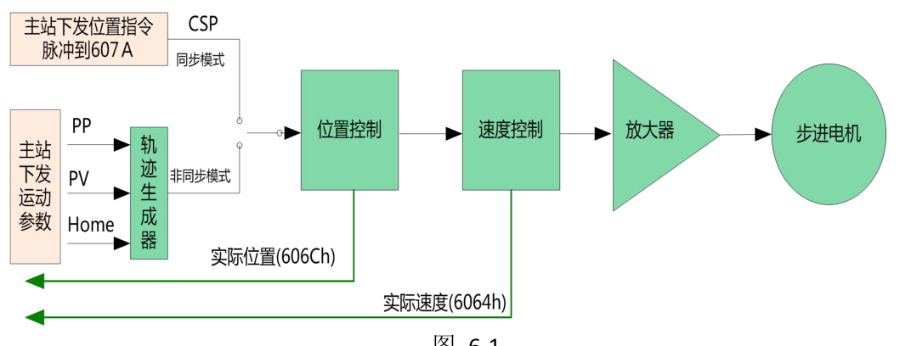

**Hình 6-1**

Chữ trong hình: Master truyền xung lệnh vị trí đến 607A; Chế độ đồng bộ; Chế độ không đồng bộ; Master truyền tham số chuyển động (PP, PV, Home); Bộ tạo quỹ đạo; Điều khiển vị trí; Điều khiển tốc độ; Bộ khuếch đại; Động cơ bước; Vị trí thực tế (606Ch); Tốc độ thực tế (6064h).

Bất kể ở chế độ điều khiển nào, việc trao đổi dữ liệu giữa master và slave trên bus EtherCAT đều được thực hiện thông qua từ điển đối tượng (Object Dictionary). Phương thức truyền dữ liệu có hai phương thức là PDO và SDO, thông thường chỉ có thể chọn một trong hai; tùy theo nhu cầu điều khiển, dựa trên yêu cầu về tính thời gian thực và mức độ quan trọng của việc truyền dữ liệu mà chia thành ba mức: Bắt buộc > Khuyến nghị > Có thể. "Bắt buộc" biểu thị trong chế độ này, từ điển đối tượng tương ứng bắt buộc phải được cấu hình sang phương thức truyền PDO. "Khuyến nghị" biểu thị trong chế độ này, từ điển đối tượng tương ứng được khuyến nghị cấu hình sang phương thức truyền PDO để đảm bảo tính thời gian thực của dữ liệu nhằm đáp ứng tốt hơn nhu cầu điều khiển; nếu yêu cầu điều khiển không cao thì cũng có thể truyền dữ liệu thông qua phương thức giao tiếp SDO. "Có thể" biểu thị trong chế độ này, từ điển đối tượng tương ứng thường truyền dữ liệu qua phương thức giao tiếp SDO, không nhất thiết phải cấu hình thành PDO. Các từ điển đối tượng liên kết với từng chế độ điều khiển được thể hiện như trong Bảng 6.2.

**Bảng 6.2 Từ điển đối tượng liên kết với các chế độ điều khiển**

| Chế độ điều khiển | Chỉ mục + chỉ mục phụ | Tên | Kiểu dữ liệu | Kiểu truy cập | Đơn vị | Cấu hình PDO | Giao tiếp SDO |
| --- | --- | --- | --- | --- | --- | --- | --- |
| Chế độ CSP (8) | 6040-00h | Từ điều khiển (controlword) | U16 | RW | — | Bắt buộc | - |
| | 607A-00h | Vị trí mục tiêu | I32 | RW | P | Bắt buộc | - |
| | 6041-00h | Từ trạng thái (statusword) | U16 | RO | — | Bắt buộc | - |
| | 6064-00h | Vị trí thực tế | I32 | RO | P | Bắt buộc | - |
| | 606C-00h | Tốc độ thực tế | I32 | RO | P/S | Có thể | Có thể |
| Chế độ PP (1) | 607A-00h | Vị trí mục tiêu | I32 | RW | P | Khuyến nghị | Có thể |
| | 6081-00h | Tốc độ tối đa | U32 | RW | P | Có thể | Có thể |
| Chế độ PV (3) | 60FF-00h | Tốc độ mục tiêu | I32 | RW | P | Khuyến nghị | Có thể |
| Dùng chung cho chế độ PP (1) và chế độ PV (3) | 6040-00h | Từ điều khiển (controlword) | U16 | RW | — | Khuyến nghị | Có thể |
| | 6083-00h | Gia tốc | I32 | RW | P/S | Có thể | Có thể |
| | 6084-00h | Độ giảm tốc | U32 | RW | P/S | Có thể | Có thể |
| Chế độ HOME (6) | 6040-00h | Từ điều khiển (controlword) | U16 | RW | — | Khuyến nghị | Có thể |
| | 6098-00h | Phương pháp về gốc (homing method) | I8 | RW | — | Có thể | Có thể |
| | 6099-01h | Tốc độ về gốc nhanh | U32 | RW | P/S | Có thể | Có thể |
| | 6099-02h | Tốc độ về gốc chậm | U32 | RW | P/S | Có thể | Có thể |
| | 609A-00h | Gia tốc về gốc | U32 | RW | P/S² | Có thể | Có thể |
| | 607C-00h | Độ lệch gốc (home offset) | U32 | RW | P | Có thể | Có thể |
| Dùng chung cho các chế độ PP, PV và HOME | 6041-00h | Từ trạng thái (statusword) | U16 | RO | — | Khuyến nghị | Có thể |
| | 6064-00h | Vị trí thực tế | I32 | RO | P | Khuyến nghị | Có thể |
| | 606C-00h | Tốc độ thực tế | I32 | RO | P/S | Khuyến nghị | Có thể |
| Dùng chung cho tất cả các chế độ | 60B8-00h | Chức năng đầu dò (probe) | U16 | RW | — | Khuyến nghị | Có thể |
| | 60B9-00h | Trạng thái đầu dò | U16 | RO | — | Có thể | Có thể |
| | 60BA-00h | Giá trị bắt giữ của đầu dò 1 | I32 | RO | P | Có thể | Có thể |
| | 60FD-00h | Đầu vào số (digital input) | U32 | RO | — | Khuyến nghị | Có thể |
| | 603F-00h | Mã lỗi mới nhất | U16 | RO | P | Khuyến nghị | Có thể |
| Các tham số liên quan khác | 6060-00h | Chế độ hoạt động (modes of operation) | I8 | RW | — | Có thể | Có thể |
| | 60B0-00h | Độ lệch vị trí (position offset) | I32 | RW | — | Có thể | Có thể |
| | 6082-00h | Tốc độ khởi động | U32 | RW | P/S | Có thể | Có thể |
| | 6085-00h | Độ giảm tốc dừng khẩn cấp | U32 | RW | P/S | Có thể | Có thể |
| | 6061-00h | Hiển thị chế độ hoạt động | I8 | RO | — | Có thể | Có thể |

Dù áp dụng chế độ điều khiển nào để thực hiện việc điều khiển truyền động cơ cấu chấp hành, đều không thể tách rời việc đọc ghi hai từ điển đối tượng (Object Dictionary) là từ điều khiển (controlword) 6040h và từ trạng thái (statusword) 6041h. Master/slave (trạm chủ/trạm tớ) thông qua hai từ điển đối tượng này làm trung gian để thực hiện phát lệnh và giám sát trạng thái. Dưới đây tập trung giới thiệu định nghĩa từng bit của hai từ điển đối tượng này.

Định nghĩa từ điều khiển (6040h) được thể hiện như trong Bảng 6.3. Nửa bên trái của bảng mô tả bit4~6 và bit8, ý nghĩa của chúng tùy thuộc vào chế độ hoạt động, chủ yếu quản lý việc thực thi chạy hoặc dừng,... của từng chế độ; nửa bên phải của bảng mô tả bit0~3 và bit7, tổ hợp các bit này quản lý sự chuyển đổi trạng thái của máy trạng thái 402, từ đó đáp ứng các nhu cầu điều khiển đa dạng và phức tạp. Định nghĩa từ trạng thái (6041h) được thể hiện như trong Bảng 6.4. Bit0~bit7 chủ yếu hiển thị trạng thái chuyển đổi của máy trạng thái 402, bit8~bit15 chủ yếu hiển thị trạng thái thực thi chuyển động hoặc dừng dưới từng chế độ điều khiển. Quá trình chuyển đổi trạng thái kích hoạt (enable) điển hình như sau:

Khởi tạo (00h)-----Cấp nguồn (06h)-----Khởi động (07h)-----Kích hoạt (0fh)-----Thực thi chạy hoặc tạm dừng (tùy thuộc vào chế độ hoạt động, kết hợp bit4~6 và bit8 để phát các lệnh điều khiển liên quan). Quá trình chuyển đổi trạng thái kích hoạt điều khiển vận hành ở từng chế độ điều khiển được thể hiện như trong Bảng 6.5.

**Bảng 6.3 Định nghĩa bit của từ điều khiển (6040h)**

| Chế độ/Bit | 15~9 | 8 | 6 | 5 | 4 | 7 | 3 | 2 | 1 | 0 | Giá trị điển hình | Kết quả hành động |
| --- | --- | --- | --- | --- | --- | --- | --- | --- | --- | --- | --- | --- |
| Dùng chung | - | Tạm dừng | Tùy thuộc vào chế độ hoạt động | ← | ← | Reset lỗi | Cho phép vận hành | Dừng nhanh | Xuất điện áp | Khởi động | | |
| Chế độ CSP 8 | - | Vô hiệu | Vô hiệu | Vô hiệu | Vô hiệu | 0 | 0(x) | 1 | 1 | 0 | 06h | Cấp nguồn |
| Chế độ PP 1 | - | Giảm tốc dừng | Tuyệt đối/Tương đối | Kích hoạt ngay | Điểm vị trí mới | 0 | 0 | 1 | 1 | 1 | 07h | Khởi động |
| Chế độ PV 3 | - | Giảm tốc dừng | Vô hiệu | Vô hiệu | Vô hiệu | 0 | 0(x) | 0 | 1 | 0(x) | 02h | Dừng nhanh |
| Chế độ HM 6 | - | Giảm tốc dừng | Vô hiệu | Vô hiệu | Khởi động chuyển động | 0 | 1 | 1 | 1 | 1 | 0fh | Kích hoạt (enable) |
| Không | | | | | | 1 | 0(x) | 0(x) | 0(x) | 0(x) | 80h | Xóa lỗi |
| Không | | | | | | 0 | 0 | 0 | 0 | 0 | 0 | Khởi tạo |

**Giải thích bổ sung về các bit khác:**

- Logic kích hoạt dừng nhanh của bit 2 là tích cực mức 0 (0 có hiệu lực), lưu ý phân biệt với logic kích hoạt của các bit khác.
- Logic kích hoạt reset lỗi của bit 7 là có hiệu lực theo sườn lên.
- Logic kích hoạt kích hoạt ngay của bit 5 là có hiệu lực theo sườn lên.

**Bảng 6.4 Định nghĩa bit của từ trạng thái (6041h)**

| Chế độ/8 bit thấp | 7 | 6 | 5 | 4 | 3 | 2 | 1 | 0 |
| --- | --- | --- | --- | --- | --- | --- | --- | --- |
| Dùng chung | Dự phòng | Chưa khởi động | Dừng nhanh | Cấp nguồn | Lỗi | Cho phép vận hành | Khởi động | Sẵn sàng khởi động |

| Chế độ/8 bit cao | 15 | 14 | 13 | 12 | 10 | 8 | 11 | 9 |
| --- | --- | --- | --- | --- | --- | --- | --- | --- |
| Dùng chung | Tùy thuộc vào chế độ hoạt động | ← | ← | ← | ← | ← | Giới hạn hành trình có hiệu lực | Từ xa |
| Chế độ CSP 8 | Vô hiệu | Vô hiệu | Vô hiệu | Bám theo có hiệu lực | Vô hiệu | Dừng bất thường | Được set khi giới hạn hành trình phần cứng có hiệu lực | Bằng 0 khi ở dưới PreOP |
| Chế độ PP 1 | Phản hồi có thể kích hoạt | Tham số có 0 | Vô hiệu | Phản hồi điểm vị trí mới | Đã đến vị trí | Dừng bất thường | Được set khi giới hạn hành trình phần cứng có hiệu lực | Bằng 0 khi ở dưới PreOP |
| Chế độ PV 3 | Vô hiệu | Tham số có 0 | Vô hiệu | Tốc độ bằng 0 | Đã đạt tốc độ | Dừng nhanh | Được set khi giới hạn hành trình phần cứng có hiệu lực | Bằng 0 khi ở dưới PreOP |
| Chế độ HM 6 | Phản hồi có thể kích hoạt | Tham số có 0 | Lỗi gốc | Hoàn thành về gốc | Đã đến vị trí | Dừng bất thường | Được set khi giới hạn hành trình phần cứng có hiệu lực | Bằng 0 khi ở dưới PreOP |

**Giải thích bổ sung về các bit khác:**

- Khi driver được cấp nguồn, bit 4 sẽ được set.
- Kích hoạt dừng nhanh của bit 5 chỉ có hiệu lực ở mức logic 0, ngược lại với logic của các bit khác.
- Bit 9 từ xa (remote), hiển thị trạng thái của máy trạng thái truyền thông, bằng 0 khi ở dưới PreOP, lúc này các lệnh từ từ điều khiển (6040h) sẽ không thể thực thi.
- Bit 11 giới hạn hành trình (limit), chỉ được set khi giới hạn hành trình phần cứng có hiệu lực.
- Bit 8 dừng bất thường, thường có hiệu lực trong các trạng thái kích hoạt giới hạn hành trình phần cứng, giảm tốc dừng và dừng nhanh.
- Bit 12 bám theo master, trong chế độ CSP nếu driver chưa được kích hoạt (enable) hoặc không còn bám theo lệnh của master thì bit này sẽ đặt về 0.

**Bảng 6.5 Chuyển đổi trạng thái điều khiển vận hành của từng chế độ**

| Chế độ | Bước/Hành động | 0 Công tác chuẩn bị | 1 Khởi tạo | 2 Cấp điện | 3 Khởi động | 4 Kích hoạt (enable) | 5 Bắt đầu chạy | 6 Đổi vị trí | 7 Dừng | 8 Lỗi (fault) |
| --- | --- | --- | --- | --- | --- | --- | --- | --- | --- | --- |
| Chế độ CSP 8 | 6040 | Thiết lập trạng thái truyền thông OP, kích hoạt trục NC | 00h | 06h | 07h | 0fh | 1fh Master gửi lệnh | Master điều khiển | Master dừng lệnh vị trí | - |
| | 6041 | | 250h | 231h | 233h | 1237h | 1237h | 1237h | 1237h | 238h |
| Chế độ PP 1 | 6040 | Thiết lập trạng thái truyền thông OP, cài đặt thông số chuyển động | 00h | 06h | 07h | 0fh | - | 2fh->3fh | 10fh | - |
| | 6041 | | 250h | 231h | 233h | 8237h | 1237h | 1637h->1237h | 1737h | 1238h |
| Chế độ PV 3 | 6040 | Thiết lập trạng thái truyền thông OP, cài đặt thông số chuyển động | 00h | 06h | 07h | 0fh | Kích hoạt xong chạy ngay | Chỉ cần thay đổi tốc độ | 10fh | - |
| | 6041 | | 250h | 231h | 233h | 1637h | 1637h | 1637h | 1737h | 1638h |
| Chế độ HM 6 | 6040 | Thiết lập trạng thái truyền thông OP, cài đặt thông số chuyển động | 00h | 06h | 07h | 0fh | 1fh | Không hiệu lực | 10fh | - |
| | 6041 | | 250h | 231h | 233h | 8337h | 237h | 237h | 737h | 238 |

**Thuyết minh bổ sung về các bit khác:**

Khi chế độ PP thay đổi vị trí, cần đưa sườn lên vào bit5 của từ điều khiển (controlword) thì mới có thể khởi động chuyển động vị trí mới;

### 6.3 Chức năng bắt tín hiệu đầu dò (probe)

Chức năng đầu dò sử dụng tín hiệu đầu vào có tính năng đầu dò để bắt vị trí thực tế của động cơ và ghi lại. Driver CL3-EC507 có hai kênh tín hiệu IO đầu vào hỗ trợ chức năng đầu dò và có thể kích hoạt đồng thời. Từ điển đối tượng (Object Dictionary) liên quan đến chức năng đầu dò được thể hiện trong Bảng 6.6.

**Bảng 6.6 Từ điển đối tượng liên quan đến chức năng đầu dò**

60B8h (Từ điều khiển đầu dò):

| Bit | 7~6 | 5 | 4 | 3 | 2 | 1 | 0 |
| --- | --- | --- | --- | --- | --- | --- | --- |
| Ý nghĩa | - | Kích hoạt sườn xuống đầu dò 1 | Kích hoạt sườn lên đầu dò 1 | - | - | Chế độ đầu dò 1 | Kích hoạt (enable) đầu dò 1 |

| Bit | 15~14 | 13 | 12 | 11 | 10 | 9 | 8 |
| --- | --- | --- | --- | --- | --- | --- | --- |
| Ý nghĩa | - | Kích hoạt sườn xuống đầu dò 2 | Kích hoạt sườn lên đầu dò 2 | - | - | Chế độ đầu dò 2 | Kích hoạt (enable) đầu dò 2 |

60B9h (Từ trạng thái đầu dò):

| Bit | 7 | 6 | 5~3 | 2 | 1 | 0 |
| --- | --- | --- | --- | --- | --- | --- |
| Ý nghĩa | - | - | - | Kích hoạt sườn xuống đầu dò 1 hoàn thành | Kích hoạt sườn lên đầu dò 1 hoàn thành | Đầu dò 1 đang hoạt động |

| Bit | 15 | 14 | 13~11 | 10 | 9 | 8 |
| --- | --- | --- | --- | --- | --- | --- |
| Ý nghĩa | Mức điện áp thực tế của đầu dò 2 | Mức điện áp thực tế của đầu dò 1 | - | Kích hoạt sườn xuống đầu dò 2 hoàn thành | Kích hoạt sườn lên đầu dò 2 hoàn thành | Đầu dò 2 đang hoạt động |

| Từ điển đối tượng | Ý nghĩa |
| --- | --- |
| 60BAh | Thanh ghi giá trị dữ liệu bắt sườn lên đầu dò 1 |
| 60BBh | Thanh ghi giá trị dữ liệu bắt sườn xuống đầu dò 1 |
| 60BCh | Thanh ghi giá trị dữ liệu bắt sườn lên đầu dò 2 |
| 60BDh | Thanh ghi giá trị dữ liệu bắt sườn xuống đầu dò 2 |
| 60FDh | Trạng thái bit26 là logic AND của bit1 và bit2 của 60B9, trạng thái bit27 là logic AND của bit9 và bit10 của 60B9 |
| 2152h | Có thể ghi giá trị 17 hoặc 18 vào chỉ mục phụ (sub-index) 01h và 02h để cấu hình chức năng đầu dò 1 hoặc đầu dò 2 |

**Thuyết minh bổ sung về các bit khác:**

- bit0 và bit8 của 60B8h: Lần lượt là các bit điều khiển bật/dừng của đầu dò 1 và đầu dò 2, có hiệu lực ở sườn lên.
- bit1 và bit9 của 60B8h: Chế độ đầu dò được chia thành chế độ một lần và chế độ liên tục; bằng 0 là chế độ một lần, bằng 1 là chế độ liên tục.
- Chế độ một lần: Sau khi đầu dò khởi động, chỉ bắt tín hiệu tại tín hiệu kích hoạt đầu tiên. Để bắt lại giá trị vị trí mới, bắt buộc phải cấp tín hiệu sườn lên cho bit0/bit8 của đối tượng 60B8 để khởi động lại hoạt động của đầu dò.
- Chế độ liên tục: Sau khi đầu dò khởi động, hành động bắt tín hiệu sẽ được thực hiện ở mỗi tín hiệu kích hoạt.

**Chi tiết từ điển đối tượng đầu dò:**

| Từ điển đối tượng | Tên tham số | Thao tác | Ghi chú |
| --- | --- | --- | --- |
| 60B8 | Từ điều khiển đầu dò | Gán giá trị | Cổng IO được đặt thành tiếp điểm a (kiểu thường mở NO) （1）Cài đặt 60B8 thành 0x0011, đầu dò 1 bật chốt (latch) sườn lên một lần; （2）Cài đặt 60B8 thành 0x0013, đầu dò 1 bật chốt sườn lên liên tục; （3）Cài đặt 60B8 thành 0x0033, đầu dò 1 bật chốt sườn lên và sườn xuống liên tục; （1）Cài đặt 60B8 thành 0x1100, đầu dò 2 bật chốt sườn lên một lần; （2）Cài đặt 60B8 thành 0x1300, đầu dò 2 bật chốt sườn lên liên tục; （3）Cài đặt 60B8 thành 0x3300, đầu dò 2 bật chốt sườn lên và sườn xuống liên tục; |
| 60B9 | Từ trạng thái đầu dò | Đọc | Khi 60B8 chưa bật chức năng đầu dò: 60B9 bằng 0x4000 khi cổng đầu dò 1 có đầu vào mức cao, 60B9 bằng 0x8000 khi cổng đầu dò 2 có đầu vào mức cao; Sau khi 60B8 bật chức năng đầu dò 1, 60B9 hiển thị là 0x0001, Sau khi đầu dò 1 có sườn lên hoàn thành việc chốt, 60B9 hiển thị là 0x4003, Sau khi đầu dò 1 có sườn xuống hoàn thành việc chốt, 60B9 hiển thị là 0x0005, Sau khi đầu dò 1 có cả sườn lên và sườn xuống đều hoàn thành việc chốt, 60B9 hiển thị là 0x0007 (khi cổng đầu dò 1 ở mức thấp, nếu ở mức cao thì là 0x4007); Sau khi 60B8 bật chức năng đầu dò 2, 60B9 hiển thị là 0x0100, Sau khi đầu dò 2 có sườn lên hoàn thành việc chốt, 60B9 hiển thị là 0x8300, Sau khi đầu dò 2 có sườn xuống hoàn thành việc chốt, 60B9 hiển thị là 0x0500, Sau khi đầu dò 2 có cả sườn lên và sườn xuống đều hoàn thành việc chốt, 60B9 hiển thị là 0x0700 (khi cổng đầu dò 2 ở mức thấp, nếu ở mức cao thì là 0x8700). |
| 60BA | Dữ liệu đầu dò 1 | Đọc | Sau khi bật chốt sườn lên của đầu dò 1, khi mức điện áp cổng đầu dò 1 chuyển từ thấp lên cao thì dữ liệu 60BA sẽ thay đổi tương ứng; Nếu 60B8 cài đặt đầu dò 1 là chốt một lần thì 60BA chỉ chốt một lần, các lần mức điện áp từ thấp lên cao tiếp theo sẽ không thay đổi nữa; Nếu 60B8 cài đặt đầu dò 1 là chốt liên tục thì 60BA sẽ thay đổi theo mức điện áp, mức điện áp cổng đầu dò 1 chuyển từ thấp lên cao 1 lần thì vị trí chốt sẽ thay đổi tương ứng 1 lần; |
| 60BB | Dữ liệu đầu dò 2 | Đọc | Sau khi bật chốt sườn xuống của đầu dò 1, khi mức điện áp cổng đầu dò 1 chuyển từ cao xuống thấp thì dữ liệu 60BB sẽ thay đổi tương ứng; Nếu 60B8 cài đặt đầu dò 1 là chốt một lần thì 60BB chỉ chốt một lần, các lần mức điện áp từ cao xuống thấp tiếp theo sẽ không thay đổi nữa; Nếu 60B8 cài đặt đầu dò 1 là chốt liên tục thì 60BA sẽ thay đổi theo mức điện áp, mức điện áp cổng đầu dò 1 chuyển từ cao xuống thấp 1 lần thì vị trí chốt sẽ thay đổi tương ứng 1 lần |
| 60BC | Dữ liệu đầu dò 3 | Đọc | Sau khi bật chốt sườn lên của đầu dò 2, khi mức điện áp cổng đầu dò 2 chuyển từ thấp lên cao thì dữ liệu 60BC sẽ thay đổi tương ứng; Nếu 60B8 cài đặt đầu dò 2 là chốt một lần thì 60BC chỉ chốt một lần, các lần mức điện áp từ thấp lên cao tiếp theo sẽ không thay đổi nữa; Nếu 60B8 cài đặt đầu dò 2 là chốt liên tục thì 60BC sẽ thay đổi theo mức điện áp, mức điện áp cổng đầu dò 2 chuyển từ thấp lên cao 1 lần thì vị trí chốt sẽ thay đổi tương ứng 1 lần |
| 60BD | Dữ liệu đầu dò 4 | Đọc | Sau khi bật chốt sườn xuống của đầu dò 2, khi mức điện áp cổng đầu dò 2 chuyển từ cao xuống thấp thì dữ liệu 60BD sẽ thay đổi tương ứng; Nếu 60B8 cài đặt đầu dò 2 là chốt một lần thì 60BD chỉ chốt một lần, các lần mức điện áp từ cao xuống thấp tiếp theo sẽ không thay đổi nữa; Nếu 60B8 cài đặt đầu dò 2 là chốt liên tục thì 60BD sẽ thay đổi theo mức điện áp, mức điện áp cổng đầu dò 2 chuyển từ cao xuống thấp 1 lần thì vị trí chốt sẽ thay đổi tương ứng 1 lần |
| 60D5 | Bộ đếm kích hoạt sườn lên đầu dò 1 | Đọc | Khi sườn lên đầu dò 1 có thay đổi, 60D5 sẽ cộng dồn tương ứng 1 lần. |
| 60D6 | Bộ đếm kích hoạt sườn xuống đầu dò 1 | Đọc | Khi sườn xuống đầu dò 1 có thay đổi, 60D6 sẽ cộng dồn tương ứng 1 lần. |
| 60D7 | Bộ đếm kích hoạt sườn lên đầu dò 2 | Đọc | Khi sườn lên đầu dò 2 có thay đổi, 60D7 sẽ cộng dồn tương ứng 1 lần. |
| 60D8 | Bộ đếm kích hoạt sườn xuống đầu dò 2 | Đọc | Khi sườn xuống đầu dò 2 có thay đổi, 60D8 sẽ cộng dồn tương ứng 1 lần. |
| 60FD | Trạng thái IO đầu vào sau khi đặt cổng IO thành đầu vào đầu dò 1 | Đọc | Cổng IO 1 đặt thành đầu dò 1, khi 60B8 bật chức năng đầu dò 1 và đầu dò 1 có trạng thái chốt hoàn tất thì bit26 của 60FD bằng 1, đồng thời trạng thái của bit này sẽ thay đổi theo mức điện áp vật lý; ví dụ chốt sườn lên một lần, sau khi hoàn thành chốt nếu lại có sườn lên thay đổi thì giá trị 60BA không đổi nữa, nhưng trạng thái 60FD vẫn thay đổi |
| 60FD | Trạng thái IO đầu vào sau khi đặt cổng IO thành đầu vào đầu dò 2 | Đọc | Cổng IO 2 đặt thành đầu dò 2, khi 60B8 bật chức năng đầu dò 2 và đầu dò 2 có trạng thái chốt hoàn tất thì bit27 của 60FD bằng 1, đồng thời trạng thái của bit này sẽ thay đổi theo mức điện áp vật lý; ví dụ chốt sườn lên một lần, sau khi hoàn thành chốt nếu lại có sườn lên thay đổi thì giá trị 60BC không đổi nữa, nhưng trạng thái 60FD vẫn thay đổi |

---

## Phụ lục 1 Phương pháp về gốc (homing)

Dòng sản phẩm driver DM3E hỗ trợ các phương pháp về gốc (homing) 17~30, 35/37; định nghĩa cụ thể và quá trình về gốc được mô tả như sau:

- Negative Limit: Giới hạn hành trình âm
- Positive Limit: Giới hạn hành trình dương
- Negative direction: Hướng âm
- Positive direction: Hướng dương

Trong hình: đường nét đậm là 6099h-01h (tốc độ tìm gốc 1), đường nét mảnh là 6099h-02h (tốc độ tìm gốc 2).

### Phương pháp 17

Nếu công tắc giới hạn hành trình âm chưa được kích hoạt, hướng chuyển động ban đầu của động cơ là hướng âm.
Sau khi chạm công tắc giới hạn hành trình âm, động cơ giảm tốc và quay ngược chiều, vị trí phát hiện gốc là vị trí trạng thái của công tắc giới hạn hành trình âm thay đổi.

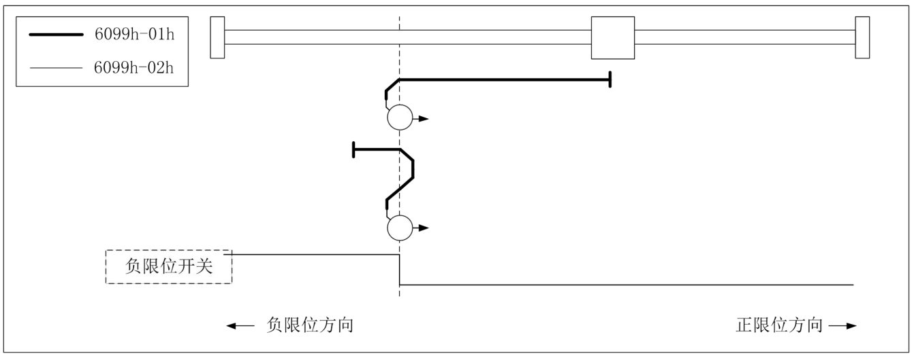

**Hình minh họa phương pháp 17** (chữ trong hình: công tắc giới hạn hành trình âm; hướng giới hạn âm; hướng giới hạn dương)

### Phương pháp 18

Nếu công tắc giới hạn hành trình âm chưa được kích hoạt, hướng chuyển động ban đầu của động cơ là hướng dương.
Sau khi chạm công tắc giới hạn hành trình âm, động cơ giảm tốc và quay ngược chiều, vị trí phát hiện gốc là vị trí trạng thái của công tắc giới hạn hành trình dương thay đổi.

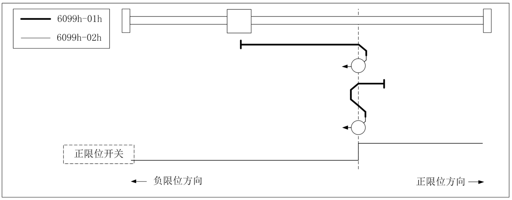

**Hình minh họa phương pháp 18** (chữ trong hình: công tắc giới hạn hành trình dương; hướng giới hạn âm; hướng giới hạn dương)

### Phương pháp 19, 20

Dựa vào trạng thái của công tắc gốc khi khởi động để quyết định hướng vận hành ban đầu.
Vị trí phát hiện gốc là phía hướng âm, hoặc phía hướng âm sau khi trạng thái của công tắc gốc thay đổi.

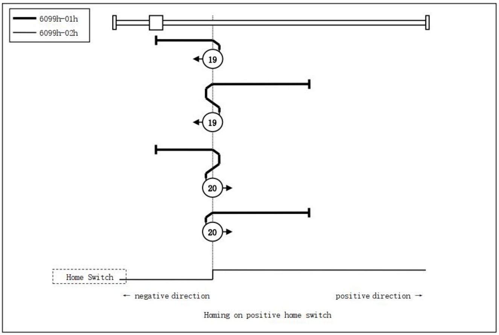

**Hình minh họa phương pháp 19, 20**

### Phương pháp 21, 22

Phương pháp này tương tự phương pháp 19/20.
Dựa vào trạng thái của công tắc gốc khi khởi động để quyết định hướng vận hành ban đầu.
Vị trí phát hiện gốc là phía hướng dương hoặc phía hướng âm sau khi trạng thái của công tắc gốc thay đổi.

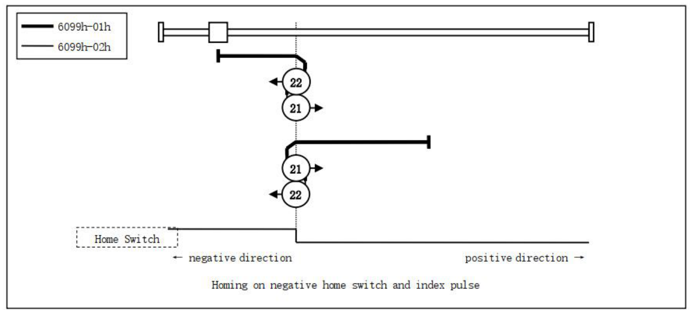

**Hình minh họa phương pháp 21, 22**

### Phương pháp 23, 24, 25, 26

Trong phương pháp này, sử dụng công tắc gốc và tín hiệu dương.
Hướng chuyển động ban đầu của phương pháp 23, 24 là hướng âm nếu công tắc gốc đã được kích hoạt ngay từ đầu;
Hướng chuyển động ban đầu của phương pháp 25, 26 là hướng dương nếu công tắc gốc đã được kích hoạt ngay từ đầu;
Vị trí phát hiện gốc là vị trí trạng thái của công tắc gốc thay đổi. (Vui lòng tham khảo hình dưới)

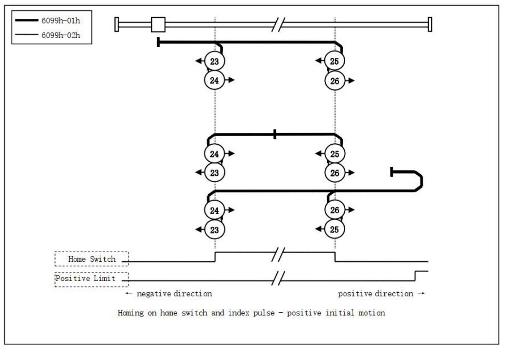

**Hình minh họa phương pháp 23, 24, 25, 26**

### Phương pháp 27, 28, 29, 30

Trong phương pháp này, sử dụng công tắc gốc và tín hiệu âm.
Hướng chuyển động ban đầu của phương pháp 27, 28 là hướng dương nếu công tắc gốc đã được kích hoạt ngay từ đầu;
Hướng chuyển động ban đầu của phương pháp 29, 30 là hướng âm nếu công tắc gốc đã được kích hoạt ngay từ đầu;
Vị trí phát hiện gốc là vị trí trạng thái của công tắc gốc thay đổi. (Vui lòng tham khảo hình dưới)

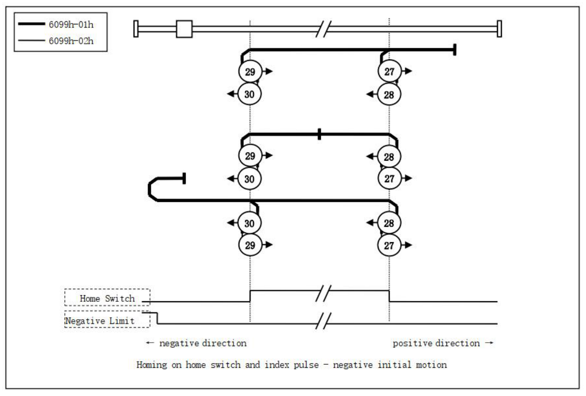

**Hình minh họa phương pháp 27, 28, 29, 30**

### Phương pháp 33, 34

Trong phương pháp này, chỉ sử dụng tín hiệu Z.
Sau khi chuyển động theo hướng như trong hình, phát hiện tín hiệu Z làm vị trí gốc.

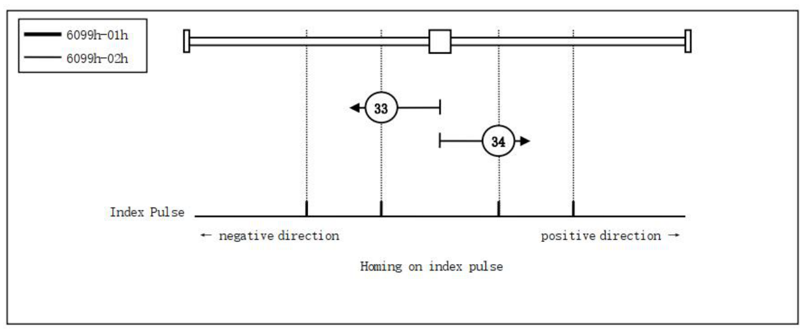

**Hình minh họa phương pháp 33, 34**

### Phương pháp 35, 37

Lấy điểm hiện tại làm gốc.
35 và 37 có chức năng như nhau, nhưng dựa theo quy chuẩn ETG, khuyến nghị sử dụng 37.

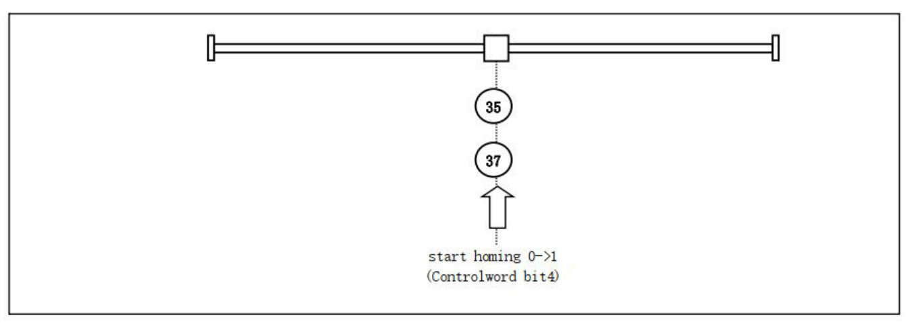

**Hình minh họa phương pháp 35, 37**

---

## Phụ lục 2 Lựa chọn phụ kiện đầu nối

- Phiên bản MS11E trở về trước: dây cáp thành phẩm là **dây cáp thành phẩm vỏ đen** (dây nguồn + dây cuộn dây động cơ);
- Phiên bản MS13A trở về sau: dây cáp thành phẩm là **dây cáp thành phẩm vỏ trong suốt**, cũng có thể dùng cho driver phiên bản cũ.

**1. Mã linh kiện dây cáp thành phẩm đầu nối vỏ đen:**

- Dây nguồn dài 15cm, mã linh kiện Leadshine: 82200070
- Dây cuộn dây động cơ dài 15cm, mã linh kiện Leadshine: 82200069

| Hình minh họa | Mã linh kiện Leadshine | Mô tả | Ghi chú |
| --- | --- | --- | --- |
| 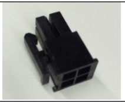 | 11600385 | Vỏ đực 5557-2\*2P | Tương ứng với dây cuộn dây động cơ **Mỗi driver cần 1 cái** |
| 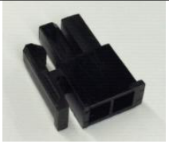 | 11600386 | Vỏ đực 5557-2\*1P | Tương ứng với dây nguồn **Mỗi driver cần 1 cái** |
| 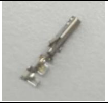 | 11600387 | Chân cos cái 5557-T | Một mã linh kiện tương ứng với một chân cos, **Mỗi driver cần 6 chân cos** |

**2. Mã linh kiện dây cáp thành phẩm đầu nối vỏ trong suốt:**

- Dây nguồn dài 15cm, mã linh kiện Leadshine: 82200072
- Dây cuộn dây động cơ dài 15cm, mã linh kiện Leadshine: 82200071

| Hình minh họa | Mã linh kiện Leadshine | Mô tả | Ghi chú |
| --- | --- | --- | --- |
| 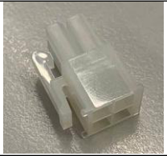 | 11600416 | Vỏ đực MOLEX 2\*2P | Tương ứng với dây cuộn dây động cơ **Mỗi driver cần 1 cái** |
|  | 11600415 | Vỏ đực MOLEX 2\*1P | Tương ứng với dây nguồn **Mỗi driver cần 1 cái** |
| 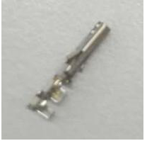 | 11600414 | Chân cos kim loại đầu cái | Một mã linh kiện tương ứng với một chân cos, **Mỗi driver cần 6 chân cos** |

**Đầu nối 2 hàng 10 PIN:**

| Hình minh họa | Mô tả | Mã linh kiện |
| --- | --- | --- |
| 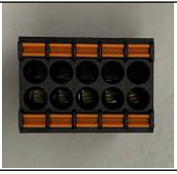 | **Đầu nối 2 hàng 10 PIN** | **11600058** |

**2. Hướng dẫn thao tác đấu dây đầu nối:**

Để đảm bảo kết nối an toàn và tin cậy, quy cách dây dẫn khuyến nghị sử dụng tiết diện dây khoảng 0.3mm² ~ 0.75mm², chuẩn dây trong khoảng AWG18 ~ AWG22, khuyến nghị từ 0.5mm² trở lên. Đặt dây và chân cos vào vị trí theo như hình minh họa bên dưới, để chống tuột, có thể dùng kìm nhọn bấm sơ bộ trước. Chiều dài tuốt vỏ cáp khoảng 3mm, khi bấm cos chú ý vị trí và hướng đặt chân cos 5557, tránh bấm sai vị trí hoặc đặt ngược hướng.

Dùng kìm bấm cos chuyên dụng để bấm chặt dây và chân cos, lưu ý: không bấm cong phần được mô tả trong hình, đồng thời chú ý hướng bấm cos, không được để ngược.

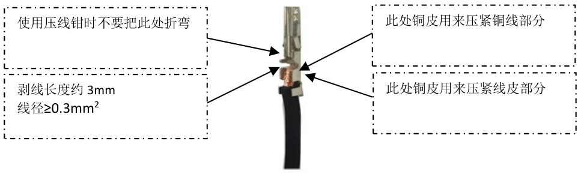

Chữ trong hình: Khi sử dụng kìm bấm cos không được bẻ cong vị trí này; miếng đồng tại đây dùng để ép chặt phần lõi đồng; chiều dài tuốt dây khoảng 3mm, tiết diện dây ≥ 0.3mm²; miếng đồng tại đây dùng để ép chặt phần vỏ bọc dây.

Khuyến nghị sử dụng kìm bấm cos để thao tác. Khi bấm cos xin lưu ý vị trí đặt chân cos: rãnh của kìm bấm cos có vị trí cao thấp, chú ý hướng đặt của chân cos 5557.

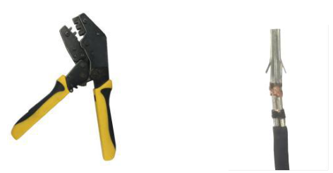

Lắp chân cos đã bấm vào vỏ đầu nối (housing), khi lắp hướng ngạnh nhọn lên trên, như minh họa trong hình dưới:

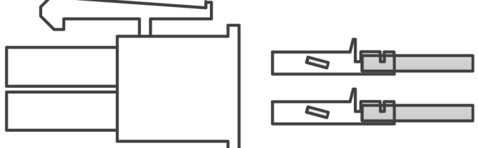

Kết quả thao tác như minh họa trong hình dưới:

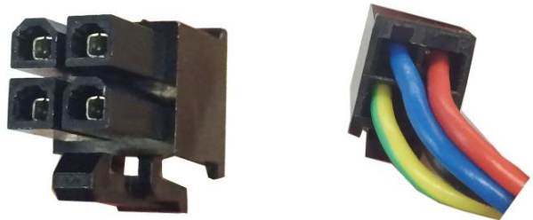

Nếu lắp chân cos vào vỏ đầu nối bị sai, có thể dùng ***dụng cụ rút chân cos 5557 (pin extractor)*** để tháo ra, hoặc dùng nhíp nhỏ để thao tác. (Dụng cụ rút chân cos 5557 có thể mua trên Taobao)

---

## Phụ lục 3 Xử lý sự cố thường gặp

### I. Khi kết nối mạng node không thể giao tiếp bình thường, hoặc node báo lỗi giao tiếp

1. Nếu là lần đầu tiên sử dụng model sản phẩm này, hãy kiểm tra phiên bản XML (tệp mô tả thiết bị) xem có chính xác không. Phần lớn master hỗ trợ quét slave, khuyến nghị thiết lập cấu hình bằng phương thức quét để tránh hoặc nhanh chóng định vị sự cố.
2. Một số master phân biệt cổng kết nối vật lý IN và OUT, hãy kiểm tra IN hoặc OUT đã cắm đúng chưa.
3. Kiểm tra chu kỳ đồng bộ PDO được thiết lập giữa master và slave có nhất quán hay không.
4. Chu kỳ đồng bộ PDO không được hỗ trợ (chu kỳ giao tiếp EtherCAT), ví dụ như 1.1ms, 0.9ms v.v., chu kỳ đồng bộ PDO phổ biến là 250us/500us/1ms/2ms/4ms v.v. Hãy tham khảo ý kiến nhà sản xuất xem có hỗ trợ chu kỳ đồng bộ bạn đã cài đặt hay không.
5. Một số master yêu cầu cài đặt số node slave, hãy kiểm tra xem số node gạt trên công tắc xoay có khớp với cài đặt cấu hình và không bị trùng lặp hay không. Phần lớn master hỗ trợ quét slave, khuyến nghị thiết lập cấu hình bằng phương thức quét để tránh hoặc nhanh chóng định vị sự cố.
6. Cáp mạng gặp sự cố hoặc tiếp xúc kém, hãy thay cáp mạng. Đổi chéo cáp mạng với node đang kết nối bình thường có thể nhanh chóng định vị sự cố.
7. Vấn đề do chính driver. Bằng cách thay thế hoặc đổi chéo với driver đang kết nối bình thường, có thể nhanh chóng định vị sự cố.

### II. Master thao tác nhưng slave không kích hoạt (enable)

1. Kiểm tra trạng thái driver. Trong điều kiện bình thường, đèn L/A cổng mạng IN và OUT của driver nhấp nháy nhanh, đèn Run sáng liên tục, đèn Err tắt. Đèn Power của driver sáng liên tục, đèn ALM tắt.
2. Lỗi cấu hình PDO hoặc ánh xạ (mapping) PDO. Có thể tham khảo hướng dẫn ứng dụng, cấu hình chính xác PDO hoặc ánh xạ PDO theo hướng dẫn.
3. Kiểm tra giám sát từ điển đối tượng (Object Dictionary) 6040 xem giá trị có phải là 16#F hay không, giám sát từ điển 6040 xem bit0~bit3 có phải là 0111 hay không.
4. Kiểm tra master có cảnh báo hoặc lỗi hay không. Xóa cảnh báo hoặc lỗi trên master.
5. Master hiển thị đã hoàn tất kích hoạt (enable), nhưng động cơ không kích hoạt. Kiểm tra đấu dây cáp động cơ xem có bị đấu sai hoặc đứt dây hay không. Kiểm tra thông số dòng điện của driver đã được cài đặt chính xác chưa.

### III. Vừa chạy định vị là báo lỗi

1. Kiểm tra driver có cảnh báo (alarm) hay không. Kiểm tra đèn ALM của driver và đèn Err cổng mạng EtherCAT có nhấp nháy hay không, nếu có cảnh báo, xem hướng dẫn sử dụng driver và định vị sự cố theo mô tả cảnh báo.
2. Chế độ hoạt động không đúng. Giám sát từ điển đối tượng 6060 xem có phải là 8 (chế độ CSP) hay không.
3. Cấu hình PDO bất thường. Một số master cần kiểm tra giá trị trả về từ từ điển đối tượng 6061 của slave có chính xác không, nếu 6061 chưa được cấu hình, slave có thể không chuyển động hoặc master báo cảnh báo.
4. Tín hiệu giới hạn hành trình (limit) có hiệu lực. Kiểm tra trạng thái tín hiệu giới hạn hành trình có nhất quán với logic thiết lập trên master hay không. Cực tính cổng đầu vào của slave có phù hợp với công tắc giới hạn hành trình đang dùng hay không. Công tắc giới hạn hành trình có bị hỏng hay không. Đấu dây giữa công tắc giới hạn hành trình và slave có chính xác không. Lỗi ánh xạ bit của từ điển đối tượng 60FD với master.

### IV. Động cơ không quay

1. Lệnh từ máy tính cấp trên chưa được gửi tới. Kiểm tra giá trị từ điển đối tượng 607A (vị trí lệnh) có thay đổi hay không, nếu không thay đổi, khách hàng cần kiểm tra xem chương trình có bất thường hay không, hoặc giới hạn hành trình có đang kích hoạt không.
2. Tín hiệu giới hạn hành trình có hiệu lực. Kiểm tra trạng thái tín hiệu giới hạn hành trình có nhất quán với logic thiết lập trên master hay không. Cực tính cổng đầu vào của slave có phù hợp với công tắc giới hạn hành trình đang dùng hay không. Công tắc giới hạn hành trình có bị hỏng hay không. Đấu dây giữa công tắc giới hạn hành trình và slave có chính xác không. Lỗi ánh xạ bit của từ điển đối tượng 60FD với master.
3. Lệnh từ máy tính cấp trên bình thường, động cơ không quay. Cài đặt dòng điện quá nhỏ, động cơ không đủ lực, không kéo được tải. Tải quá nặng, chọn sai model động cơ. Cài đặt tốc độ quá lớn, dẫn đến kẹt động cơ (stall). Cài đặt gia tốc/giảm tốc quá lớn, dẫn đến kẹt động cơ. Bản thân động cơ có bất thường. Tất cả các khả năng trên đều có thể định vị sự cố bằng cách cho động cơ chạy không tải, cài đặt tốc độ động cơ là 60rpm, thời gian tăng giảm tốc không nhỏ hơn 200ms để chạy thử nghiệm.

### V. Không thể hoàn tất về gốc (homing)

1. Phương pháp về gốc bị sai. Hiện tại về gốc có thể chia thành: sử dụng phương pháp về gốc của master, khi về gốc 6060 bằng 8; sử dụng phương pháp về gốc của slave, khi về gốc 6060 bằng 6; sử dụng phương pháp về gốc phối hợp master - slave, khi về gốc 6060 bằng 8 sau đó bằng 6. Hãy hỏi nhà sản xuất master về phương thức về gốc của họ, đồng thời kiểm tra kỹ phương pháp về gốc đã chọn, các thông số liên quan đến về gốc, hướng có chính xác hay không và các tín hiệu cảm biến liên quan trong phương pháp về gốc đã chọn có bình thường hay không.
2. Dừng trên cảm biến, luôn ở trạng thái Busy. Nguyên nhân là do định vị chưa hoàn tất (xem chi tiết mô tả tại điểm 5), dẫn đến việc về gốc không thể tiếp tục thực hiện. Quá trình về gốc của một số master là phương thức kết hợp giữa master và slave (Panasonic và Keyence), sau khi tìm thấy vị trí gốc thông qua phương pháp về gốc của master, sẽ chuyển sang phương pháp về gốc của slave để reset tọa độ về 0, lúc này cần sửa 6060=6 sang chế độ về gốc, nếu trong PDO không có 6060 hoặc chưa được cấu hình, hoặc cấu hình phương pháp về gốc của slave bị sai, đều sẽ dẫn đến việc không thể hoàn tất về gốc.

### VI. Thỉnh thoảng bị mất kết nối khi đang vận hành

1. Trên bus luôn bị rớt kết nối ở một driver cố định. Vấn đề cáp mạng. Cáp mạng tiếp xúc kém với cổng của driver. Cổng OUT của driver phía trước gặp sự cố. Vấn đề do chính driver. Tất cả các khả năng trên đều có thể định vị sự cố bằng cách đổi chéo driver hoặc đổi chéo cáp mạng.
2. Driver bị mất kết nối ngẫu nhiên. Vấn đề nhiễu: Chất lượng cáp mạng kém, khuyến nghị sử dụng cáp Cat5e trở lên, cáp mạng chuẩn công nghiệp có xoắn đôi chống nhiễu. Đảm bảo thiết bị được nối đất tốt. Khi bố trí tủ điện, chú ý tách riêng điện mạnh và điện yếu. Tránh xa các thiết bị công suất lớn gây nhiễu mạnh như máy tạo plasma, nguồn phát laser, biến tần, v.v.

### VII. Hiển thị cảnh báo LED 7 đoạn thường gặp

| Hiển thị LED 7 đoạn | Ý nghĩa | Đối tượng (Object) 603Fh | Biện pháp xử lý |
| --- | --- | --- | --- |
| E0e0 | Lỗi quá dòng | 0x2211 | Đảm bảo dây ngõ ra driver không bị ngắn mạch; đảm bảo động cơ không bị hỏng |
| E0e1 | Quá dòng mô-đun công suất thông minh (IPM) | 0x2212 | Đảm bảo dây ngõ ra driver không bị ngắn mạch; đảm bảo động cơ không bị hỏng |
| E0c0 | Điện áp bus DC quá cao | 0x3211 | Giảm điện áp cấp nguồn cho driver; nếu báo quá áp trong quá trình chuyển động, có thể tăng thời gian tăng giảm tốc |
| E0a0 | Lỗi mạch phát hiện dòng điện | 0x3150 | Đảm bảo đấu dây động cơ chính xác |
| E0a1 | Lỗi mạch phát hiện dòng điện | 0x3151 | Đảm bảo đấu dây động cơ chính xác |
| E0d0 | Điện áp bus DC quá thấp | 0x3221 | Tăng điện áp cấp nguồn cho driver; siết chặt đấu dây đầu nối |
| E100 | Quá tải động cơ | 0x8311 | Giảm tải; tăng thời gian tăng giảm tốc; điều chỉnh đấu dây |
| E1a0 | Lỗi quá tốc độ lệnh | 0x8402 | Điều chỉnh độ lớn tốc độ lệnh; sửa đổi tần số xung đầu vào của lệnh; đảm bảo đấu dây encoder chính xác; Ghi giá trị 7 vào từ điển đối tượng (Object Dictionary) 2056 để bỏ qua (mask) lỗi này; |
| E240 | Lỗi lưu tham số EEPROM | 0x5530 | Khôi phục cài đặt gốc; lưu lại tham số |
| E5f0 | Lỗi mất pha | 0x7712 | Kiểm tra đấu dây động cơ xem đã chính xác chưa; đảm bảo động cơ không có bất thường; |
| E816 | Cấu hình hộp thư (mailbox) không hợp lệ ở trạng thái Pre-Operational | 0x8216 | Kiểm tra cấu hình master (trạm chủ) |
| E81a | Lỗi đồng bộ | 0xFF02 | Lỗi chế độ đồng bộ |
| E81b | Quá thời gian watchdog Sync Manager 2 | 0x821B | Mất kết nối mạng, kiểm tra kết nối truyền thông; driver bị hỏng |
| E870 | Kích hoạt (enable) ở chế độ không được hỗ trợ | 0x5201 | Đã cài đặt chế độ không được hỗ trợ và thực hiện thao tác kích hoạt (enable); kiểm tra giá trị của 6061; |

---

## Thuyết minh phiên bản tài liệu

| Phiên bản | Thời gian cập nhật | Nội dung cập nhật | Người cập nhật |
| --- | --- | --- | --- |
| V1.00 | 20170302 | Phiên bản đầu tiên | PC/LYJ |
| V1.01 | 20170405 | Thêm ký hiệu chứng nhận hợp chuẩn EtherCAT | PC/LYJ |
| V1.02 | 20170511 | Thêm tính năng lưu tham số, sửa đổi tham số mặc định, cảnh báo (alarm) trên phiên bản 10B | LYJ |
| V2.01 | 20180515 | Sắp xếp, hoàn thiện lại và bổ sung thuyết minh một số chức năng trên phiên bản 11A | LYJ |
| V2.02 | 20180808 | Bổ sung các mã lỗi, cập nhật các bước cài đặt phần mềm gỡ lỗi (debug) | LYJ |
| V2.03 | 20181010 | Điều chỉnh một số nội dung liên quan đến gỡ lỗi cổng nối tiếp (serial port) | LYJ |
| V2.04 | 20200220 | Thêm mới một bản vẽ kích thước driver, sửa đổi nội dung phần định nghĩa cổng mạng, thay đổi cấu trúc danh sách từ điển đối tượng (Object Dictionary), thay đổi phương pháp về gốc (homing), cập nhật thuyết minh phiên bản phần mềm, thêm OD 5012-04, thêm OD 5014, 6080, thêm bảng tổng hợp từ điển đối tượng; bổ sung Phụ lục 4; sửa đổi một phần nội dung chương sự cố; sửa đổi mục 4.2; | LYJ |
| V2.05 | 20200408 | Thay đổi nội dung mục 4.1 trong Chương 4; Thay đổi phương pháp về gốc (homing) số 17, 18; | LYJ |
| V2.06 | 20200423 | Sửa lỗi mô tả tại thời gian lọc 2010-01 | LYJ |
| V2.07 | 20200722 | Sửa đổi kiểu dữ liệu của từ điển đối tượng | LYJ |

Chú thích: Tài liệu phiên bản V2.05 có thể áp dụng cho các dòng driver phiên bản MS10_, MS11_, MS13_. Nếu sản phẩm có cập nhật, tạm thời sẽ không thông báo riêng.

## Thuyết minh phiên bản driver

Phiên bản driver xem trên nhãn máy, phiên bản phần mềm xem tại từ điển đối tượng (Object Dictionary) 3100h:01 và 3100h:03.

| Phiên bản DM3E-556/522 | Phiên bản DM3E-870 | Phiên bản phần mềm driver | Phiên bản phần mềm stack giao thức |
| --- | --- | --- | --- |
| MS 10D | MS 10D | 110 | 204 |
| MS 10E | --- | 111 | 204 |
| MS 10F | MS 10E | 110 | 204 |
| MS 10H | MS 10H | 116 | 204 |
| MS 10I | MS 10I | 117 | 204 |
| MS 11B | MS 11B | 200 | 208 |
| MS13A | MS13A | 300 | 109 |
| MS13B | MS13B | 300 | 109 |
| MS13C | MS13C | 300 | 109 |
| MS13D | MS13D | 301 | 110 |
| MS13E | MS13E | 301 | 110 |
